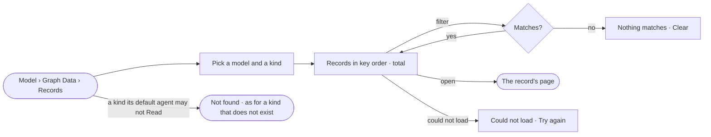

# RC-01 · Browse the records of a kind

**As** an analyst **I want** every record of a kind, filtered by its properties and opened whole **so that** I know what Graph Data holds before I ask it anything.

Tasks: [task.md](task.md) · Feature: [RC-F01](../../feature.md)

## Who can

Anyone with Read on `data/<graph database>/<kind>` browses records ([the permission catalogue](../../../../../../os/access/features/AC-F02-access-policies/feature.md#the-permission-catalogue)).

| Access | Can | Otherwise sees |
|---|---|---|
| Admin | Browse, filter and open the records of any kind | — |
| Operator | Browse, filter and open the records of any kind their Access Policies let them see, in the graph databases their default agent may Read | Kinds their Access Policies do not allow, and kinds in a graph database their default agent may not Read, are absent; a direct link reads *Not found* |

## Flow

## Acceptance criteria

| # | Given | When | Then |
|---|---|---|---|
| RC-01.1 | A kind with records | *Records* opens on it | they page in key order with the engine's total |
| RC-01.2 | A filter on a property | it matches nothing | *Nothing matches* names the filter, with *Clear* |
| RC-01.3 | A record in the list | it is opened | its page shows every value the published model gives its kind |
| RC-01.4 | A kind with no records | it is picked | the page says there are none yet and where records come from |
| RC-01.5 | A kind an Operator's Access Policies do not allow them to Read | they open the picker | the kind is absent |
| RC-01.6 | The records cannot be read | the page opens | *Could not load the records* shows with *Try again* |
| RC-01.7 | Kinds in two graph databases, and a default agent whose Access Policies allow Read on only one | the person opens the picker | only the kinds of that graph database are listed, grouped by model; the other's kinds are absent |
| RC-01.8 | A kind in a graph database the person's default agent may not Read | they open a direct link to it | the page reads *Not found*, as for a kind that does not exist; nothing names the rule and no record is shown |

## Screens

| Surface | Access | First use | Empty after a filter | Loading | Has data | Failed | Agent working or proposing | No access |
|---|---|---|---|---|---|---|---|---|
| Records | Admin | data.records · No records yet | data.records · Nothing matches | data.records · Loading | data.records | data.records · Could not load | — | — |
| Records | Operator | data.records · No records yet | data.records · Nothing matches | data.records · Loading | data.records | data.records · Could not load | — | — |
| A kind the default agent may not read, by direct link | Admin | — | — | — | — | — | — | data.records · Not found |
| A kind the default agent may not read, by direct link | Operator | — | — | — | — | — | — | data.records · Not found |
