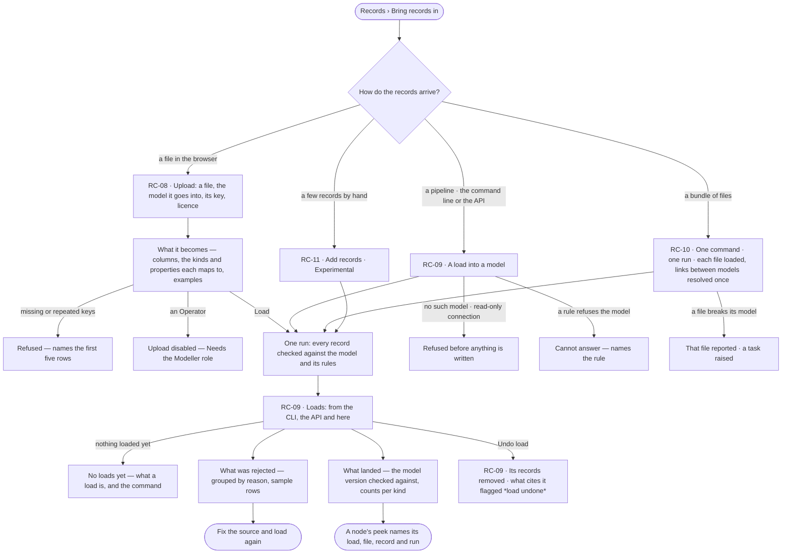

# Bring records in

> Every way records arrive — a file uploaded in the browser, a pipeline's load from the command line or the API, a
> bundle of files that only make sense together, a few records by hand — each a **load** into one model, checked
> against its rules record by record, and one place to see what landed, what was rejected and why. The decision it
> helps make: *is this load right, or do I fix the source?*

## User journey

Journeys this feature is a step of: [J01 · From a fresh deployment to a first answer](../../../../journeys/J01-from-a-fresh-deployment-to-a-first-answer.md)

## Stories

| ID | Story | Status |
|---|---|---|
| RC-08 | [Upload a file into a model](stories/RC-08-upload-a-file-into-a-model/story.md) | idea |
| RC-09 | [See every load and what it rejected](stories/RC-09-see-every-load-and-what-it-rejected/story.md) | idea |
| RC-10 | [Load a bundle as one run](stories/RC-10-load-a-bundle-as-one-run/story.md) | idea |
| RC-11 | [Add a few records by hand](stories/RC-11-add-a-few-records-by-hand/story.md) | idea |

## Access

| Act | Role ([the role table](../../../../os/access/features/AC-F02-access-policies/feature.md#the-role-table)) | Everyone else sees |
|---|---|---|
| Load into a model — upload, command line, API, a bundle, records by hand | Modeller · Admin, through an agent granted to them | *Upload* and *Add records* disabled — *Needs the Modeller role — ask an Admin*; the command line and API refuse before anything is written |
| Read the loads, what each rejected and what landed | Every role — Operator, Modeller, Admin | — |
| Export a load with its provenance | Every role — Operator, Modeller, Admin | — |
| Undo a load | Modeller · Admin | *Undo load* disabled — *Needs the Modeller role — ask an Admin* |
| Cancel a load | Who started it, where they started it | Studio offers no cancel: a load is stopped where it was started |

## States

| State | What the person sees |
|---|---|
| First use | *Upload*: a drop zone, the models it can load into and what a file needs. *Loads*: *No loads yet* with what a load is and the command to run one |
| Empty after a filter | *No loads match* — the filters (status · model · source · time) named, with *Clear filters* |
| Loading | The preview reads *Reading the file…*; load rows and tiles hold their shape |
| Has data | A preview of what the file becomes; loads newest first with records written and rejected; a run's outcome, steps, what was rejected, its log and what landed |
| Failed | A refused upload names the rows or the reason; a failed load shows its diagnosis and the next step where its counts are |
| Agent working or proposing | — |
| No access | Loading acts are disabled — *Needs the Modeller role — ask an Admin*; every load still reads |

## Rules

| Rule | Detail |
|---|---|
| Invana is a destination | Something else extracts and transforms; what arrives already conforms to a model. Invana builds no source connectors and no mapping grammar |
| Structured rows only | A load takes rows that conform to one kind of the model it names — a file of rows, a bundle of such files, or records typed by hand. A document, a paper or any free-text file is refused before anything is read |
| A load names its model | Every load says the one model its records go into; nothing is inferred from a file |
| Checked against Semantics' rules | Each record is checked against its kind, its constraints and the standards the model holds it to ([SE-F07](../../../semantics/features/SE-F07-rules/feature.md)) before it is written |
| Rejected record by record | One bad record never fails a load and is never dropped silently; each rejection names its record, field and reason |
| A load is a run | It streams its steps, retries, times out and is cancelled like every other run, with the same trace, and records who ran it and the command it came from |
| A load is the citable anchor | It has a stable id, its file's content hash and a licence field; findings, reports and simulations cite it, and it exports with its provenance |
| Everything written traces back | Every node, relationship and value a load writes carries its load, file, record and run ([RC-F06](../RC-F06-provenance/feature.md)) |
| The version it was checked against | A load records the model version it checked against when it started and never switches mid-run |
| No dangling relationships | A relationship whose end does not resolve is rejected naming both ends |
| Loading again updates | Records are matched by the model's keys; the same file twice updates, never duplicates, and the report says updated versus created |
| The same file twice is one hash | A file whose content hash matches an earlier load into the same model reads *Unchanged* in the preview; loading it anyway updates nothing |
| Undoing a load flags what cites it | *Undo load* removes the records it created and reverts the values it wrote that nothing has changed since; every finding, report and simulation that cites it carries a *load undone* notice |
| A bundle is one run | A bundle's files load together, links between models resolve once over everything that landed, and a broken file raises a task without discarding the others |
| A bundle is checked before it loads | Each file against its own model, then the rules between them — offline, before anything is written |
| The fast path is marked | A bulk load writes without checking and without provenance; it is listed among loads as *bulk load*, saying what it did not do, and it cannot be cited |
| Two ways in, one load | *Upload* in the browser and the load command make the same load; every dialog prints its command twin |
| The engine counts | Records written and rejected, the loads, running and failed tiles and *loads a day* are the engine's; Studio formats them |

## Data touched

| Record | Read or write |
|---|---|
| A load — its id, file, content hash, licence, model version, counts | Write · read |
| A load's run — steps, who ran it, the command | Write · read |
| The load's rejections — per record, with field and reason | Write · read |
| Nodes, relationships and values in the graph, with their provenance | Write |
| A task naming a broken file | Write |
| The run a saved result came from, and the loads it was pinned to | Read · write (as the load's inputs) |

## Engine

### Records

| Table | Columns | Notes |
|---|---|---|
| `record_loads` | `id` · `graph_id` · `model_id` · `model_version` · `file_name` · `file_hash` · `licence` · `source` (`upload` · `cli` · `api` · `bundle` · `by_hand` · `bulk` · `run`) · `run_id` · `bundle_run_id?` · `from_run_id?` · `status` (`running` · `succeeded` · `partly_rejected` · `failed` · `cancelled` · `undone`) · `written` · `created` · `updated` · `rejected` · `created_by` · `created_at` · `undone_at` · `undone_by` | `id` is stable and citable; `file_hash` is SHA-256 of the file's bytes, or of the records' canonical JSON when there is no file (`by_hand` · `run`); counts are written when the run settles; a bulk load is `source = bulk` and is never citable. `run_id` is the load's own run; `bundle_run_id` the bundle run it is a lane of; `from_run_id` the run whose result a `source = run` load saves |
| `record_load_inputs` | `load_id` · `input_load_id` | A `source = run` load only: one row per load the run it saves was pinned to. Its records are *derived*; their provenance is `from_run_id` and these loads |
| `record_load_rejections` | `load_id` · `record_ref` · `field` · `reason` · `sample` | One row per rejected record; grouped by `reason` when read |

### Reads

| Record | Owner |
|---|---|
| Published models, kinds, keys and versions | [SE-F02 › Engine](../../../semantics/features/SE-F02-change-and-publish-a-model/feature.md) |
| Constraints, standards and rules a load is checked against | [SE-F07 › Engine](../../../semantics/features/SE-F07-rules/feature.md) |
| Runs and their steps | [CP-F10](../../../../os/control/features/CP-F10-runs-and-how-the-agents-are-doing/feature.md) |
| The packaged plans `model-import@1` · `bundle-import@1` · `bulk-load@1` and the functions their steps call | [AG-F06](../../../agents/features/AG-F06-plans-and-workflows/feature.md) |
| Workers and the queue a load runs on | [CP-F03](../../../../os/control/features/CP-F03-workers-and-the-queue/feature.md) |
| History — every value a load wrote | [AC-F06](../../../../os/access/features/AC-F06-history/feature.md) |
| The view a load runs under, and the touches it records | [SE-F09 › Engine](../../../semantics/features/SE-F09-views-of-the-graph/feature.md#engine) |
| Active links between models a load resolves | [SE-F06](../../../semantics/features/SE-F06-links-and-mappings/feature.md#engine) |
| The task raised for a bundle's broken file | [PJ-F01 › Engine](../../../projects/features/PJ-F01-projects-and-tasks/feature.md#engine) |
| The simulation run a `source = run` load saves | [EX-F05 › Engine](../../../explore/features/EX-F05-when-it-cannot-answer-and-how-it-reasons/feature.md#engine) |

### Routes

| Route, after `/api/v1/u/{u}/{g}/records` | Does | Story |
|---|---|---|
| `POST /loads` | Start a load into a model — a file, a stream of records, or `{from_run_id, kind}` to save a run's result as derived records | RC-08 · RC-09 · RC-11 · EX-33 |
| `POST /loads/preview` | What a file becomes against a model, before anything is written | RC-08 |
| `POST /loads/bundles` | Check, then load a bundle as one run; returns the run to poll or stream | RC-10 |
| `GET /loads` | The loads, newest first, keyset-paged, filtered by status · model · source · time; a bundle run is one row | RC-09 · RC-10 |
| `GET /loads/summary` | The tiles — loads, running, failed, median time, loads a day — over the runs of kind `import` and `bulk` | RC-09 |
| `GET /loads/{id}` | One load: outcome, counts, the model version checked against | RC-09 |
| `GET /loads/{id}/rejections` | What was rejected, grouped by reason, with sample rows | RC-09 |
| `GET /loads/{id}/export` | The load's records with their provenance | RC-09 |
| `POST /loads/{id}/undo` | Undo a load and flag what cites it | RC-09 |

### Events

| Event | When |
|---|---|
| `records.load.start` | A load's run opens |
| `records.load.settle` | A load's run ends, with its counts |
| `records.load.undo` | A load is undone; carries the ids of what cites it |
| — | A load's steps and progress are its run's `run.*` and `step.*` events ([CP-F10](../../../../os/control/features/CP-F10-runs-and-how-the-agents-are-doing/feature.md#engine)); a load has no step vocabulary of its own |

### Refusals

| Status | When | Sentence | Criterion |
|---|---|---|---|
| 404 | The load names no model, or one the Graph lacks | *No model `{name}` in this graph — it has {models}.* | RC-09.1 |
| 409 | The Graph's connection is read-only | *This graph's connection is read-only — loading needs a writable connection.* | RC-09.2 |
| 403 | A rule refuses writing into the model | *Cannot answer — `{rule}` refuses writing into `{model}`.* | RC-09.3 |
| 403 | The caller is an Operator | *Needs the Modeller role — ask an Admin.* | RC-08.9 |
| 415 | A file that is not rows with a header — a document, a paper, free text | *Only rows that fit a kind can be loaded — extract them first.* | RC-08.10 |
| 422 | Rows without a key, or two rows with one key, in an upload | *{n} rows have no key or repeat one — the first five: {rows}.* | RC-08.4 |
| 409 | A record added by hand whose key already exists | *`{key}` already exists — a new record never overwrites one.* | RC-11.4 |
| 409 | Undo of a bulk load, or of a load already undone | *This load cannot be undone — {reason}.* | RC-09.20 |
| 422 | A bundle whose manifest names a missing folder, or holds a malformed file | *`{file}` fails `{check}` — nothing was loaded.* | RC-10.3 |
| 422 | A run's result saved into a kind its rows do not fit | *These rows do not fit `{kind}` — {why}.* | EX-33.15 |
| 409 | `from_run_id` names a run with no result, or one that is not the caller's to read | *Run `{id}` has no result to save.* | API only — Studio offers *Save as records* on a result alone |

### CLI

| Command | Does |
|---|---|
| `invana load <file> --graph <g> --model <m> [--licence <l>]` | One load into one model; exits non-zero past the rejection threshold; progress on `stderr` (a rewriting counter on a terminal, a line a step otherwise), the summary alone on `stdout` |
| `invana load --bundle <folder> --graph <g> [--check]` | Check, then load a bundle as one run; `--check` runs the offline check alone and writes nothing; one progress line per lane; exits non-zero when any file failed |
| `invana load --bulk <path> --graph <g>` | The marked fast path: no checks, no provenance; the Graph supplies the connector, URI and credentials, and `--connector` · `--uri` · `--username` · `--password` each override one part |
| `invana load --bulk <path> --connector <c> --uri <u>` | Without `--graph`: runs direct, records nothing and says so — credentials never ride a run's params |

### Mechanisms

| Mechanism | How |
|---|---|
| The open | Before the run's first step: resolves the model, takes its published version, checks the connection is writable and writes the `record_loads` row; the results ride the run's params as `load_id` · `model_id` · `model_version`. A refusal here is a load that never started, not a failed step |
| `model-import@1` | A run of kind `import`: **Validate** (`data.records.validate`) checks every record against the pinned version · **Write** (`graph.write.records`) writes the accepted ones · **Stitch** (`graph.stitch.run`) resolves the active links between models over what this load wrote · **Snapshot** (`data.snapshot`) stores the model version checked against with the run. Nothing in the run authors a model |
| Records ride the working state | Parsed records pass between steps in the run's working state, never in the plan; a plan binds only what a step declares — counts and ids |
| Per-record check | Each record is checked against its kind's properties, constraints and standards; a break of a `reject` rule rejects it, a break of a `flag` rule writes it for RC-F03 to list ([SE-F02 › Engine](../../../semantics/features/SE-F02-change-and-publish-a-model/feature.md#engine) `on_break`); the run never stops for a bad record |
| Provenance stamps | Every node and relationship written carries `_inv_load_id` · `_inv_model_id` · `_inv_record_id` · `_inv_file` · `_inv_run_id`; a node's peek reads them off the element with no request. An element with none was written by a bulk load or before Invana ([RC-F06](../RC-F06-provenance/feature.md#engine) reads them) |
| A loaded link row carries both marks | A relationship a link file writes carries the load's stamps and its link's, as [SE-F06 › Engine](../../../semantics/features/SE-F06-links-and-mappings/feature.md#engine) says |
| Link rows from a file | A file ships a link's rows in `stitches/<RELATIONSHIP>.json` (`{id, from, to, properties}`); the Graph must hold an active link naming this load's model and that relationship, or the file is reported `no_stitch_for_edge` and nothing of it is written |
| A load is governed | The run freezes the Graph's view at open; Write engages the version the open pinned and records one touch with what it wrote; Stitch touches every model its relationships joined; Validate and Snapshot touch nothing. A rule that refuses the model ends the load *cannot answer*, naming it, before anything is written ([SE-F09 › Engine](../../../semantics/features/SE-F09-views-of-the-graph/feature.md#engine)) |
| A failure is its step's | A failure is attributed to the step in flight; the database's refusal of a write becomes a diagnosis with the next step, never a stack trace |
| The version holds | A model published mid-run does not switch the run; it keeps and reports the version it opened with |
| Cancel | Accepted records stay; the run is `cancelled` and the report says where it stopped; a bundle says which files had finished |
| It streams | The run reports at every step change and every 500 records written, with the step and message its log stores — one log, read live or afterwards |
| Content hash | SHA-256 over the file's bytes, computed as it streams, or over the records' canonical JSON (sorted keys, compact separators, ordered by key) when there is no file; a match with an earlier load into the same model is *Unchanged* |
| The bundle manifest | `stitches.json` at the folder's root: `name` · `datasets[]` (folders, each declaring its model in `graph-model.json`, by `package_id` then `name`; two may declare one model) · `stitches[]` — `id` (a label for the report) · `kind` (`anchor` · `relationship`) · `source` · `target` (`<folder>:<Kind>.<property>`) · `identity_match` (`exact` · `case_insensitive`) · `edge_type` · `rows` (a rows file when there is no key pair) · `partial` (the sides overlap, not match fully) |
| The offline check | `data.bundle.check`, before anything is written: `node_ids_unique` · `identity_key_present` · `identity_key_unique` · `node_type_declared` · `edge_type_declared` · `property_declared` · `property_type` · `enum_value` · `endpoint_types`; each rule between files resolves and is counted by distinct key values, failing when it leaves values unresolved unless `partial`; `endpoint_resolves` is reported deferred, never failed |
| `bundle-import@1` | **check** (the offline check) · **load** — one lane per file, up to 4 at once, each inlining `model-import@1` by `uses` so a lane and a single load never drift; a failed lane does not stop the others · **stitch** — once, over everything that landed; skipped when every lane failed, and the run fails with a diagnosis · **report** — each file's counts rolled into the run · **triage** — a task naming a failed file, assigned to the person who started the bundle or left unassigned. Lanes and events are the runtime's; no table of its own |
| `bulk-load@1` | A run of kind `bulk`, one step `graph.write.bulk` through the connector's bulk write — counts, log and who ran it, no report and no provenance. With no model version to pin, the Graph's grounding version governs it |
| A Python call | `load_records(...)` for an orchestrator that holds the records in memory: the same load, returning its run to wait on, with an `on_progress` callback |
| A saved result | `POST /loads` with `from_run_id` and a kind: one `source = run` load of that kind, keyed by each row's label, one property per figure; `record_load_inputs` copies the run's pinned loads. Every value it writes reads *derived*, its provenance the run and those loads |
| Undo | Removes the nodes and relationships the load created; reverts a value it wrote only when no later write changed it, and lists the rest as kept; sets `undone_at` and emits `records.load.undo` with what cites the load — findings, reports, simulations and every `source = run` load whose inputs name it |
| Counts | `written` · `created` · `updated` · `rejected` are stored when the run settles; the tiles are the runtime's run statistics for this Graph; Studio never derives them |

## System impact

| HLD section | Change | NFRs |
|---|---|---|
| — | A load is a queue run on a worker (CP-F03); no new store or service | — |

## Decisions

| Decision | Detail |
|---|---|
| Loads live in Records › Bring records in | *Loads — from the CLI, the API and here*: one row per load, newest first; a row opens the run as a sheet |
| Rejections group by reason | One bad column is one line with its count and sample rows, not thousands |
| A run's page reads in audit order | Outcome · Steps · What was rejected · Log · What landed |
| What landed names its version | Counts per kind sit beside *Checked against Model@v3* |
| A node traces to its load | A node's peek reads load · file · record · run; a node a bulk load wrote says it carries no provenance |
| One run surface | A load's trace is the same step view an answer's run uses |
| Purged rows say so | A run past retention keeps its counts and says its rows are gone |
| The browser reads the file | Rows left out for having no key are listed in the load's report |
| Records by hand are a load | The new records are one load, its source *by hand*, the person its author; a new record never overwrites a key; above 5,000 records the form points to the command |
| A bulk load is listed when it names its Graph | The Graph supplies the connection and the load is listed; a connection typed on the command line runs direct and is not listed, because credentials never ride a run — the command says so |
| Loading needs the Modeller role | Writing records into a Graph's model is the Modeller's and the Admin's, in the browser, the CLI and the API alike; which records a load reaches is the agent's Access Policies |
| Experimental | Records by hand carry an *Experimental* badge on their act and page head |
| A saved result is a load | Records saved from a run's result are one load, its source *run*, naming that run and the loads it was pinned to; its records read *derived*, and undoing an input flags it like any other citation |

## Open questions

| Question | Who answers |
|---|---|
| — | — |

## Not building

| Item | Why not |
|---|---|
| Source connectors, cursors, a mapping grammar | Whatever already extracts the data does it better |
| Scheduled loads | The customer's pipeline calls the CLI or the API on its own schedule |
| Inferring a model from a file | A load states its model; a guessed schema is one nobody chose |
| Streaming ingest | A batch with a report is what a person can audit |
| Transforming data on the way in | Whatever produced the data transforms it better |
| Upsert strategy settings | Identity comes from the model's keys |
| Re-running a rejected subset from Studio | The source owns its fixes; loading again is idempotent |
| A bundle authoring screen | A bundle's manifest is a file beside the data, checked offline and reviewed like code |
| Re-running one file of a bundle | Load that file on its own; it is idempotent |
| One report for a whole bundle | What was rejected is per file, because that is what a person fixes; the run rolls the counts up |
| Records collected by an agent | An agent that gathers facts writes them through a run like anyone else |
| Editing records where loads are read | A record is edited on the board in Edit mode |
| Log search across every run | A run's log is read inside that run |
| Streamed or chunked upload over HTTP | Bulk loads go through the command line |
