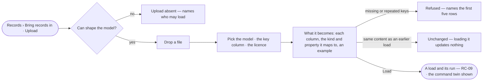

# RC-08 · Upload a file into a model

**As** a data curator **I want** to upload a file in the browser, see what it becomes in a model, and load it
**so that** my files become records without the command line, each one checked and traceable to this load.

Tasks: [task.md](task.md) · Feature: [RC-F02](../../feature.md)

## Who can

| Lens | Can | Otherwise sees |
|---|---|---|
| Admin | Upload a file into any published model of the Graph and load it | — |
| Operator | Read the loads | *Upload* absent, a line naming who may load. With *Can shape the model*: as Admin |

## Flow

## Acceptance criteria

| # | Given | When | Then |
|---|---|---|---|
| RC-08.1 | Records › Bring records in with no file | it opens | a drop zone says what a file needs — a header row, a key column and a licence — and which published models it can load into |
| RC-08.2 | A file dropped | the browser reads it | it shows the file's rows and columns and *What it becomes*: each column, the kind and property it maps to, an example value, before anything is written |
| RC-08.3 | A file and a model | the person sets up the load | they pick the model, the key column and the licence; *Load* waits until all are set |
| RC-08.4 | Rows without a key, or two rows with one key | the person loads | the load is refused, naming the first five rows; nothing is written |
| RC-08.5 | A valid file | the person loads | a load starts with a stable id and the file's content hash, the person its author, its run opens (RC-09), and the dialog shows the command that does the same |
| RC-08.6 | A file whose content hash matches an earlier load into the same model | it is previewed | it reads *Unchanged — loading it updates nothing*, naming the earlier load |
| RC-08.7 | Columns that map to no property of the model | the preview shows | they are listed as *not loaded*, never silently dropped |
| RC-08.8 | A file the browser cannot read | it is dropped | it says why, with *Choose another* |
| RC-08.9 | An Operator without *Can shape the model* | they open Bring records in | *Upload* is absent and a line names who may load |
| RC-08.10 | A document, a paper or any file that is not rows with a header | it is dropped | it is refused before anything is read: *Only rows that fit a kind can be loaded — extract them first*; nothing is written |

## Screens

| Surface | Lens | First use | Empty after a filter | Loading | Has data | Failed | Agent working or proposing | No access |
|---|---|---|---|---|---|---|---|---|
| Upload | Admin | data.upload · Drop a file | — | data.upload · Reading the file | data.upload | data.upload · Refused rows | — | — |
| Upload | Operator | data.upload · Drop a file | — | data.upload · Reading the file | data.upload | data.upload · Refused rows | — | data.upload · Needs the model grant |
| What it becomes | Admin | — | — | data.upload · Reading the file | data.upload · Preview | data.upload · Unchanged | — | — |
| What it becomes | Operator | — | — | data.upload · Reading the file | data.upload · Preview | data.upload · Unchanged | — | data.upload · Needs the model grant |
