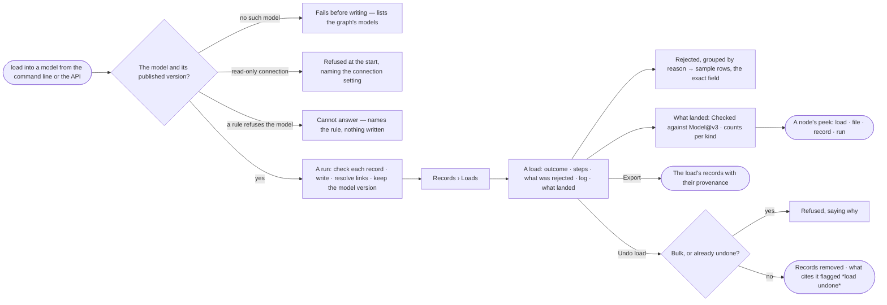

# RC-09 · See every load and what it rejected

**As** someone whose pipeline already produces data **I want** one command that loads it into a model, and one place
to see every load, what it rejected and why **so that** I can put the load in a pipeline, trust the result, cite it,
and fix the source rather than guess at the graph.

Tasks: [task.md](task.md) · Feature: [RC-F02](../../feature.md)

## Who can

| Lens | Can | Otherwise sees |
|---|---|---|
| Admin | Load into any model; read and export every load; undo any load | — |
| Operator | Read and export every load in the Graph — its outcome, what was rejected, its log and what landed | Loading is refused before anything is written, naming who may load; *Undo load* absent on loads they did not run. With *Can shape the model*: loads from the command line or the API, and undoes their own loads |

## Flow

## Acceptance criteria

| # | Given | When | Then |
|---|---|---|---|
| RC-09.1 | A load that names no model, or one the Graph lacks | it starts | it fails before writing anything, listing the Graph's models |
| RC-09.2 | A load against a read-only connection | it starts | it is refused at the start, naming the connection setting |
| RC-09.3 | A rule that refuses writing into the model | a load starts | it ends *cannot answer* naming the rule; nothing is written |
| RC-09.4 | A load whose records include bad ones | it runs | each good record is written; each bad one is rejected naming its record, field and reason; the load does not fail for them |
| RC-09.5 | A relationship whose end resolves nowhere | it loads | it is rejected naming both ends; nothing dangling is written |
| RC-09.6 | The same file loaded twice | the second run ends | records are matched by the model's keys and the report says how many were updated and how many created |
| RC-09.7 | A model published while a load runs | the load ends | it reports the version it checked against when it started |
| RC-09.8 | A load from the command line | it ends | it exits non-zero when rejections exceed the threshold, so a scheduler can branch on it; progress streams on a terminal |
| RC-09.9 | Loads in the Graph | the person opens *Loads* | each row reads the file, its model, where it came from (CLI · API · here · by hand), who ran it, when, records written and rejected — newest first; the tiles (loads · running · failed · median time) and *loads a day* are the engine's |
| RC-09.10 | No load yet | *Loads* opens | it reads *No loads yet*, what a load is, and the command to run one |
| RC-09.11 | A run with rejections | the person opens it | *What was rejected* groups them by reason with a count each; a group opens to sample rows and the exact field |
| RC-09.12 | A load | the person opens it | it reads *Outcome* (its id, content hash and licence · written of total · duration · who ran it · where the file came from), *Steps* in the same view every run uses, *Log* (time · level · step · message, filterable by level), and *What landed* (the model version checked against, counts per kind) |
| RC-09.13 | A run still going | its row is open | the steps paint and counts climb from the run's own events |
| RC-09.14 | A failed run | it is open | its diagnosis and next step sit with its counts, never a stack trace |
| RC-09.15 | A bulk load | it is listed | it reads *bulk load*, with counts, log and who ran it, and says it checked nothing, kept no provenance and cannot be cited |
| RC-09.16 | A node a load wrote | its peek opens on the board | it names its load, file, record and run; a node a bulk load wrote says it carries no provenance |
| RC-09.17 | A run past retention | it is opened | its counts stay and it says the rows are gone |
| RC-09.18 | A finished load | the person opens *How it got here* | the run's steps show what each one checked, wrote and rejected |
| RC-09.19 | A finished load | the person picks *Export* | the load's records download with their provenance — the load's id, content hash, licence, file and run on each |
| RC-09.20 | A load the person ran, or any load for an Admin | they pick *Undo load* and confirm | the records it created are removed, values it wrote that nothing changed since are reverted, and every finding, report and simulation that cites it carries a *load undone* notice; a bulk load or one already undone is refused, saying why |
| RC-09.21 | An Operator who did not run the load | they open it | *Undo load* is absent, naming who ran it |

## Screens

| Surface | Lens | First use | Empty after a filter | Loading | Has data | Failed | Agent working or proposing | No access |
|---|---|---|---|---|---|---|---|---|
| Loads | Admin | data.upload · No loads yet | data.upload · No loads match | data.upload · Loads loading | data.upload | data.upload · Loads could not load | — | — |
| Loads | Operator | data.upload · No loads yet | data.upload · No loads match | data.upload · Loads loading | data.upload | data.upload · Loads could not load | — | — |
| A load's run | Admin | — | — | agents.run · Load running | agents.run · Load | agents.run · Load failed | — | — |
| A load's run | Operator | — | — | agents.run · Load running | agents.run · Load | agents.run · Load failed | — | agents.run · Undo not theirs |
| What was rejected | Admin | — | — | agents.run · Load running | agents.run · Load rejected | agents.run · Load failed | — | — |
| What was rejected | Operator | — | — | agents.run · Load running | agents.run · Load rejected | agents.run · Load failed | — | — |
| A node's provenance | Admin | — | — | — | explore.board.menu · Provenance | explore.board.menu · No provenance | — | — |
| A node's provenance | Operator | — | — | — | explore.board.menu · Provenance | explore.board.menu · No provenance | — | — |
