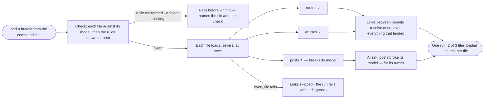

# RC-10 · Load a bundle as one run

**As** a modeller whose nightly load spans several files that only make sense together **I want** one command and
one run for the whole bundle **so that** I read one outcome instead of correlating several, and links between models
resolve after every part of it has landed.

Tasks: [task.md](task.md) · Feature: [RC-F02](../../feature.md)

## Who can

| Lens | Can | Otherwise sees |
|---|---|---|
| Admin | Check and load any bundle; read its run | — |
| Operator | Check a bundle offline; read a bundle's run | Loading is refused before anything is written, naming who may load. With *Can shape the model*: loads it |

## Flow

## Acceptance criteria

| # | Given | When | Then |
|---|---|---|---|
| RC-10.1 | A bundle folder with its manifest | the person checks it offline | each file is checked against its own model first — ids unique, keys present and unique, every kind and property declared, values of the declared type and in range, relationships on the kinds they name — then each rule between files is resolved and counted by distinct key values |
| RC-10.2 | A rule between files that leaves values unresolved | it is checked | it fails, unless the rule says it is meant to overlap only partly; an end the bundle does not carry is reported as deferred, never failed |
| RC-10.3 | A bundle whose manifest names a folder that is not there, or a malformed file | it is loaded | it fails before anything is written, naming the file and the check |
| RC-10.4 | A clean bundle | it is loaded | it is one run and one load per file, each with its content hash; files load in parallel, up to the bundle's ceiling and the Graph's capacity |
| RC-10.5 | One file of three that fails | the run ends | the other two stand, the failed one is reported with its reason, links between models resolve over what landed, and a task naming the file is raised for its owner — or left unassigned |
| RC-10.6 | Every file that fails | the run ends | resolving links is skipped and the run fails with a diagnosis, never an empty success |
| RC-10.7 | A bundle's run | it is listed in *Loads* | it is one row; opening it shows each file's load with its counts, and the task it raised links to its project |
| RC-10.8 | A cancelled bundle | the run stops | each file keeps what it wrote and the report says which had finished |
| RC-10.9 | A bundle loaded again | the run ends | records match by each model's keys and nothing duplicates |
| RC-10.10 | A bundle with a relationship file the Graph has no active link between models for | it loads | that file is reported and nothing of it is written |
| RC-10.11 | A bundle's run | the person opens *How it got here* | the check, each file's load, the links and the report show as its steps |

## Screens

| Surface | Lens | First use | Empty after a filter | Loading | Has data | Failed | Agent working or proposing | No access |
|---|---|---|---|---|---|---|---|---|
| A bundle in loads | Admin | data.upload · No loads yet | data.upload · No loads match | data.upload · Loads loading | data.upload · Bundle | data.upload · Loads could not load | — | — |
| A bundle in loads | Operator | data.upload · No loads yet | data.upload · No loads match | data.upload · Loads loading | data.upload · Bundle | data.upload · Loads could not load | — | — |
| A bundle's run | Admin | — | — | agents.run · Bundle running | agents.run · Bundle | agents.run · Bundle partly failed | — | — |
| A bundle's run | Operator | — | — | agents.run · Bundle running | agents.run · Bundle | agents.run · Bundle partly failed | — | — |
