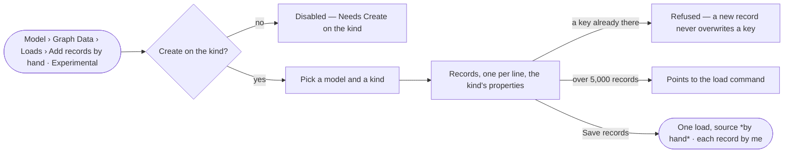

# RC-11 · Add a few records by hand

**As** a field researcher curating my own data **I want** to add a few observations to a kind by hand **so that** my
own evidence enters the trail as a load, authored by me.

Tasks: [task.md](task.md) · Feature: [RC-F02](../../feature.md)

## Who can

Adding records needs Create on `data/<graph database>/<kind>` ([the permission catalogue](../../../../../../os/access/features/AC-F02-access-policies/feature.md#the-permission-catalogue)).

| Access | Can | Otherwise sees |
|---|---|---|
| Admin | Add records to any kind of a published model | — |
| Operator | With Create on the kind, adds records as an Admin does | *Add records* disabled — *Needs Create on {kind} in {graph database} — ask {who can grant}* |

## Flow

## Acceptance criteria

| # | Given | When | Then |
|---|---|---|---|
| RC-11.1 | Model › Graph Data › Loads › Bring records in | it opens for a person with Create on the kind | *Add records by hand* carries an *Experimental* badge and offers the kinds of the published models |
| RC-11.2 | A chosen kind | the person adds records | the form has the kind's properties; *Save records* waits until each record has its key |
| RC-11.3 | Records saved | the load runs | they are one load, its source *by hand*, the person its author, each record checked against the kind's constraints like any load |
| RC-11.4 | A new record whose key already exists | it is saved | it is refused naming the key; a new record never overwrites one |
| RC-11.5 | More than 5,000 records | the form opens | it points to the load command instead |
| RC-11.6 | A person without Create on the kind | they open Bring records in | *Add records by hand* is disabled with *Needs Create on {kind} in {graph database} — ask {who can grant}* |

## Screens

| Surface | Access | First use | Empty after a filter | Loading | Has data | Failed | Agent working or proposing | No access |
|---|---|---|---|---|---|---|---|---|
| Add records by hand | Admin | data.loads · Add by hand · No kind to add to | — | data.loads · Add by hand · Saving records | data.loads · Add by hand | data.loads · Add by hand · Records refused | — | — |
| Add records by hand | Operator | data.loads · Add by hand · No kind to add to | — | data.loads · Add by hand · Saving records | data.loads · Add by hand | data.loads · Add by hand · Records refused | — | data.loads · Add by hand · Needs the model grant |
