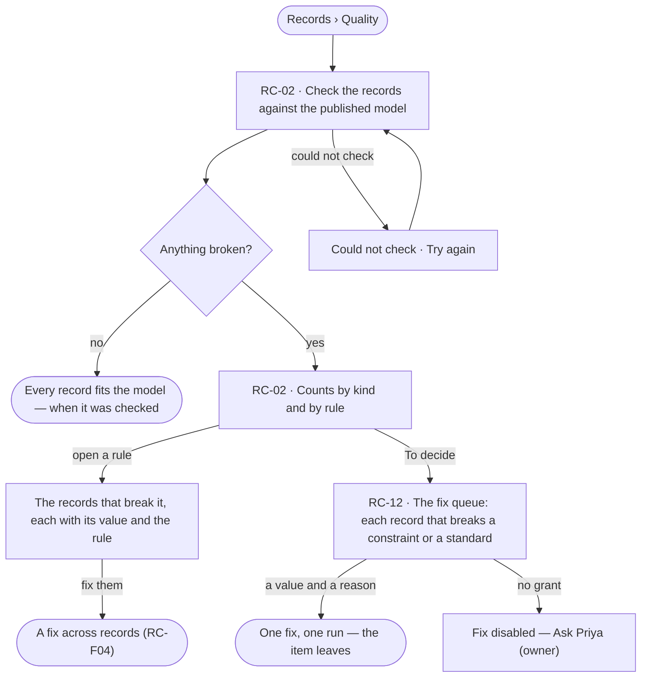

# Quality against the model

> Every record that breaks the published model — a missing key, a value outside its constraint or its standard, a
> relationship the model does not allow — scored by kind, listed by rule, and queued to fix.
> The decision it helps make: *which records are not fit to rely on, and which to fix first?*

## User journey

## Stories

| ID | Story | Status |
|---|---|---|
| RC-02 | [See the records that break the model](stories/RC-02-see-the-records-that-break-the-model/story.md) | idea |
| RC-12 | [Decide what breaks the standards](stories/RC-12-decide-what-breaks-the-standards/story.md) | idea |

## Rules

| Rule | Detail |
|---|---|
| The published model is the bar | A record is checked against its kind's keys, constraints, the standards it is held to and allowed relationships in the published version, never a draft ([SE-F05](../../../semantics/features/SE-F05-standards/feature.md) · [SE-F07](../../../semantics/features/SE-F07-rules/feature.md)) |
| A score per kind | Each kind's score is the share of its records that conform; the engine stores it when a check settles |
| The fix queue | *To decide* lists every record that breaks a constraint or a standard; a fix is a value and a reason, written as one run |
| Quality is record by record | How the model and the database differ kind by kind is Semantics' health (SE-F10) |
| A check is a run | It streams, can be stopped and leaves a trace like any run |

## Access

| Act | Role (`.claude/team/TEAM.md` §7) | Everyone else sees |
|---|---|---|
| Read records, their provenance and the fix queue | Operator — every member | — |
| Run a check | Operator — every member | — |
| Fix a problem from the queue | `contributor` · shown as *Can work on projects*, on a connection that writes | Disabled — *Ask Priya (owner)* |

## States

| State | What the person sees |
|---|---|
| First use | No records of this kind yet: why, and that records arrive from the graph database, a load or a board's save. *To decide*: *Nothing to decide* |
| Empty after a filter | Nothing matches: the filter named, and *Clear* |
| Loading | Rows load in key order; the total arrives with them |
| Has data | Scores and counts by kind and rule; each rule opens its records; the queue lists each problem |
| Failed | *Could not load the records* and *Try again* |
| Agent working or proposing | A check running: what it has read so far, and *Stop* |
| No access | Kinds a view hides are left out of the counts, and the page says so |

## Data touched

| Record | Read or write |
|---|---|
| Nodes and relationships | Read · write (a fix) |
| The published model's constraints, standards and rules | Read |
| The check's run, its counts and each kind's score | Write |

## Engine

### Records

| Table | Columns | Notes |
|---|---|---|
| `record_checks` | `id` · `graph_id` · `model_id` · `model_version` · `run_id` · `status` (`running` · `succeeded` · `stopped` · `failed`) · `checked` · `conforming` · `problems` · `unreadable_kinds` · `started_by` · `started_at` · `settled_at` | One row per check; counts are written when the run settles, and kept as they stood when it was stopped (`stopped` is partial) |
| `record_check_scores` | `check_id` · `kind` · `records` · `conforming` · `score` | One row per kind checked; `score` is `conforming / records`, stored by the engine |
| `record_check_problems` | `id` · `check_id` · `kind` · `record_ref` · `property` · `rule_ref` · `problem` (`missing` · `not_allowed` · `wrong_type` · `out_of_range` · `pattern` · `relationship`) · `value` · `fixed_at?` · `fixed_run_id?` | One row per record and rule it breaks; `rule_ref` names the validation rule, or the standard `publisher/name@v` and its term |

### Reads

| Record | Owner |
|---|---|
| Published versions, kinds, keys, validation rules and what each breaks to (`on_break`) | [SE-F02 › Engine](../../../semantics/features/SE-F02-change-and-publish-a-model/feature.md#engine) |
| Standard versions and their terms | [SE-F05](../../../semantics/features/SE-F05-standards/feature.md) |
| Rules in scope and the `enforce` check a fix passes | [SE-F07 › Engine](../../../semantics/features/SE-F07-rules/feature.md#engine) |
| The view an Operator reads through | [SE-F09 › Engine](../../../semantics/features/SE-F09-views-of-the-graph/feature.md#engine) |
| Runs, their steps and stop | [CP-F10](../../../../os/control/features/CP-F10-runs-and-how-the-agents-are-doing/feature.md) |
| History — the value a fix writes | [AC-F06](../../../../os/access/features/AC-F06-history/feature.md) |

### Routes

| Route, after `/api/v1/u/{u}/{g}/records` | Does | Story |
|---|---|---|
| `POST /checks` | Start a check of a model's records against its published version | RC-02 |
| `GET /checks/latest?model=` | The last settled check: counts by kind and by rule, scores, when, and kinds left out | RC-02 |
| `POST /checks/{id}/stop` | Stop a running check; what it counted stays, marked partial | RC-02 |
| `GET /problems?kind=&rule=` | *To decide* — the open problems of the last check, with the total, each kind's own total and score, and `unreadable` | RC-02 · RC-12 |
| `GET /problems/{id}` | One problem: the record, the term or constraint, the value and why it breaks it | RC-12 |
| `POST /problems/{id}/fix` | `{value, why, seen_at}` — writes the value as one run and re-checks the record | RC-12 |

### Events

| Event | When |
|---|---|
| `records.check.start` | A check's run opens |
| `records.check.settle` | A check ends — succeeded, stopped or failed — with its counts |
| `records.problem.fix` | A fix is written, with its value, `why` and run; the value change itself is History's (AC-F06) |

### Refusals

| Status | When | Sentence | Criterion |
|---|---|---|---|
| 403 | A fix by someone without *Can work on projects* | *Fixing needs Can work on projects — ask {owner}.* | RC-12.9 |
| 409 | The record changed since the problem was opened | *`{record}` changed since you opened it — reload and fix again.* | RC-12.6 |
| 409 | A fix on a read-only connection | *This graph's connection is read-only — a fix needs a writable connection.* | RC-12.10 |
| 422 | A fix whose value still breaks the rule, or with no reason | *`{value}` still breaks `{rule}`* · *A fix needs a reason.* | RC-12.11 |
| 404 | A model with no published version | *`{model}` has no published version to check against.* | API only — *Quality* lists published models alone |

### CLI

| Command | Does |
|---|---|
| — | No command of its own; the offline bundle check is RC-F02's `invana load --bundle --check` |

### Mechanisms

| Mechanism | How |
|---|---|
| A check is a run | A queued run on a worker (CP-F03) that reads every record of the model's kinds against the published version — keys, validation rules, held standards and allowed relationships — and writes one problem row per break; it streams what it has read and stops on *Stop* |
| Scored per kind | A record conforms when it breaks nothing; each kind's `score` is its share of conforming records, stored when the check settles |
| A standard's term | A held standard's term is checked as the validation rule names it: `missing` — required and empty · `not_allowed` — not one of its codes · `wrong_type` — not its type |
| The queue is the last check | *To decide* reads the open problems (`fixed_at` null) of each model's last settled check; a new check replaces them |
| Kinds a view hides | A check counts every kind; a read through a view leaves the hidden kinds out of rows and totals and counts them in `unreadable`, which the page names |
| A fix | Passes `enforce` (SE-F07), writes the value as one run with `why`, re-checks that record, and sets `fixed_at` when it conforms — the item leaves the queue. `seen_at` older than the record's last write is refused |
| Breaks on load | A load's `reject` breaks never reach the graph; its `flag` breaks are written and listed by the next check |

## System impact

| HLD section | Change | NFRs |
|---|---|---|
| — | A check is a queued run on a worker (CP-F03); three tables in Invana's own store; no new store or service | — |

## Decisions

| Decision | Detail |
|---|---|
| Counts are stored | The engine stores each check's counts when it settles; Studio shows them, never derives them |
| One fix from the queue, many from RC-F04 | The queue fixes one record with a reason; a fix across records is previewed and run in RC-F04 |

## Open questions

| Question | Who answers |
|---|---|
| Should a check run on a schedule? Recommend: on demand first; a schedule is an agent's job (AG-F07) | Ravi |

## Not building

| Item | Why not |
|---|---|
| Fixing many records from the queue | A fix across records is previewed and run as one (RC-F04) |
| Checks the model does not state | Quality reads the model's own constraints and rules, nothing else |
| A queue across every Graph | Records' scope is the Graph; each Graph's queue is its own |
| A claim on a standard outside the model | A kind or property holds a standard through its model (SE-F07); there is no second place to attach one |
