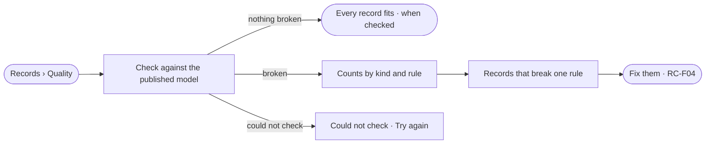

# RC-02 · See the records that break the model

**As** a data curator **I want** every record that breaks the published model, counted by kind and listed by rule **so that** I fix what matters before an answer rests on it.

Tasks: [task.md](task.md) · Feature: [RC-F03](../../feature.md)

## Who can

Every role runs a check and reads what breaks the model ([the role table](../../../../../../os/access/features/AC-F02-access-policies/feature.md#the-role-table)).

| Lens | Can | Otherwise sees |
|---|---|---|
| Admin | Run a check and read every record that breaks the model | — |
| Operator | Run a check and read what breaks the model, within what a view of the graph lets them see | Hidden kinds are left out, and the page says so |

## Flow

## Acceptance criteria

| # | Given | When | Then |
|---|---|---|---|
| RC-02.1 | A Graph with a published model | a check runs | it ends with counts by kind and by rule, stored by the engine |
| RC-02.2 | A rule with breaking records | it is opened | each record shows with its value and the rule it breaks |
| RC-02.3 | Every record fits | a check ends | *Every record fits the model* shows with when it was checked |
| RC-02.4 | A check running | the person presses *Stop* | it stops and keeps what it counted, marked as partial |
| RC-02.5 | A kind a view of the graph hides | an Operator runs a check | the kind is left out and the page says so |
| RC-02.6 | The check cannot read the database | it runs | *Could not check* shows with the reason and *Try again* |

## Screens

| Surface | Lens | First use | Empty after a filter | Loading | Has data | Failed | Agent working or proposing | No access |
|---|---|---|---|---|---|---|---|---|
| Quality | Admin | data.quality · Never checked | data.quality · Nothing matches | data.quality · Checking | data.quality | data.quality · Could not check | data.quality · Checking | — |
| Quality | Operator | data.quality · Never checked | data.quality · Nothing matches | data.quality · Checking | data.quality | data.quality · Could not check | data.quality · Checking | data.quality · Kinds hidden |
