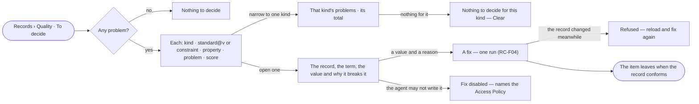

# RC-12 · Decide what breaks the standards

**As** a data curator **I want** one queue of every record that breaks a constraint or a standard its kind is held
to, to fix with a value and a reason **so that** records are checked before anyone relies on them, and no fix is
silent.

Tasks: [task.md](task.md) · Feature: [RC-F03](../../feature.md)

## Who can

Fixing one record changes data, never the model or its standards, so every role may start it ([the role table](../../../../../../os/access/features/AC-F02-access-policies/feature.md#the-role-table) › *quality*); which records the fix reaches is the agent's Access Policies alone.

| Lens | Can | Otherwise sees |
|---|---|---|
| Admin | Read every problem; fix any, on a connection that writes | — |
| Operator | Read every problem on kinds they may read; fix, on a connection that writes. A Modeller does the same | A record the agent granted to them may not write: *Fix* disabled, naming the Access Policy that stops it |

## Flow

## Acceptance criteria

| # | Given | When | Then |
|---|---|---|---|
| RC-12.1 | No problem on any readable kind | *To decide* opens | it reads *Nothing to decide* |
| RC-12.2 | Records that break a constraint or a standard their kind is held to | *To decide* opens | each lists the kind, the standard version or constraint, the property and the problem; each kind carries its score — the share of its records that conform; the totals and scores are the engine's |
| RC-12.3 | The queue | the person narrows it to one kind | only that kind's problems list, with its own total; one with none reads *Nothing to decide for this kind* and offers *Clear* |
| RC-12.4 | One problem | the person opens it | it shows the record, the term, the value and why it breaks the standard or constraint |
| RC-12.5 | A person of any role, a problem, and an agent granted to them that may write the record | they fix it with another value and a reason | the value is written as one run, the reason its *why*, and the record's provenance names the fix (RC-F06) |
| RC-12.6 | A record changed since the item opened | the fix is saved | it is refused, asking the person to reload and fix again |
| RC-12.7 | A fixed record that conforms | the queue reloads | the item has left it |
| RC-12.8 | Kinds a view hides | the queue opens | they are counted as not readable, never left out silently |
| RC-12.9 | A problem on a record the person's agent may not write | they open it | it reads; *Fix* is disabled, naming the Access Policy that stops it |
| RC-12.10 | A Graph whose connection is read-only | a fix is saved | it is refused, naming the connection setting; nothing is written |
| RC-12.11 | A fix whose value still breaks the rule, or with no reason | it is saved | it is refused, naming the rule or asking for the reason; nothing is written |

## Screens

| Surface | Lens | First use | Empty after a filter | Loading | Has data | Failed | Agent working or proposing | No access |
|---|---|---|---|---|---|---|---|---|
| To decide | Admin | data.checks · Nothing to decide | data.checks · Nothing for this kind | data.checks · Loading | data.checks | data.checks · Could not load | — | — |
| To decide | Operator | data.checks · Nothing to decide | data.checks · Nothing for this kind | data.checks · Loading | data.checks | data.checks · Could not load | — | — |
| A problem | Admin | — | — | data.checks · Loading | data.checks · Problem | data.checks · Fix refused | — | — |
| A problem | Operator | — | — | data.checks · Loading | data.checks · Problem | data.checks · Fix refused | — | data.checks · Fix needs a grant |
