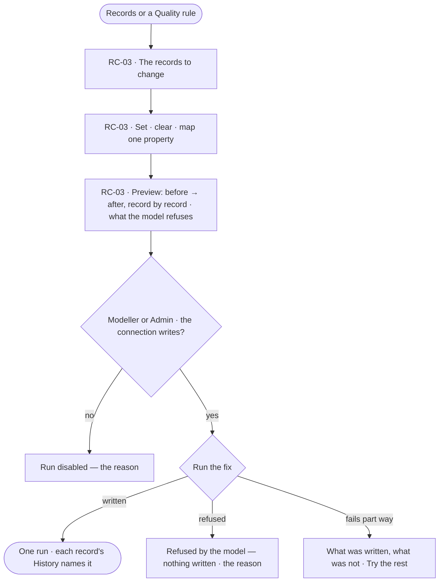

# Bulk fixes

> One change made to many records at once — set, clear or map a property — previewed record by record, checked against the model, and written as one run.
> The decision it helps make: *is this change right for every record it touches?*

## User journey

## Stories

| ID | Story | Status |
|---|---|---|
| RC-03 | [Fix many records at once](stories/RC-03-fix-many-records-at-once/story.md) | idea |

## Rules

| Rule | Detail |
|---|---|
| One property, one change | A fix sets, clears or maps one property across the picked records |
| Previewed before it writes | Nothing writes until the person runs the preview they read |
| Checked by the model | The engine refuses what the published model does not allow, whatever Studio sends |
| One run | The fix is one recorded run; a Cypher database writes it in one transaction, a Gremlin database record by record, stopping at the first refusal and saying what was applied |

## Access

| Act | Role ([the role table](../../../../os/access/features/AC-F02-access-policies/feature.md#the-role-table)) | Everyone else sees |
|---|---|---|
| Preview a fix | Every role — Operator, Modeller, Admin | — |
| Run a fix | Modeller · Admin, through an agent granted to them, on a connection that writes | Disabled — *Needs the Modeller role — ask an Admin*; a read-only connection gives its own reason |

## States

| State | What the person sees |
|---|---|
| First use | No records picked: pick from Records or a Quality rule |
| Empty after a filter | The picked records match nothing to change: the preview says so |
| Loading | The preview builds record by record |
| Has data | Before → after for each record, and what the model would refuse |
| Failed | What was written and what was not, with *Try the rest* |
| Agent working or proposing | — |
| No access | *Run* disabled with its reason; the preview still reads |

## Data touched

| Record | Read or write |
|---|---|
| Nodes and relationships picked | Read · write |
| The published model's keys and constraints | Read |
| The fix's run | Write |

## Engine

> Placeholder — its records, reads, routes, events, refusals, CLI and mechanisms.

## System impact

> Placeholder — `None`, or the `system-design.md` sections it changes and the NFRs it touches.

## Decisions

| Decision | Detail |
|---|---|
| A fix is a run | It is in History, on every record it changed, with who ran it and why |
| No undo | A wrong fix is put right by another fix; History keeps both |

## Open questions

| Question | Who answers |
|---|---|
| EX-F06 › Not building says bulk changes are an upload in Records; here a fix sets, clears or maps one property, with no upload. Recommend: a fix as written here, and EX-F06's row reads *bulk changes are a fix in Data (RC-F04)* | Ravi |
## Not building

| Item | Why not |
|---|---|
| A fix across kinds | One kind at a time keeps the preview readable |
| Scripts or query-shaped fixes | A query that writes is an agent's plan, run under its rules |
