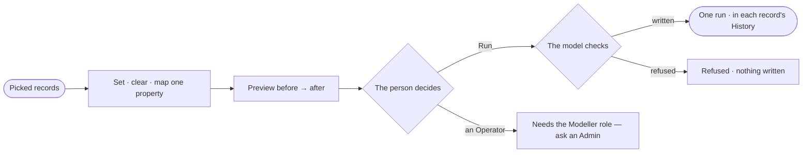

# RC-03 · Fix many records at once

**As** a data curator **I want** to change one property across many records, previewed before it writes **so that** a fix is right for every record it touches, and recorded.

Tasks: [task.md](task.md) · Feature: [RC-F04](../../feature.md)

## Who can

Running a fix is the Modeller's and the Admin's ([the role table](../../../../../../os/access/features/AC-F02-access-policies/feature.md#the-role-table)).

| Lens | Can | Otherwise sees |
|---|---|---|
| Admin | Preview and run a fix | — |
| Operator | Preview a fix. A Modeller runs it as an Admin does | *Run* disabled — *Needs the Modeller role — ask an Admin* |

## Flow

## Acceptance criteria

| # | Given | When | Then |
|---|---|---|---|
| RC-03.1 | Picked records and a change | the preview opens | each record shows before → after, and any the model would refuse are marked with why |
| RC-03.2 | A preview the model fully allows | the person runs it | it writes as one run and each record's History names it |
| RC-03.3 | A change the model refuses | the person runs it | nothing is written and the refusal names the constraint |
| RC-03.4 | A Gremlin database refusing part way | the fix runs | it says what was written and what was not, with *Try the rest* |
| RC-03.5 | An Operator | they reach *Run* | it is disabled with *Needs the Modeller role — ask an Admin* |

## Screens

| Surface | Lens | First use | Empty after a filter | Loading | Has data | Failed | Agent working or proposing | No access |
|---|---|---|---|---|---|---|---|---|
| A fix | Admin | data.fix · Nothing picked | data.fix · Nothing to change | data.fix · Building preview | data.fix | data.fix · Partly written | — | — |
| A fix | Operator | data.fix · Nothing picked | data.fix · Nothing to change | data.fix · Building preview | data.fix · Preview only | — | — | data.fix · Run disabled |
