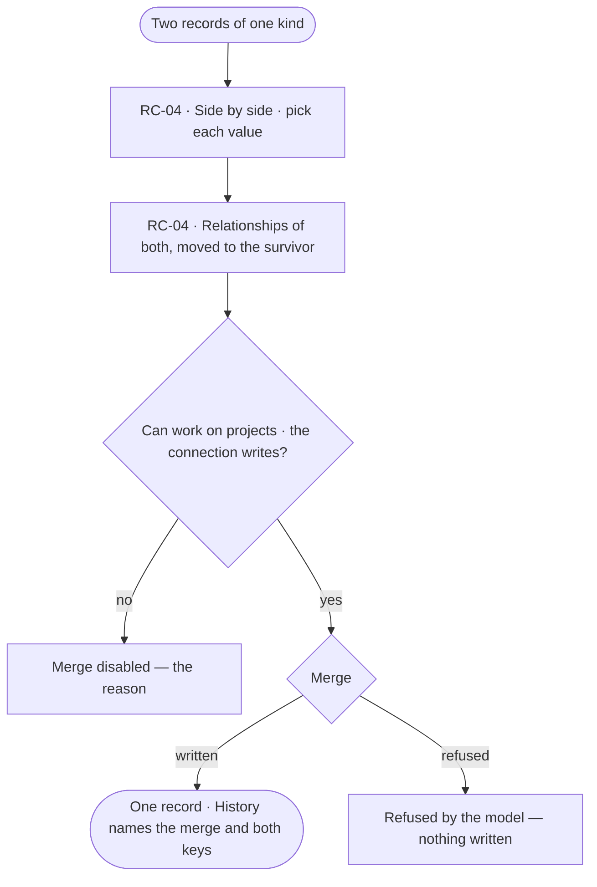

# Merge duplicates

> Two records of one kind a person knows are the same thing, merged into one: values picked side by side, relationships moved, the merge recorded.
> The decision it helps make: *are these two records one thing, and which values survive?*

## User journey

## Stories

| ID | Story | Status |
|---|---|---|
| RC-04 | [Merge two records that are one](stories/RC-04-merge-two-records-that-are-one/story.md) | idea |

## Rules

| Rule | Detail |
|---|---|
| A person picks | Invana never proposes or infers that two records are one |
| One kind | Only records of the same kind merge |
| The survivor keeps its key | The other record's key is kept in History, so what cited it still resolves |

## Access

| Act | Role (`.claude/team/TEAM.md` §7) | Everyone else sees |
|---|---|---|
| Compare two records | Operator — every member | — |
| Merge them | `contributor` · shown as *Can work on projects*, on a connection that writes | Disabled — *Ask Priya (owner)*; a read-only connection gives its own reason |

## States

| State | What the person sees |
|---|---|
| First use | Pick two records of one kind to compare |
| Empty after a filter | — |
| Loading | Both records load side by side |
| Has data | Values side by side, the survivor's picked; relationships listed |
| Failed | Nothing written, and why |
| Agent working or proposing | — |
| No access | *Merge* disabled with its reason |

## Data touched

| Record | Read or write |
|---|---|
| Two records and their relationships | Read · write |
| The merge's run | Write |

## Engine

> Placeholder — its records, reads, routes, events, refusals, CLI and mechanisms.

## System impact

> Placeholder — `None`, or the `system-design.md` sections it changes and the NFRs it touches.

## Decisions

| Decision | Detail |
|---|---|
| Entity resolution, chosen | Merge duplicates is taken up for v1: a person picks the records that are one; Invana never decides it |

## Open questions

| Question | Who answers |
|---|---|
| When it is taken up: may an agent propose pairs for a person to confirm? Recommend: yes, as a proposal only | Ravi |

## Not building

| Item | Why not |
|---|---|
| Automatic deduplication | Identity is the model's keys and a person's choice |
