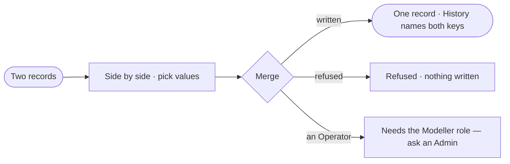

# RC-04 · Merge two records that are one

**As** a data curator **I want** to merge two records I know are the same thing, choosing which values survive **so that** the Graph says it once.

Tasks: [task.md](task.md) · Feature: [RC-F05](../../feature.md)

## Who can

Merging is the Modeller's and the Admin's ([the role table](../../../../../../os/access/features/AC-F02-access-policies/feature.md#the-role-table)).

| Lens | Can | Otherwise sees |
|---|---|---|
| Admin | Compare and merge two records of one kind | — |
| Operator | Compare two records. A Modeller merges as an Admin does | *Merge* disabled — *Needs the Modeller role — ask an Admin* |

## Flow

## Acceptance criteria

| # | Given | When | Then |
|---|---|---|---|
| RC-04.1 | Two records of one kind | they are compared | their values show side by side with the survivor's picked |
| RC-04.2 | A merge the model allows | it runs | one record remains with the picked values and every relationship of both |
| RC-04.3 | A merged record | its History opens | it names the merge, who ran it and the other record's key |
| RC-04.4 | Two records of different kinds | a merge is asked for | it is refused before anything is written |
| RC-04.5 | An Operator | they reach *Merge* | it is disabled with *Needs the Modeller role — ask an Admin* |

## Screens

| Surface | Lens | First use | Empty after a filter | Loading | Has data | Failed | Agent working or proposing | No access |
|---|---|---|---|---|---|---|---|---|
| Merge | Admin | data.merge · Pick two | — | data.merge · Loading | data.merge | data.merge · Refused | — | — |
| Merge | Operator | data.merge · Pick two | — | data.merge · Loading | data.merge · Compare only | — | — | data.merge · Merge disabled |
