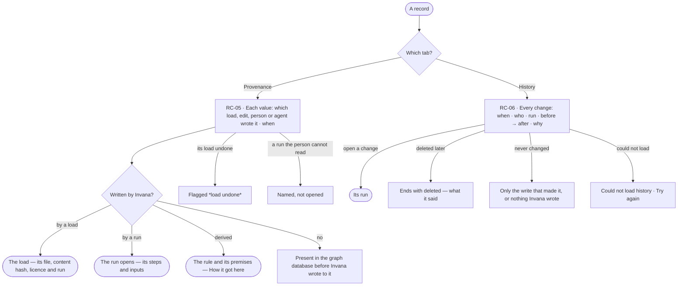

# Provenance

> Where each value of a record came from — which load, edit, person or agent wrote it and when — its lineage back to
> the file and the run, and every change to it since, read from the Graph's one History.
> The decision it helps make: *can I trust where this value came from, and was every change to it right?*

## User journey

Journeys this feature is a step of: [J02 · Ask and trust the answer](../../../../journeys/J02-ask-and-trust-the-answer.md)

## Stories

| ID | Story | Status |
|---|---|---|
| RC-05 | [Trace a record to what wrote it](stories/RC-05-trace-a-record-to-what-wrote-it/story.md) | idea |
| RC-06 | [Read a record and every change to it](stories/RC-06-read-a-record-and-every-change-to-it/story.md) | idea |

## Rules

| Rule | Detail |
|---|---|
| Provenance is field-level | Each value names the load, edit, person or agent that wrote it, the run, and when |
| Lineage ends at the file | A value a load wrote traces to the load, its file, its content hash, its licence and its run ([RC-F02](../RC-F02-bring-records-in/feature.md)) |
| Derived values name their rule | A value inference added is labelled *derived* and names its rule and premises (SE-F08, [Semantics](../../../semantics/product.md)) |
| One event store | Provenance and history read the Graph's one append-only History ([AC-F06](../../../../os/access/features/AC-F06-history/feature.md)), filtered to the record — never a second log |
| Every write lands there | A load, a board's save, a fix, a merge and a derivation each write their changes to History |
| The database's own records | A value Invana never wrote reads *Present in the graph database before Invana wrote to it* — never a guess |
| Provenance is not lineage | Provenance is *where a value came from* — a load, an edit, a person, an agent. Lineage is *what a copy was read from* — an answer, a finding, a report, a snapshot, a note, an export. Provenance feeds lineage: a copy's sources are resources in [Access Policies' grammar](../../../../os/access/features/AC-F02-access-policies/feature.md#mechanisms), and a record's provenance is what tells which load or run a source was ([GP-F02 › Engine](../../../../os/graph/features/GP-F02-memory/feature.md#engine)) |
| A value shows as far as the reader's agent reads | A value whose level the person's default agent may not Read shows in provenance and history as *Withheld — your agent may not read {resource}*; what wrote it and when stay readable |
| An undone load says so | A value whose load was undone and that nothing changed since is gone; one kept because a later write changed it names both |

## Access

| Act | Role ([the role table](../../../../os/access/features/AC-F02-access-policies/feature.md#the-role-table)) | Everyone else sees |
|---|---|---|
| Read records, their provenance and history | Every signed-in person — Operator, Modeller, Admin — as far as their default agent reads each value | A value at a level their agent may not Read: *Withheld — your agent may not read {resource}* |

## States

| State | What the person sees |
|---|---|
| First use | A record Invana never wrote or changed: *Present in the graph database before Invana wrote to it* · *No changes made in Invana* |
| Empty after a filter | — |
| Loading | Provenance and history load with the record's sheet |
| Has data | Each value with what wrote it and when; changes newest first: when · who · run · before → after · why |
| Failed | *Could not load provenance* or *Could not load history*, and *Try again* |
| Agent working or proposing | — |
| No access | A run or member the person may not see is named, not opened: *a run by an agent you cannot see* · *a member you cannot see*; a value their agent may not read: *Withheld — your agent may not read {resource}* |

## Data touched

| Record | Read or write |
|---|---|
| History, filtered to one record — every write and change, per value | Read |
| Loads | Read |
| Runs | Read |

## Engine

### Records

| Table | Columns | Notes |
|---|---|---|
| — | — | Stores nothing of its own: provenance is read from the stamps a load writes, the loads, derived facts and History |

### Reads

| Record | Owner |
|---|---|
| Loads, their inputs and the stamps a load writes on each element | [RC-F02 › Engine](../RC-F02-bring-records-in/feature.md#engine) |
| History — every write and change, per value | [AC-F06](../../../../os/access/features/AC-F06-history/feature.md) |
| Derived facts, their rule version and premises | [SE-F08 › Engine](../../../semantics/features/SE-F08-inference/feature.md#engine) |
| Runs, and whether the reader may open one | [CP-F10](../../../../os/control/features/CP-F10-runs-and-how-the-agents-are-doing/feature.md) |
| The record's kind and its values in the published version | [RC-F01](../RC-F01-records-by-kind/feature.md) |
| A property's level · the lineage that copies of a record carry | [SE-F03 › Engine](../../../semantics/features/SE-F03-meaning/feature.md#engine) · [GP-F02 › Engine](../../../../os/graph/features/GP-F02-memory/feature.md#engine) |

### Routes

| Route, after `/api/v1/u/{u}/{g}/records` | Does | Story |
|---|---|---|
| `GET /{kind}/{key}/provenance` | Per value: what wrote it (`load` · `run` · `derived` · `database`), the load or run, the person or agent, when, and `load_undone` | RC-05 |
| `GET /{kind}/{key}/history` | History filtered to the record, newest first: when · who · run · property, before → after · why; also for an address deleted since | RC-06 |

### Events

| Event | When |
|---|---|
| — | None of its own; every write it reads is History's (AC-F06) |

### Refusals

| Status | When | Sentence | Criterion |
|---|---|---|---|
| 404 | A kind the published model lacks, or an address History never saw | *No `{kind}` `{key}` in this graph.* | API only — Studio opens a record from a listed kind |

### CLI

| Command | Does |
|---|---|
| — | No command of its own |

### Mechanisms

| Mechanism | How |
|---|---|
| What wrote a value | The newest History event that wrote the property; none, the element's load stamps; none, *Present in the graph database before Invana wrote to it* — never a guess |
| Lineage to the file | A load-written value opens its load: id, file, content hash, licence and run |
| Derived | A value from a derived fact names its rule version and premises; a value from a `source = run` load names that run and the loads it was pinned to (`record_load_inputs`) |
| An undone load | A value its undone load wrote that a later write kept names the later write and flags the load *load undone* |
| What the reader may open | A run or a member the reader may not read is named, never opened — *a run by an agent you cannot see* · *a member you cannot see* |
| Values the reader may not read | Both routes read each value through the person's default agent: a property whose level `decide()` does not Allow is returned as *withheld*, with the resource, and counted; the load, run, person and time stay |
| One set of rows | `/history` and History filtered to the record are one query on the event store |

## System impact

| HLD section | Change | NFRs |
|---|---|---|
| § 12 Qualities | Privacy: a value reads only as far as the person's default agent reads its level; two read routes over History and the loads | NFR-SEC-11 |

## Decisions

| Decision | Detail |
|---|---|
| Written once | What wrote a value is stamped when it is written and never changes; later changes are its History |
| The same rows as History | What a record's History shows and what History shows for it are the same rows |

## Open questions

| Question | Who answers |
|---|---|
| History by record is AC-16's, for an Admin; a record's History here is every member's. Recommend: RC-06 reads AC-16's rows for one record, shown to every member as changes with before → after; AC-16 keeps the Admin's counts and who can see it now | Ravi |

## Not building

| Item | Why not |
|---|---|
| A second change log per record | A record's history is History, filtered to it |
| Provenance for a bulk load | A bulk load is the marked fast path; its values say they carry no provenance |
| A source note per record inside a load | Provenance is the load, file, record and run; a note a row carries is a property its kind declares |
| A record's change log read from versions of its load | A record's history is History, filtered to it |
