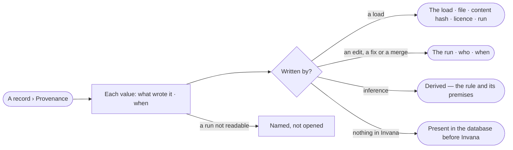

# RC-05 · Trace a record to what wrote it

**As** an analyst **I want** to see what wrote each value of a record — which load, edit, person or agent, in which
run, and when — and trace a loaded value back to its file **so that** I know whether to trust it.

Tasks: [task.md](task.md) · Feature: [RC-F06](../../feature.md)

## Who can

| Lens | Can | Otherwise sees |
|---|---|---|
| Admin | Read any record's provenance and open its loads and runs | — |
| Operator | Read any record's provenance; open loads and runs they may read | A run they may not read is named, not opened |

## Flow

## Acceptance criteria

| # | Given | When | Then |
|---|---|---|---|
| RC-05.1 | A record whose values were written by a load and later edited on a board | *Provenance* opens | each value names what wrote it — the load or the board's save — the person or agent, the run and when; the run opens from it |
| RC-05.2 | A value a load wrote | the person opens its load | it names the load's id, file, content hash, licence and run |
| RC-05.3 | A value inference added | *Provenance* opens | it is labelled *derived*, naming its rule and premises |
| RC-05.4 | A record Invana never wrote | *Provenance* opens | it reads *Present in the graph database before Invana wrote to it* |
| RC-05.5 | A value whose load was undone and a later write kept | *Provenance* opens | it names the later write and flags the load *load undone* |
| RC-05.6 | A run by an agent the Operator may not read | *Provenance* opens | the run is named, not opened |
| RC-05.7 | Provenance cannot be read | the tab opens | *Could not load provenance* shows with *Try again* |
| RC-05.8 | A value saved from a simulation's result | *Provenance* opens | it is labelled *derived*, naming the run it came from and the loads that run was pinned to |

## Screens

| Surface | Lens | First use | Empty after a filter | Loading | Has data | Failed | Agent working or proposing | No access |
|---|---|---|---|---|---|---|---|---|
| A record · Provenance | Admin | — | — | data.record · Loading | data.record · Provenance | data.record · Could not load | — | — |
| A record · Provenance | Operator | — | — | data.record · Loading | data.record · Provenance | data.record · Could not load | — | data.record · Run not readable |
