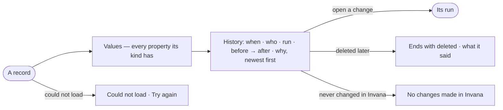

# RC-06 · Read a record and every change to it

**As** a data curator **I want** a record's values and every change made to it — who, in which run, what and why
**so that** a fix is never silent.

Tasks: [task.md](task.md) · Feature: [RC-F06](../../feature.md)

## Who can

| Lens | Can | Otherwise sees |
|---|---|---|
| Admin | Read any record and its history, and open the run behind each change | — |
| Operator | Read any record their default agent may read, and its history. A Modeller the same | A change by a member they cannot see reads *a member you cannot see*; a value at a level their agent may not Read: *Withheld — your agent may not read {resource}* |

## Flow

## Acceptance criteria

| # | Given | When | Then |
|---|---|---|---|
| RC-06.1 | A record | it opens | every value its kind has in the published model shows |
| RC-06.2 | A record changed by a board's save and later by a fix | *History* opens | both changes list newest first — *when · who · run · property, before → after · why* |
| RC-06.3 | A change in the list | it is opened | its run opens |
| RC-06.4 | A record Invana never changed | *History* opens | it reads *No changes made in Invana* |
| RC-06.5 | A record deleted in a later run | its address is opened | its History ends with *deleted* and what it said |
| RC-06.6 | A record's History and the Graph's History filtered to it | both are read | they show the same rows |
| RC-06.7 | A change by a member the Operator cannot see | *History* opens | it reads *a member you cannot see* |
| RC-06.8 | The record cannot be read | it opens | *Could not load* shows with *Try again* |
| RC-06.9 | A change to a property whose level the person's default agent may not Read | *History* opens | the change lists with its time, who and run, and *before → after* reads *Withheld — your agent may not read {resource}*; the same row in the Graph's History shows to those whose agent may read it |

## Screens

| Surface | Lens | First use | Empty after a filter | Loading | Has data | Failed | Agent working or proposing | No access |
|---|---|---|---|---|---|---|---|---|
| A record · Values | Admin | — | — | data.record · Loading | data.record | data.record · Could not load | — | — |
| A record · Values | Operator | — | — | data.record · Loading | data.record | data.record · Could not load | — | — |
| A record · History | Admin | data.record · No changes | — | data.record · Loading | data.record · History | data.record · Could not load | — | — |
| A record · History | Operator | data.record · No changes | — | data.record · Loading | data.record · History | data.record · Could not load | — | data.record · Member hidden |
| A record · History, a value withheld | Admin | — | — | — | data.record · History · Redacted | — | — | — |
| A record · History, a value withheld | Operator | — | — | — | data.record · History · Redacted | — | — | data.record · History · Redacted |
