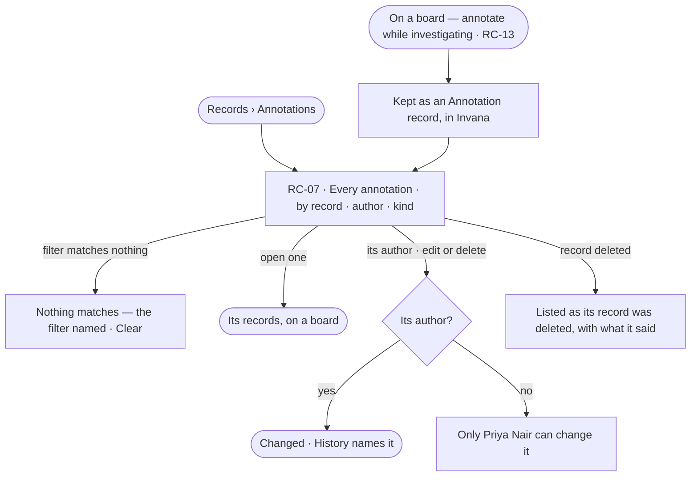

# Annotations

> The one home for annotations: what people and the assistant say about the records, kept by Invana as records of
> the built-in *Annotation* kind — what an annotation is, how it is kept, and every one in the Graph in one place,
> found by record, author or kind, and edited or removed by its author. Making one is done on a board
> ([RC-13](stories/RC-13-annotate-the-records-on-a-board/story.md)).
> The decision it helps make: *which annotations still hold, and which should go?*

## User journey

## Stories

| ID | Story | Status |
|---|---|---|
| RC-07 | [Find and manage the Graph's annotations](stories/RC-07-find-and-manage-the-graphs-annotations/story.md) | idea |
| RC-13 | [Annotate the records on a board](stories/RC-13-annotate-the-records-on-a-board/story.md) | idea |

## Rules

| Rule | Detail |
|---|---|
| A built-in kind | An annotation is a record of the built-in *Annotation* kind: its text, author, the records it is about, the value then, and its evidence |
| Kept by Invana | Annotation records are kept by Invana, never in the customer's graph database; a read-only database can be annotated |
| Made on a board, kept here | Annotating is done on a board (RC-13); what an annotation is, and finding, reading, editing and removing all of them, is here too |
| On data, never free | It names the records it is about — a node, a relationship, one value, a set (highlight) or two or more nodes (group) |
| One word | *Annotation*, with an author — a person or the assistant |
| It belongs to the Graph | Any board that loads a record shows its annotations |
| A value annotation keeps its value | When the record's value differs it says *Was 71% when noted*; it never rewrites itself |
| A deleted record | Its annotation is listed as *its record was deleted*, with what it said |
| Reach | A person's annotations reach the Graph. The assistant's stay in their conversation until a person adds them to the Graph or dismisses them; one still in someone else's conversation is absent to everyone else |
| Evidence | The assistant's annotations carry their query, what came back and the reply; where the Graph cannot answer, a gap annotation — never a number |
| Five colours | Amber, blue, green, red or grey, from the theme's tokens — amber `--warning`, blue `--primary`, green `--success`, red `--destructive`, grey `--muted-foreground`; a new one is amber, a group blue |
| Never counted as data | Annotations are not records of the Graph's own models: never counted in Quality, never exported with records |

## Access

| Act | Role ([the role table](../../../../os/access/features/AC-F02-access-policies/feature.md#the-role-table)) | Everyone else sees |
|---|---|---|
| Read every annotation | Every role — Operator, Modeller, Admin | — |
| Edit or delete one's own annotation | Every role — an *Own* act on what the person wrote | Off on another person's — *Only Priya Nair can change it* |
| Delete any annotation, with a reason | Admin | Off — *Only its author or an Admin can change it* |

## States

| State | What the person sees |
|---|---|
| First use | *Nothing annotated yet* — annotations are made on a board in Explore |
| Empty after a filter | Nothing matches: the filter named, and *Clear* |
| Loading | Rows load newest first |
| Has data | Each annotation: what it says, its records, author, when |
| Failed | *Could not load annotations* and *Try again* |
| Agent working or proposing | The assistant's annotations a person added show as the assistant's; proposals still in a conversation are not listed |
| No access | Annotations on kinds a view hides are absent |

## Data touched

| Record | Read or write |
|---|---|
| Annotation — kind (note · highlight · group), records, value then, text, colour, author, conversation, reach, evidence | Read · write by their author |
| The records they are about | Read |

## Engine

> Placeholder — its records, reads, routes, events, refusals, CLI and mechanisms.

## System impact

> Placeholder — `None`, or the `system-design.md` sections it changes and the NFRs it touches.

## Decisions

| Decision | Detail |
|---|---|
| The built-in Annotation kind is not a model a person shapes | It is Invana's; it never appears on the model map |
| Only the author changes it | Others read it; an Admin may delete any, with a reason kept in History |

## Open questions

| Question | Who answers |
|---|---|
| Is the Annotation kind shown in Semantics, read-only? Recommend: no — it is Invana's, shown only here | Ravi |
| EX-F06 › Access gives changing or deleting an annotation to its author alone; here an Admin may delete any, with a reason. Which holds? Recommend: an Admin may delete any with a reason, written into EX-F06 too, so nothing anyone wrote is beyond the Graph's Admin | Ravi |

## Not building

| Item | Why not |
|---|---|
| Threads, replies, mentions | A conversation about data is the assistant's |
| Annotations written to the graph database | They are Invana's |
