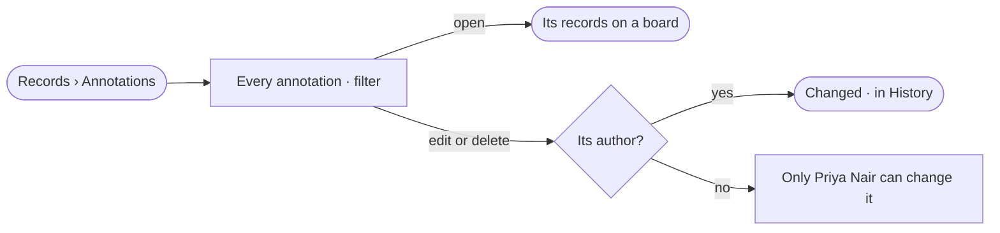

# RC-07 · Find and manage the Graph's annotations

**As** an analyst **I want** every annotation in the Graph in one place, found by record, author or kind **so that** I see what others found and clear what does not hold any more.

Tasks: [task.md](task.md) · Feature: [RC-F07](../../feature.md)

## Who can

Every role reads annotations and changes its own; an Admin deletes any ([the role table](../../../../../../os/access/features/AC-F02-access-policies/feature.md#the-role-table) › *annotations*).

| Lens | Can | Otherwise sees |
|---|---|---|
| Admin | Read every annotation; edit or delete any, with a reason kept | — |
| Operator | Read every annotation; edit or delete their own; a Modeller the same | Off on others' — *Only Priya Nair can change it* |

## Flow

## Acceptance criteria

| # | Given | When | Then |
|---|---|---|---|
| RC-07.1 | Annotations made on boards | *Annotations* opens | every annotation shows with its text, records, author and when, newest first |
| RC-07.2 | A filter by author | it matches nothing | *Nothing matches* names the filter, with *Clear* |
| RC-07.3 | An annotation | it is opened | its records open on a board with it shown |
| RC-07.4 | Their own annotation | the author edits it | it changes and History names the change |
| RC-07.5 | Someone else's annotation | an Operator tries to delete it | it is off, reading *Only Priya Nair can change it* |
| RC-07.6 | An annotation whose record was deleted | the list opens | it reads *its record was deleted*, with what it said |

## Screens

| Surface | Lens | First use | Empty after a filter | Loading | Has data | Failed | Agent working or proposing | No access |
|---|---|---|---|---|---|---|---|---|
| Annotations | Admin | data.annotations · Nothing annotated | data.annotations · Nothing matches | data.annotations · Loading | data.annotations | data.annotations · Could not load | — | — |
| Annotations | Operator | data.annotations · Nothing annotated | data.annotations · Nothing matches | data.annotations · Loading | data.annotations | data.annotations · Could not load | — | data.annotations · Not the author |
