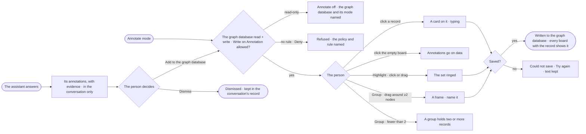

# RC-13 · Annotate the records on a board

**As** an analyst investigating on a board **I want** to annotate the records themselves — a node, a relationship, a
value, a set, a group — and see what others and the assistant noted on them **so that** whoever loads those records
next sees what the data says, and a walkthrough can point at it.

Tasks: [task.md](task.md) · Feature: [RC-F07](../../feature.md) · The board: [EX-F01](../../../../../explore/features/EX-F01-the-board-and-its-canvas/feature.md)

## Who can

| Lens | Can | Otherwise sees |
|---|---|---|
| Admin | Read, write, hide and show annotations on a read + write graph database; add the assistant's to the graph database or dismiss them; change or delete their own; delete anyone's, with a reason | A read-only graph database: Annotate off, naming it and its mode |
| Operator | The same, except deleting another person's annotation; a Modeller the same ([role table](../../../../../../os/access/features/AC-F02-access-policies/feature.md#the-role-table) › *annotations*) | Someone else's annotation: change and delete off — *Only its author or an Admin can change it* |

Annotations are written to the customer's graph database as the built-in Assistant, within its Access Policies.

## Flow

## Acceptance criteria

| # | Given | When | Then |
|---|---|---|---|
| RC-13.1 | Annotate mode, a read + write graph database and a rule allowing Write on `data/<graph database>/Annotation` | the person clicks a node or a relationship and types | a card is drawn beside it, linked by a dashed line, and written to the graph database that holds the record when they leave it |
| RC-13.2 | A record selected in Annotate | the person annotates one of its values | the annotation keeps that value; when the value later differs it says *Was 71% when noted* |
| RC-13.3 | Highlight | the person clicks or drags over nodes | those nodes are ringed and the relationships among them marked |
| RC-13.4 | Group | the person drags around fewer than two nodes | it is refused with *A group holds two or more records* |
| RC-13.5 | Annotate mode | the person clicks the empty board | nothing is made, and the board says *Annotations go on data* |
| RC-13.6 | Records annotated on one board | another person loads those records on another board | the annotations show there too |
| RC-13.7 | The Legend's *Annotations* section | the person hides the assistant's, or switches to *Badges* | the board shows each annotated record with a count instead, the choice is saved with the board, and the panel says how many are hidden, with *Show* |
| RC-13.8 | Only part of a group's records on the board | it draws | the frame is drawn dashed around those here, saying *3 of 7 on this board* |
| RC-13.9 | An answer, or *Explain this* on a selection | the assistant annotates records | its annotations show as the assistant's, in this conversation only, each with *Add to the graph database* · *Dismiss*; nothing is written until a person adds one |
| RC-13.10 | An assistant's annotation | the person opens it | it carries its evidence: *How it got here* shows its query, what came back and the reply |
| RC-13.11 | A question the Graph cannot answer | the assistant annotates | it writes a gap annotation saying what is missing, never a number |
| RC-13.12 | Someone else's annotation | the person selects it | its author's initials show; change and delete are off — *Only its author or an Admin can change it* |
| RC-13.13 | Saving an annotation fails | the graph database refuses | the card keeps its text and says *Could not save · Try again* |
| RC-13.14 | Records in a read-only graph database | the person opens the mode picker | Annotate is off, naming the graph database and that it is read-only; every annotation still shows, and the API refuses the same |
| RC-13.15 | No rule allowing the Assistant Write on `data/<graph database>/Annotation`, or a Deny | the person annotates or adds the assistant's annotation | it is refused, naming the policy and the rule; the card keeps its text. An Ask rule waits for the agent's approvers |
| RC-13.16 | The Annotations panel | the person picks *From* | it lists this conversation's annotations, adds those in the graph databases, or shows every conversation's the person may read |
| RC-13.17 | An annotation selected by its author | they change its colour | they pick one of amber · blue · green · red · grey; a new annotation is amber, a group blue |
| RC-13.18 | An assistant's annotation still in another person's conversation | someone else lists or opens annotations | it is not there — never shown as forbidden |
| RC-13.19 | A new annotation with no text, or a value annotation with no value picked | the person leaves it | it is refused saying what is missing |
| RC-13.20 | An annotation whose records are not on this board | the person picks *Load* on it in the panel | its records draw onto the board, framed |
| RC-13.21 | A graph database switched off | the person annotates its records | it is refused, naming who switched it off and when |
| RC-13.22 | An Admin and someone else's annotation | they delete it | they are asked for a reason, kept in History with the annotation's text |

## Screens

| Surface | Lens | First use | Empty after a filter | Loading | Has data | Failed | Agent working or proposing | No access |
|---|---|---|---|---|---|---|---|---|
| Annotations on the board | Admin | explore.board.annotate · Nothing annotated | explore.board.annotate · All hidden | explore.board.annotate · Loading | explore.board.annotate | explore.board.annotate · Could not save | explore.board.annotate · Assistant proposes | explore.board.annotate · Read-only database |
| Annotations on the board | Operator | explore.board.annotate · Nothing annotated | explore.board.annotate · All hidden | explore.board.annotate · Loading | explore.board.annotate | explore.board.annotate · Could not save | explore.board.annotate · Assistant proposes | explore.board.annotate · Someone else's |
| The Annotations panel | Admin | explore.board.annotate · Panel empty | explore.board.annotate · Panel hidden | explore.board.annotate · Loading | explore.board.annotate · Panel | — | explore.board.annotate · Evidence | — |
| The Annotations panel | Operator | explore.board.annotate · Panel empty | explore.board.annotate · Panel hidden | explore.board.annotate · Loading | explore.board.annotate · Panel | — | explore.board.annotate · Evidence | — |
