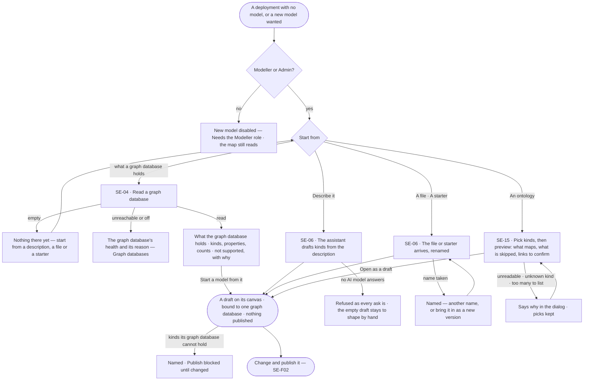
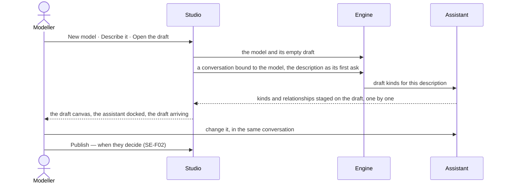

# Start a model

> A model is never started from a blank page: Invana drafts it from what a graph database already holds, from a
> description the assistant turns into kinds, from a file, a starter or an ontology a field already published. The
> person decides what to keep, and nothing is published until they publish it. Every published model joins the one
> stitched model of the deployment.
> The decision it helps make: *which drafted kinds and links belong in the model, and is it ready to publish?*

## User journey

Journeys this feature is a step of: [J01 · From a fresh deployment to a first answer](../../../../journeys/J01-from-a-fresh-deployment-to-a-first-answer.md)

## Stories

| ID | Story | Status |
|---|---|---|
| SE-04 | [Draft a model from the database](stories/SE-04-draft-a-model-from-the-database/story.md) | idea |
| SE-06 | [Start a model from a description, a file or a starter](stories/SE-06-start-a-model-from-a-description-a-file-or-a-starter/story.md) | idea |
| SE-15 | [Start a model from an ontology](stories/SE-15-start-a-model-from-an-ontology/story.md) | idea |

## Access

The role each act needs is the role table's *Ontology* row
([AC-F02 › The role table](../../../../os/access/features/AC-F02-access-policies/feature.md#the-role-table)); this
table names the acts.

| Act | Role | Everyone else sees |
|---|---|---|
| See the models, the drafts and what each graph database holds | Operator · Modeller · Admin | — |
| Read a graph database · start a model from it | Modeller · Admin, through the Modeller agent | *Read the database* disabled — *Needs the Modeller role — ask an Admin* |
| New model — describe it, a file, a starter, an ontology | Modeller · Admin, through the Modeller agent | *New model* disabled — *Needs the Modeller role — ask an Admin* |
| Connect a graph database | Admin, in Graph databases ([CP-F05](../../../../os/control/features/CP-F05-graph-databases/feature.md)) | — |

## States

| State | What the person sees |
|---|---|
| First use | No model yet: the map says *No model yet* with *New model*, and *Read the database* beside each graph database that holds records |
| Empty after a filter | The ontology picker's search matches no kind: *No kind matches "<text>"* · *Clear* |
| Loading | *Reading the database…* with counts first; *Reading the ontology…*; a draft's canvas fills as kinds arrive |
| Has data | The new draft open on its canvas, its kinds staged, the draft bar counting them |
| Failed | The graph database unreachable or switched off, an unreadable file or ontology, a name taken — said in a sentence where it happened, with the next act; nothing half-made |
| Agent working or proposing | The assistant drafting kinds from a description, docked beside the draft, each kind arriving staged |
| No access | Every start disabled with *Needs the Modeller role — ask an Admin*; the map and drafts still read |

## Rules

| Rule | Detail |
|---|---|
| A start is always a draft | Every way in lands on the new model's draft canvas; nothing publishes until a person does (SE-F02) |
| What a graph database holds is not the model | It is named as such, per graph database, shown with the time it was read, and compared against the model; it never grounds an answer |
| A model lives in one graph database | Every model is bound to the graph database its records are in — picked when it is made, fixed once saved; a model drafted from a graph database is bound to it |
| One stitched model | The deployment's published models, their links and identity match rules are one model — what every question is grounded in, across every graph database (SE-F06) |
| A model is named for its domain | `Customers`, `Orders`, `Suppliers` — unique in the deployment and portable to another deployment as a file; models meet only through declared links and identity match rules (SE-F06) |
| The graph database decides what a property can be | A property type the model's graph database cannot hold is refused when it is authored, naming the type and the server version; an import with one lands as a draft that cannot publish, naming it |
| Starters are ordinary models | Memory and Provenance ship as model files, renamed on arrival; nothing in Invana depends on their kind names |
| An ontology maps into Invana's model | RDFS, an OWL subset and schema.org, from JSON-LD, Turtle or RDF/XML. Subclasses are flattened; what Invana cannot hold is skipped and listed; equivalences come back as links to confirm, never made |
| Every kind keeps where it came from | A kind or property from an ontology keeps its source address |
| Leans on | Graph databases ([CP-F05](../../../../os/control/features/CP-F05-graph-databases/feature.md)) — the connection and its server version · SE-F02 — change and publish the draft · SE-F06 — links between models · Explore's assistant — the conversation that drafts |

## Data touched

| Record | Read or write |
|---|---|
| What each graph database holds — kinds, properties, counts, the time read | Read · write on each read |
| Model and its draft version — kinds, properties, keys, constraints, description, source addresses | Write |
| Starter model files shipped with Invana | Read |
| The conversation that drafts a described model | Write |

## Engine

The low-level design: what this feature stores, serves and refuses. Conventions — naming, errors, lists, events — are
[system-design.md](../../../../system-design.md) §§ 6–8; this section only fills them in.

### Records

| Table | Columns | Notes |
|---|---|---|
| `model_models` | `database_id` · `name` · `description` · `package_id` · `source` (`authored` · `introspected` · `starter` · `ontology` · `import`) · `status` (`active` · `archived`) · `created_by_id` | Unique `name` in the deployment; `database_id` fixed once saved. `name` and `description` are not part of a version. What a graph database holds is its one model with `source = introspected`, replaced whole on each read |

### Reads

| Record | Owner |
|---|---|
| Versions, kinds, keys, constraints and indexes of a draft | [SE-F02](../SE-F02-change-and-publish-a-model/feature.md#engine) |
| Record counts per kind, taken by a read of the database | [SE-F10](../SE-F10-health-and-history/feature.md#engine) |
| The graph database — its mode, switches, health and the server version that decides which property types exist | [CP-F05](../../../../os/control/features/CP-F05-graph-databases/feature.md#engine) |
| The conversation that drafts a described model | [EX-F03](../../../explore/features/EX-F03-ask-a-question/feature.md#engine) |
| Runs — a read of the database is one | [CP-F10](../../../../os/control/features/CP-F10-runs-and-how-the-agents-are-doing/feature.md#engine) |
| History — every event this feature writes | [AC-F06](../../../../os/access/features/AC-F06-history/feature.md#engine) |

### Routes

| Route, after `/api/v1/model` | Does | Story |
|---|---|---|
| `GET /models` · `POST /models` | List the deployment's models, filterable by `database` · create one with its empty draft, naming its graph database | SE-01 · SE-06 |
| `POST /databases/{database}/read` | Read what a graph database holds — a run; replaces its `introspected` model | SE-04 |
| `GET /models/{id}` · `PATCH /models/{id}` | Read a model · change its `name` or `description` at once, or archive and restore it (`status`) | SE-02 · SE-07 |
| `DELETE /models/{id}` | Remove a model never published | SE-07 |
| `GET /models/starters` | The starters shipped with the distribution — `memory` · `provenance` — with what each holds | SE-06 |
| `POST /models/import` | A model file or a starter as a new model's draft, or a restore onto the model of the same name | SE-06 · SE-16 |
| `POST /models/import/ontology` | An ontology's text as a new model's draft: `content` (≤20 MB) · `format?` (`turtle` · `json-ld` · `rdf-xml`; omitted, detected) · `types?` (class names, local names or IRIs; omitted, every class) · `name?` (omitted, the ontology's label) · `lang` (default `en`) · `dry_run` (default false). A dry run returns `200` and writes nothing; an import returns `201`. Returns `model?` · `version?` (absent on a dry run) · `draft` · `report` · `unsupported_property_types` · `publishable` | SE-15 |

### Events

| Event | When |
|---|---|
| `model.models.create` · `model.models.update` | A model is created · its name or description changes |
| `model.models.archive` · `model.models.restore` · `model.models.delete` | Archived · restored · a never-published model removed |
| `model.models.import` | A file, starter or ontology arrives: `name` · `package_id` · `content_hash` · `source` · `unsupported` · `skipped` (a count); a dry run writes none |

### Refusals

| Status | When | Sentence | Criterion |
|---|---|---|---|
| 403 | A write by someone without the Modeller role | *Needs the Modeller role — ask an Admin.* | SE-04.11 · SE-06.13 · SE-15.14 · SE-07.19 |
| 409 | A name already used by a model in the deployment — create, import or ontology import; nothing is written | *A model named {name} already exists — pick another name or bring it in as a new version.* (`model_name_taken`) | SE-06.8 · SE-15.11 |
| 409 | Reading a graph database that is unreachable or switched off — before the run starts | *{database} is {unreachable, or off — switched off by whom}.* | SE-04.4 |
| 422 | Ontology text that cannot be read, a remote context, more than 20 MB, or a kind named in `types` the ontology lacks | *{format} could not be read: {why} — {line or name}.* | SE-15.9 |
| 422 | A model file declaring an axis on a property the model lacks | *{model} declares {axis} on {property}, which it does not have.* | SE-16.13 |
| 422 | A model file that cannot be read | *The file could not be read: {why}.* | SE-16.10 |
| 409 | Archiving a model with an active link — carries each link as `source` · `target` · `kind` (`archive_has_active_links`) | *{model} has active links — remove them first: {links}.* | SE-07.17 |
| 409 | Deleting a model any version of which was published (`delete_has_published_version`) | *{model} was published — archive it instead.* | SE-07.20 |

### CLI

| Command | Does |
|---|---|
| `invana models` | Owned by [SE-F06](../SE-F06-links-and-mappings/feature.md#engine) — list, import, export, upgrade, starters |

### Mechanisms

| Mechanism | How |
|---|---|
| Reading a graph database | A run of the Modeller agent, in the driver's read mode, that reads the schema — every label, relationship type, property and count, never a record — replaces that graph database's `introspected` model whole and takes a counts snapshot (SE-F10); *Start a model from it* copies it into a new model's draft bound to the same graph database. Its calls are ledgered schema-only ([AC-F09](../../../../os/access/features/AC-F09-what-left-the-platform/feature.md)) |
| A property type the server cannot hold | Refused when authored ([SE-F02](../SE-F02-change-and-publish-a-model/feature.md#engine)); a file, starter or ontology carrying one lands as a draft with `publishable = false`, naming each type |
| Starters | Model files in the distribution, taking the import path with `source = starter` and a fresh name; nothing in the engine depends on their kind names |
| Ontology import | Studio reads the source and sends the text; the engine never fetches. One call previews (`dry_run`) or imports a new model with a fresh `package_id` and one draft version, `source = ontology` |
| Ontology report | `format` · `triples` · mapped counts · `types[]` (name · iri · kind · came with · properties · inherited from) · `skipped[]` (≤200, with `skipped_count`) · `notes[]` · `suggestions[]` (`same_as` · `equivalent_class` · `equivalent_property`) — links to confirm, never made · `unsupported_property_types` · `publishable` |
| Ontology labels | The asked language, then untagged, then any; a clash is suffixed `_2` |
| Source addresses | `source_iri` (≤2048, nullable) on kinds and keys, copied with every version and exported; it enters the content hash only when set |
| RDFS · OWL · schema.org → model | A class (`rdfs:Class` · `owl:Class` · a schema.org type) → a kind · `rdfs:label` · `rdfs:comment` → its name · description · `rdfs:domain` · `schema:domainIncludes` → the kinds a property is on · a literal `rdfs:range` · `schema:rangeIncludes` → a key on each domain kind · a class range → a relationship, subclasses on both ends · literal ranges that disagree, or none → a string key, with a note · `owl:unionOf` → its members · `rdfs:subClassOf` → flattened |
| XSD · schema.org → property type | `string` · `normalizedString` · `token` · `language` · `anyURI` · `Name` · `NCName` · `NMTOKEN` · `QName` · `Text` · `URL` → string · `integer` · `int` · `long` · `short` · `byte` · the signed and unsigned integer types · `Integer` → integer · `decimal` · `float` · `double` · `Number` · `Float` → float · `boolean` · `Boolean` → boolean · `date` · `Date` → date · `dateTime` · `dateTimeStamp` · `DateTime` → datetime · `time` · `Time` → time · `duration` · `dayTimeDuration` · `yearMonthDuration` → duration · anything else → string, with a note |
| Archive, not delete | `PATCH` sets `status = archived`: out of the map and Health, every version still resolves |

## System impact

| HLD section | Change | NFRs |
|---|---|---|
| § 6 Data and storage | `model_models` in Postgres, each bound to one graph database; what a graph database holds is kept as one model, never synced | — |
| § 8 APIs and events | The routes and events above, under `model` | — |
| § 11 Failure modes and the outside boundary | The engine never fetches an ontology — Studio sends the text, capped at 20 MB | — |

## Decisions

| Decision | Detail |
|---|---|
| One dialog for a new model | Name, description, then where to start — *Describe it* · *From a file* · *From an ontology* · *From a starter* · *Import a model file*; *Import* on the map opens it on *From a file* |
| *Describe it* is a conversation | *Open the draft* makes the model and its empty draft, then opens a conversation bound to it whose first ask is the description; the draft canvas opens with the assistant docked, and the person replies in the same thread |
| The description is the model's | What the person typed is kept as the model's description, shown on its head — not a hidden prompt |
| Reading a graph database is a run of the Modeller agent | It reads the whole schema and never a record; Access Policy rules on `data/<graph database>/<kind>` are defined against what it finds |
| The engine never fetches an ontology | Studio reads schema.org's current release, a URL or a file in the browser and sends the text; a server that refuses the browser is named, with *Download the file and choose From a file* |
| An ontology import is two steps in one dialog | Pick, then preview; *Back* keeps the picks; nothing survives a reload |
| The picker is the all-kinds preview | Up to 500 classes are listed with their property counts; above 500 the picker takes names |
| A first version changed everything | The first published version is compared against nothing, so every kind reads as added |
| Broader kind, meaning only | A subclass in an ontology becomes a kind whose *Broader kind* is its parent — meaning only (SE-F04); each kind carries its ancestors' properties as its own, so storage and queries stay flattened |

## Open questions

| Question | Who answers |
|---|---|
| — | — |

## Not building

| Item | Why not |
|---|---|
| Continuous sync with the database | Drift is shown on demand (SE-F10); a background sync invents a source of truth |
| Publishing a model by itself | A schema nobody chose is not a model |
| Guessing property types from sampled values | The database's own type report is the honest input |
| Free-form property bags | A model that allows anything grounds nothing |
| Reserved kinds, a starter marketplace | Naming kinds forces one vocabulary on every domain; files and git are the registry, and a domain's starter ships in its Domain pack (CP-F02) |
| GQL graph types, OWL export | Later, in that order; source addresses make export cheap. SHACL shapes import as a standard (SE-F05) |
| OWL restrictions as constraints | Listed as skipped; derived facts come from derivations (SE-F08) |
| Fetching URLs or following `owl:imports` on the engine | The engine never fetches |
| Records from an ontology's individuals | A model, not records — records come in through a load (RC-F02) |
| Upgrading an ontology-made model from a newer ontology | An ontology import always creates a new model |
