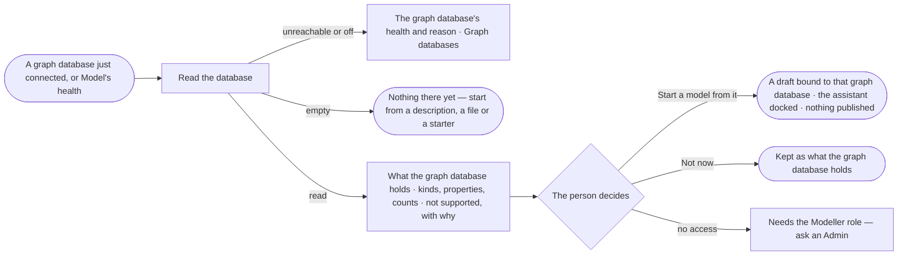

# SE-04 · Draft a model from the database

**As** a modeller with a graph database that already holds records **I want** Invana to read what is there and draft
a model from it **so that** the deployment answers in minutes, and I am not retyping a schema I already have.

Tasks: [task.md](task.md) · Feature: [SE-F01](../../feature.md)

## Who can

| Lens | Can | Otherwise sees |
|---|---|---|
| Admin | Read a graph database, see what it holds, and start a draft model from it | — |
| Operator | See what each graph database holds and the drafts on the map; a Modeller as Admin ([role table](../../../../../../os/access/features/AC-F02-access-policies/feature.md#the-role-table) › *Ontology*) | *Read the database* and *Start a model from it* disabled — *Needs the Modeller role — ask an Admin* |

## Flow

## Acceptance criteria

| # | Given | When | Then |
|---|---|---|---|
| SE-04.1 | A graph database that holds records | the person picks *Draft a model from what is there* after connecting it, or *Read the database* beside it on Model's health | Invana reads its kinds of node and relationship, their properties and counts — never a record — and shows them as *What <graph database> holds*, with the time it was read — never called the model |
| SE-04.2 | What a graph database holds is shown | the person picks *Start a model from it* | a new draft model bound to that graph database opens on its canvas with every kind staged and editable, the assistant docked beside it; nothing is published |
| SE-04.3 | A graph database with no records or kinds | it is read | *Nothing there yet* says to start a model from a description, a file or a starter, then load data — not a failure |
| SE-04.4 | The graph database is unreachable, or switched off for the deployment or for the person | the person reads it | the read is refused before it starts, showing its health or who switched it off, with *Open Graph databases* — never a modelling error |
| SE-04.5 | Kinds or property types the model cannot hold | the graph database is read | they are listed as *Not supported*, each with its reason, and left out of the draft |
| SE-04.6 | A graph database with hundreds of kinds | it is read | the counts show first and kinds page in; *Start a model from it* does not wait for every kind to draw |
| SE-04.7 | A published model | its graph database is read again | what it holds is replaced with the new read and its time; every published version is unchanged |
| SE-04.8 | A draft started from a graph database | nobody publishes it | it stays a draft; nothing reaches the stitched model everyone asks against |
| SE-04.9 | An Access Policy rule that denies agents a kind | the graph database is read | the read still lists that kind: the Modeller agent reads the schema whole, and no record |
| SE-04.10 | A read has finished | the person opens *How it got here* on what the graph database holds | it shows the run that read it, the person behind it, when, the calls it made marked schema-only, and what was left out and why |
| SE-04.11 | An Operator | they open Model's health | *Read the database* is disabled with *Needs the Modeller role — ask an Admin*; what each graph database holds still reads |
| SE-04.12 | A drafted model | it opens | it lists the assumptions the draft rests on and the option it recommends where it had a choice, each with its reason |

## Screens

| Surface | Lens | First use | Empty after a filter | Loading | Has data | Failed | Agent working or proposing | No access |
|---|---|---|---|---|---|---|---|---|
| Connect a graph database · the database | Admin | settings.databases.connect | — | settings.databases.connect · Testing | settings.databases.connect · Connected | settings.databases.connect · Unreachable | — | — |
| Connect a graph database · the database | Operator | — | — | — | — | — | — | — |
| Connect a graph database · shape the model | Admin | settings.databases.connect.shape · Nothing there yet | — | settings.databases.connect.shape · Reading | settings.databases.connect.shape | settings.databases.connect.shape · Unreachable | settings.databases.connect.shape · Drafting | — |
| Connect a graph database · shape the model | Operator | — | — | — | — | — | — | — |
| The draft | Admin | — | — | model.board.draft · Arriving | model.board.draft | — | model.board.draft · Assistant docked | — |
| The draft | Operator | — | — | — | model.board.draft · Read only | — | — | model.board.draft · Read only |
| What a graph database holds | Admin | model.health · Database not read | — | model.health · Reading the database | model.health · Database | model.health · Unreachable | — | — |
| What a graph database holds | Operator | model.health · Database not read | — | model.health · Reading the database | model.health · Database | model.health · Unreachable | — | model.health · Database read only |
