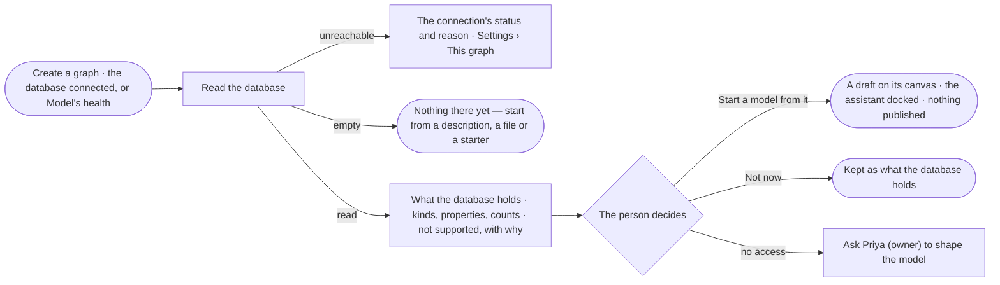

# SE-04 · Draft a model from the database

**As** a modeller with a graph database that already holds records **I want** Invana to read what is there and draft
a model from it **so that** a new Graph starts in minutes, and I am not retyping a schema I already have.

Tasks: [task.md](task.md) · Feature: [SE-F01](../../feature.md)

## Who can

| Lens | Can | Otherwise sees |
|---|---|---|
| Admin | Read the database, see what it holds, and start a draft model from it | — |
| Operator | See what the database holds and the drafts on the map | *Read the database* and *Start a model from it* disabled — *Ask Priya (owner) to shape the model*. With *Can shape the model*: as Admin |

## Flow

## Acceptance criteria

| # | Given | When | Then |
|---|---|---|---|
| SE-04.1 | A Graph whose database holds records | the person picks *Draft a model from what is there* while creating the Graph, or *Read the database* on Model's health | Invana reads its kinds of node and relationship, their properties and counts, and shows them as *What the database holds*, with the time it was read — never called the model |
| SE-04.2 | What the database holds is shown | the person picks *Start a model from it* | a new draft model opens on its canvas with every kind staged and editable, the assistant docked beside it; nothing is published |
| SE-04.3 | A database with no records or kinds | it is read | *Nothing there yet* says to start a model from a description, a file or a starter, then load data — not a failure |
| SE-04.4 | The database cannot be reached | the person reads it | the connection's status and its reason show, with *Open Settings › This graph* — never a modelling error |
| SE-04.5 | Kinds or property types the model cannot hold | the database is read | they are listed as *Not supported*, each with its reason, and left out of the draft |
| SE-04.6 | A database with hundreds of kinds | it is read | the counts show first and kinds page in; *Start a model from it* does not wait for every kind to draw |
| SE-04.7 | A published model | the database is read again | what the database holds is replaced with the new read and its time; every published version is unchanged |
| SE-04.8 | A draft started from the database | nobody publishes it | it stays a draft; nothing reaches the model everyone asks against |
| SE-04.9 | A view of the graph that hides a kind | the database is read | the read still lists that kind: no view narrows what the database holds |
| SE-04.10 | A read has finished | the person opens *How it got here* on what the database holds | it shows the run that read it, who started it, when, and what was left out and why |
| SE-04.11 | An Operator without *Can shape the model* | they open Model's health | *Read the database* is disabled with *Ask Priya (owner) to shape the model*; what the database holds still reads |
| SE-04.12 | A drafted model | it opens | it lists the assumptions the draft rests on and the option it recommends where it had a choice, each with its reason |

## Screens

| Surface | Lens | First use | Empty after a filter | Loading | Has data | Failed | Agent working or proposing | No access |
|---|---|---|---|---|---|---|---|---|
| Create a graph · the database | Admin | graphs.new_graph.connect | — | graphs.new_graph.connect · Testing | graphs.new_graph.connect · Connected | graphs.new_graph.connect · Unreachable | — | — |
| Create a graph · the database | Operator | — | — | — | — | — | — | — |
| Create a graph · shape the model | Admin | graphs.new_graph.shape · Nothing there yet | — | graphs.new_graph.shape · Reading | graphs.new_graph.shape | graphs.new_graph.shape · Unreachable | graphs.new_graph.shape · Drafting | — |
| Create a graph · shape the model | Operator | — | — | — | — | — | — | — |
| The draft | Admin | — | — | model.board.draft · Arriving | model.board.draft | — | model.board.draft · Assistant docked | — |
| The draft | Operator | — | — | — | model.board.draft · Read only | — | — | model.board.draft · Read only |
| What the database holds | Admin | model.health · Database not read | — | model.health · Reading the database | model.health · Database | model.health · Unreachable | — | — |
| What the database holds | Operator | model.health · Database not read | — | model.health · Reading the database | model.health · Database | model.health · Unreachable | — | model.health · Database read only |
