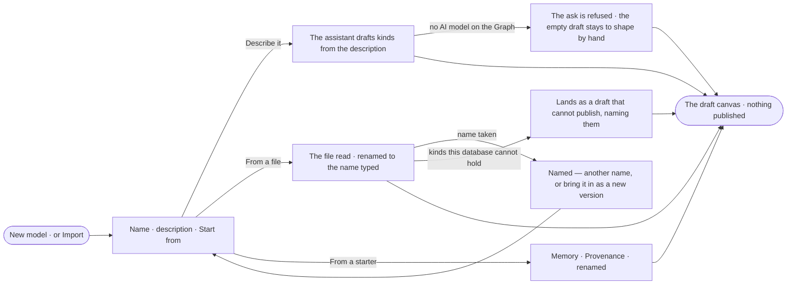

# SE-06 · Start a model from a description, a file or a starter

**As** a modeller **I want** to start a model by describing it in plain words, from a file, or from a starter
**so that** modelling is never a blank page, and a model I describe once is reused, not retyped.

Tasks: [task.md](task.md) · Feature: [SE-F01](../../feature.md)

## Who can

| Lens | Can | Otherwise sees |
|---|---|---|
| Admin | Open *New model*, start from a description, a file or a starter, and land on the new draft | — |
| Operator | — | *New model* and *Import* disabled — *Ask Priya (owner) to shape the model*. With *Can shape the model*: as Admin |

## Flow

## Acceptance criteria

| # | Given | When | Then |
|---|---|---|---|
| SE-06.1 | A person with *Can shape the model* | they pick *New model* | one dialog asks a name, a description and where to start — *Describe it* · *From a file* · *From an ontology* · *From a starter* · *Import a model file* |
| SE-06.2 | *Describe it* with a description | they pick *Open the draft* | the model and its empty draft are made, the draft canvas opens with the assistant docked, and the assistant stages kinds and relationships on the draft as it drafts them |
| SE-06.3 | The assistant has drafted a model | the person replies in the same conversation | the assistant changes the draft; nothing is published |
| SE-06.4 | A described model | its page opens | its head reads the description the person typed |
| SE-06.5 | A Graph with no AI model | the person describes a model | the ask is refused as every ask is, saying why, and the empty draft stays to shape by hand |
| SE-06.6 | *From a file* with a model file | they pick *Open the draft* | the model arrives under the name typed, as a draft on its canvas |
| SE-06.7 | *From a starter* | the person opens the starters | Memory (an observation, a claim drawn from observations, how the claim fared) and Provenance (a source, a record, the run that wrote it) are listed with what each holds; picking one lands it as a draft under the name typed |
| SE-06.8 | A name already used by a model in this Graph | the person opens the draft | the dialog says the name is taken beside the name field, offering another name or bringing it in as a new version of that model; nothing is made |
| SE-06.9 | A file or starter with a property type this database cannot hold | it arrives | it lands as a draft that cannot publish, naming each such type and why |
| SE-06.10 | A starter already in this Graph | a newer starter version ships | it is offered as a new version with what changes; it is never applied by itself |
| SE-06.11 | A draft from a starter | the person deletes the kinds they do not need | the rest stays a draft until they publish it |
| SE-06.12 | A model the assistant drafted | the person opens *How it got here* on the draft | it shows the conversation, the description it started from, and each kind it staged |
| SE-06.13 | An Operator without *Can shape the model* | they reach *New model* | it is disabled with *Ask Priya (owner) to shape the model* |
| SE-06.14 | A model drafted from a description, a file or a starter | it opens | it lists the assumptions the draft rests on and the option it recommends where it had a choice, each with its reason |

## Screens

| Surface | Lens | First use | Empty after a filter | Loading | Has data | Failed | Agent working or proposing | No access |
|---|---|---|---|---|---|---|---|---|
| New model | Admin | model.new | — | model.new · Reading the file | model.new · Starters | model.new · Name taken | — | — |
| New model | Operator | — | — | — | — | — | — | model.new · No access |
| The draft | Admin | model.board.draft · Empty draft | — | model.board.draft · Arriving | model.board.draft | model.board.draft · Cannot publish | model.board.draft · Assistant drafting | — |
| The draft | Operator | — | — | — | model.board.draft · Read only | — | — | model.board.draft · Read only |
| Create a graph · shape the model | Admin | graphs.new_graph.shape | — | graphs.new_graph.shape · Reading | graphs.new_graph.shape · Starters | graphs.new_graph.shape · Name taken | graphs.new_graph.shape · Drafting | — |
| Create a graph · shape the model | Operator | — | — | — | — | — | — | — |
