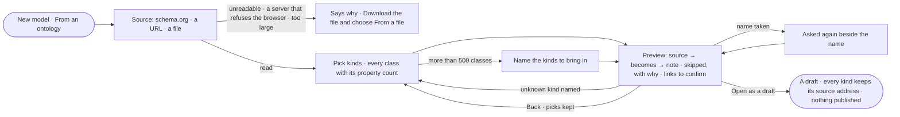

# SE-15 · Start a model from an ontology

**As** a modeller **I want** to start a model from an ontology — schema.org, RDFS or OWL — and see what maps and what
is skipped **so that** modelling starts from what my field already defined.

Tasks: [task.md](task.md) · Feature: [SE-F01](../../feature.md)

## Who can

| Lens | Can | Otherwise sees |
|---|---|---|
| Admin | Read an ontology, pick its kinds, preview the mapping and open it as a draft | — |
| Operator | — | *New model* disabled — *Ask Priya (owner) to shape the model*. With *Can shape the model*: as Admin |

## Flow

## Acceptance criteria

| # | Given | When | Then |
|---|---|---|---|
| SE-15.1 | *New model* · *From an ontology* | the person picks schema.org, a URL or a file in JSON-LD, Turtle or RDF/XML | Studio reads it and lists its classes with their property counts as the picker |
| SE-15.2 | An ontology with more than 500 classes | it is read | the picker asks for the kinds by name, label or address instead of listing them |
| SE-15.3 | Kinds picked, or none | the person picks *Preview* | the preview reads as a mapping — source → becomes → note: kinds of node with their properties, what came with each and what each inherits; relationships source → target; links to confirm; skipped constructs with their reasons. Nothing is written |
| SE-15.4 | A picked kind whose relationships point at a class not picked | the preview shows | that class comes with it, one level deep, and the preview says which relationship brought it |
| SE-15.5 | Subclasses in the ontology | the preview shows | each kind carries its ancestors' properties as its own, each inherited one naming its source |
| SE-15.6 | Restrictions, cardinalities, inverse or transitive properties, individuals and other constructs Invana cannot hold | the preview shows | each is listed as skipped with its reason; the count is the whole even when the list is cut |
| SE-15.7 | Equivalences in the ontology | the preview shows | they are listed as links between models to confirm in Model; none is made |
| SE-15.8 | The preview | the person picks *Open as a draft* | a new draft model lands on its canvas; every kind and property keeps its source address; nothing is published |
| SE-15.9 | A file that cannot be read, a remote context, more than 20 MB, or an unknown kind named | the person reads or previews | the dialog says why, naming the format and the line or the name; the picks are kept |
| SE-15.10 | A URL whose server does not let the browser read it | the person reads it | the dialog names the server and says *Download the file and choose From a file* |
| SE-15.11 | The name is used by a model in this Graph | the person opens the draft | the name is asked again beside the name field; nothing is made |
| SE-15.12 | Property types this database cannot hold | the draft opens | they are named, and the draft still lands, unable to publish until changed |
| SE-15.13 | The preview | the person picks *Back* | the picks are kept; a reload starts the dialog again |
| SE-15.14 | An Operator without *Can shape the model* | they reach *New model* | it is disabled with *Ask Priya (owner) to shape the model* |
| SE-15.15 | An ontology whose labels carry several languages | it is previewed | Each kind and property takes its label in the chosen language, else an untagged one, else any; names that clash are suffixed `_2`, and the preview says so |

## Screens

| Surface | Lens | First use | Empty after a filter | Loading | Has data | Failed | Agent working or proposing | No access |
|---|---|---|---|---|---|---|---|---|
| New model · from an ontology | Admin | model.new · Ontology | model.new · Ontology no match | model.new · Reading the ontology | model.new · Ontology preview | model.new · Ontology unreadable | — | — |
| New model · from an ontology | Operator | — | — | — | — | — | — | model.new · No access |
| The draft | Admin | — | — | model.board.draft · Arriving | model.board.draft | model.board.draft · Cannot publish | — | — |
| The draft | Operator | — | — | — | model.board.draft · Read only | — | — | model.board.draft · Read only |
