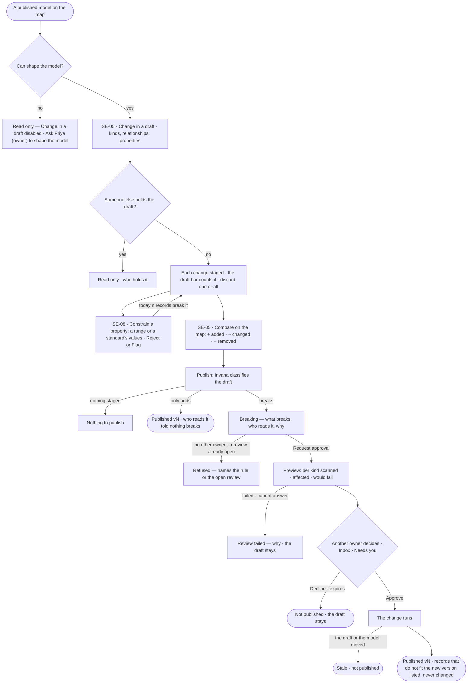
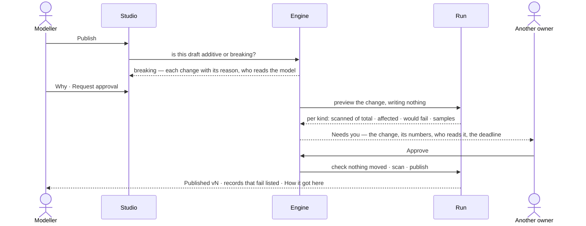

# Change and publish a model

> Every change to a model gathers in a draft, is compared on the map, and is published in one act. Invana says before
> publishing whether the change only adds or breaks what is already in the graph, who reads the model, and how many
> records a breaking change touches — and a breaking change waits for another owner's yes. The decision it helps
> make: *is this change safe to publish?*

## User journey

Journeys this feature is a step of: [J01 · From an empty install to a first answer](../../../../journeys/J01-from-an-empty-install-to-a-first-answer.md)

## Stories

| ID | Story | Status |
|---|---|---|
| SE-05 | [Change a model and publish it](stories/SE-05-change-a-model-and-publish-it/story.md) | idea |
| SE-08 | [Constrain a property's values](stories/SE-08-constrain-a-propertys-values/story.md) | idea |

## Access

| Act | Role (`.claude/team/TEAM.md` §7) | Everyone else sees |
|---|---|---|
| Read a model, its draft, its comparison and its reviews | Operator — every member | — |
| Change in a draft · stage, discard · constrain a property | `modeller` · shown as *Can shape the model* | *Change in a draft* disabled — *Ask Priya (owner) to shape the model* |
| Publish a draft that only adds · request approval for a breaking one | `modeller` · shown as *Can shape the model* | *Publish* hidden; the draft reads |
| Approve or decline a breaking publish | `owner`, other than the person who asked | Not asked; the review reads *waiting on approval* |

## States

| State | What the person sees |
|---|---|
| First use | A published model with no draft: *Change in a draft*; a draft with nothing staged: *Publish* disabled with *Nothing to publish* |
| Empty after a filter | — |
| Loading | The draft bar counts while changes save; the publish confirm reads *Checking what this changes…*; a review reads *previewing* with its run |
| Has data | The draft on its canvas, changed kinds chipped, the draft bar `n staged · Discard · Publish vN` |
| Failed | A refused change says why where it was made; a failed preview says why and keeps the draft; a stale review says what moved |
| Agent working or proposing | An agent's changes arrive staged on the same draft as a person's; the preview run scanning records |
| No access | The model and its draft read; every change disabled with *Ask Priya (owner) to shape the model* |

## Rules

| Rule | Detail |
|---|---|
| Everything stages | Adding, changing and deleting kinds, relationships, properties and constraints join one draft; nothing reaches a version until it is published |
| One draft, one writer at a time | The draft is kept by Invana, survives a reload and is seen by everyone; while one person holds it, others read it |
| An agent stages like a person | A run's changes join the same draft and the same publish |
| A published version never changes | Changing it publishes the next version; answers and loads that used the old one still resolve to it |
| Breaking, change by change | A draft breaks when any one change does: a kind removed · a property removed · a property's type changed · a property narrowed (list to single, list to set, a unique or exists constraint, a range or a standard's values added or changed) · a relationship's ends narrowed · its multiplicity changed · a key added, removed or changed · a kind's validation, parent or abstract flag changed. Adding, widening, removing a constraint that is not a key, an index or a description only adds |
| A model never published only adds | There is nothing in the graph it can break |
| One way past a breaking change | A review: a preview that writes nothing, another owner's yes, then the change runs. Nothing bypasses it |
| Counts are of what was read | The preview reads at most 1,000 records a kind and says so — *first 1,000 of 52,310* — never extrapolating |
| Data is never rewritten | Publishing changes what the model says; records that do not fit the new version are listed, never changed or deleted |
| Who reads it | The loads into a touched kind, the rules and derivations on it, and the links between models on it. Runs do not pin a model version, so a run is not a reader |
| A constraint is one property on one kind | A range with a unit, or one standard's values; Reject or Flag for review. Checked by one check wherever a record lands — every load and every edit on a board |
| One constraint a property, versioned with the model | Saving a range or a standard replaces the one the property had; a pattern or a length rule stays beside it. A kind carries its own properties — a broader kind is meaning only (SE-F04) — so a constraint is always on the kind that has the property. A constraint is staged, compared and published with the draft like a property |
| Leans on | SE-F01 — the draft · SE-F06 — links that read a model · SE-F05 — the standards a constraint names · RC-F02 — the loads into it · Inbox — the approval |

## Data touched

| Record | Read or write |
|---|---|
| Model draft — its staged changes, who holds it | Read · write |
| Model versions and the comparison between two | Read · write on publish |
| Publish review — classification, changes, preview, why, requester, approval, runs, status | Read · write |
| Approval in Inbox › Needs you — the impact list, frozen when the preview settles | Write |
| Constraint on a property — range and unit, or the standard version and term, and what happens on a break | Read · write |
| Standards and their values | Read |
| Graph records | Read — counted by the preview and by *today n break it* |

## Engine

The low-level design: what this feature stores, serves and refuses. Conventions — naming, errors, lists, events — are
[system-design.md](../../../../system-design.md) §§ 6–8; this section only fills them in.

### Records

| Table | Columns | Notes |
|---|---|---|
| `model_versions` | `model_id` · `number` · `state` (`draft` · `published`) · `content_hash` · `axes` (`time` · `geo` · `dims`) · `held_by_id` · `published_by_id` · `published_at` · `why` | One `draft` row a model; `held_by_id` is who holds it. A published row never changes |
| `model_property_keys` | `version_id` · `name` · `type` · `cardinality` (`single` · `list` · `set`) · `source_iri?` (≤2048) | Shared by every kind in the version |
| `model_node_types` · `model_edge_types` | `version_id` · `name` · `description` · `source_iri?` (≤2048); an edge type adds its source and target kinds and its multiplicity | — |
| `model_type_properties` | `type_id` · `key_id` · `order` | Which key a kind carries |
| `model_validation_rules` | `version_id` · `type_property_id?` · `key_id?` · `rule_type` (`range` · `standard` · `pattern` · `enum` · `min_length` · `max_length`) · `min` · `max` · `unit` (≤32, a label) · `standard_version_id?` · `standard_ref` (`publisher/name@v`) · `term` · `params` · `on_break` (`reject` · `flag`) | On a kind's mapping of a key, or on the key itself. `params` holds the standard's values copied at save; `standard_version_id` is `SET NULL` when that version goes |
| `model_constraints` · `model_indexes` | `version_id` · `type_id` · `properties` · `kind` (`unique` · `exists`, constraints only) | Staged like a kind |
| `model_schema_projections` | `version_id` · `statement` · `kind` · `label` · `properties` | One row per statement pushed to the database, so drift is matched against it |
| `model_publish_reviews` | `model_id` · `version_id` · `base_version_id` · `draft_hash` · `classification` · `changes` · `preview` · `result` · `why` · `requested_by_id` · `approval_id` · `preview_run_id` · `run_id` · `published_version_id` · `status` (`previewing` · `pending` · `migrating` · `published` · `failed` · `declined` · `expired` · `stale`) · `reason` | One open (`previewing` · `pending` · `migrating`) a model |

### Reads

| Record | Owner |
|---|---|
| The model, its name and status | [SE-F01](../SE-F01-start-a-model/feature.md#engine) |
| Standards and their versions | [SE-F05](../SE-F05-standards/feature.md#engine) |
| Links between models on a touched kind | [SE-F06](../SE-F06-links-and-mappings/feature.md#engine) |
| Rules and derivations on a touched kind | [SE-F07](../SE-F07-rules/feature.md#engine) · [SE-F08](../SE-F08-inference/feature.md#engine) |
| The Graph's rules on properties a preview and a change run under | [SE-F09](../SE-F09-views-of-the-graph/feature.md#engine) |
| Loads into a touched kind · the load that checks a constraint | [RC-F02](../../../records/features/RC-F02-bring-records-in/feature.md#engine) |
| The approval a breaking publish waits for, its deadline and reminder | [AC-F05](../../../../os/access/features/AC-F05-asks-and-approvals/feature.md#engine) |
| Runs and the packaged plans they run | [AG-F03](../../../agents/features/AG-F03-runs-and-how-the-agents-are-doing/feature.md#engine) · [AG-F06](../../../agents/features/AG-F06-plans-and-functions/feature.md#engine) |
| The server version's property types | [RT-F05](../../../../os/runtime/features/RT-F05-graph-database-connectors/feature.md#engine) |
| History — every event this feature writes | [AC-F06](../../../../os/access/features/AC-F06-history/feature.md#engine) |

### Routes

| Route, after `/api/v1/u/{u}/{g}/model/models/{id}` | Does | Story |
|---|---|---|
| `GET /versions` · `GET /versions/{vid}` | A model's versions and its draft · one version whole | SE-05 · SE-09 |
| `GET /versions/{vid}/node-types` · `/edge-types` · `/property-keys` · `/constraints` · `/indexes` — each `GET` · `POST` · `PATCH` · `DELETE` on the draft | Read a version's parts · stage a change on the draft | SE-05 |
| `GET /versions/{to}/diff?against=` | Compare any two: marks per kind, lines with signs, `next_version`; a first version against nothing reads every kind added | SE-05 · SE-09 |
| `PUT /versions/{draft}/property-constraints` · `DELETE /versions/{draft}/property-constraints/{rule_id}` | Stage one constraint on a kind's property — `kind` (`range` · `standard`), `min` · `max` · `unit`, or `standard` and `term`, and `on_break` (default `reject`) · stage its removal | SE-08 |
| `POST /versions/{draft}/property-constraints/check` | *Today n records break it*: `label` · `counted` · `breaking` · up to five `samples` · `reason` when it cannot count; writes nothing | SE-08 |
| `GET /draft/staged` · `POST /draft/discard` | The staged changes · discard one or all | SE-05 |
| `GET /draft/review` | `classification` (`additive` · `breaking`) · `base_version` · `changes[]` (`kind` · `target` · `breaking` · `reason`) · `added` · `changed` · `removed` · who reads it | SE-05 |
| `GET /draft/projection` | The draft's statements against the live database or the published version, unsupported operations listed | SE-05 |
| `POST /publish` | `{why, approvers?, deadline_s?}` — the one way a draft becomes a version; returns `published`, or `review` with its id | SE-05 |
| `GET /publish-reviews` | The model's reviews, each with its status and runs | SE-05 |

| Route, after `/api/v1/u/{u}/{g}/model` | Does | Story |
|---|---|---|
| `GET /models/property-constraints/standards` | The standards with a term that has values: `standard` · `title` · `version` · `term` · `values` (a count) | SE-08 |
| `GET /schema/active-version` | Each model's published version the Graph reads now | SE-05 |

### Events

| Event | When |
|---|---|
| `model.models.stage` · `model.models.unstage` | A change staged on the draft · discarded |
| `model.models.review` | A breaking publish asks for approval: `review_id` · `why` |
| `model.models.publish` | A version publishes: `review_id` and `why` on a reviewed one |

### Refusals

| Status | When | Sentence | Criterion |
|---|---|---|---|
| 403 | A change, constraint or publish by someone without *Can shape the model* | *This needs Can shape the model — ask {owner}.* | SE-05.22 · SE-08.16 |
| 409 | A change to a draft another person holds | *{person} holds this draft — it reads only.* | SE-05.6 |
| 422 | A property type the connected server version cannot hold | *{type} is not available on {database} {version}.* | SE-05.27 |
| 409 | Publishing a draft with nothing staged | *Nothing to publish.* | SE-05.10 |
| 409 | Publishing a model whose kinds use a property type the server cannot hold | *{model} uses {types}, which {database} {version} cannot hold.* | SE-05.24 |
| 409 | A breaking publish with no owner but the requester, or with a review already open on the model | *No other owner can approve this.* · *{model} already has a review open — {review}.* | SE-05.13 |
| 422 | A range on a text property, a minimum above the maximum, or a term with no values | *{property}: {why}.* | SE-08.7 |
| 422 | A record a load or a board edit writes outside a published `reject` constraint — on the writing route | *`{Kind}.{property}` breaks its constraint {label}: {value}.* | SE-08.11 |

### CLI

| Command | Does |
|---|---|
| `invana models publish <model> [--why] [--dry-run]` | Says whether the draft adds or breaks; one that adds publishes, one that breaks opens the review; `--dry-run` writes nothing |

### Mechanisms

| Mechanism | How |
|---|---|
| A key is named on its kind | Naming a property on a kind makes its `model_property_keys` row, or reuses the one of that name |
| A key-level rule | A `model_validation_rules` row on the key itself, not a kind's mapping, is read and enforced like one on a mapping |
| One constraint a property | Saving replaces that mapping's `range`, `enum` or `standard` row; `pattern` and length rows stay. An inherited property's row is the inheriting kind's own mapping; the parent is untouched |
| The check | Every load and every board edit reads the published row: `reject` refuses the record, `flag` lands it and lists it. A record with no value does not break it |
| Classification | `GET /draft/review` classifies change by change by the rule *Breaking, change by change*; a never-published model only adds |
| Who reads it | Read at review: the loads into a touched kind, the rules and derivations on it, the links on it |
| The preview is a run | `model.migrate` bound `schema_write`, `apply = false`, the packaged plan `model-migration@1`, no agent, no view; it reads at most 1,000 records a kind and returns per kind `scanned` · `total` · `affected` · `would_fail` · samples |
| The Graph's rules bind | The preview and the change run only where an allow in the Graph's rules on properties admits the published version; a refusal fails the review with the rule |
| The impact is frozen | The approval opens only when the preview succeeds; its payload — the breaking changes, the preview's counts, who reads the model, the why — is fixed then and never recomputed. A failed preview ends the review with no approval |
| Approvers | Every owner but the requester, unless `approvers` names some; `deadline_s` defaults to 72 hours |
| The clock moves it | The access clock settles a preview into an approval, opens the change run after a yes, expires a review past its deadline and fails one whose run ended without its result |
| Exactly what was approved | The change run (`model.migrate`, `apply = true`) checks `draft_hash` and the base version; a difference sets `stale` and publishes nothing. On success it publishes and lists the records that do not fit, unchanged |
| Pushing statements | Publishing pushes constraints and indexes only through the function `project_model`, bound `schema_write`, writing a `model_schema_projections` row per statement; the engine never writes the database's data here |
| An agent stages | `model.understand_ask` binds the draft and the conversation; `model.validate_proposal` (needs `model.propose`) checks referential integrity and stages. Both write the draft, never the database |
| Discard | A draft is not a version: discarding removes its rows |

## System impact

| HLD section | Change | NFRs |
|---|---|---|
| § 6 Data and storage | The version, key, kind, constraint, projection and review tables in Invana's own store | — |
| § 8 APIs and events | The routes and events above, under `model` | — |
| § 9 Distributed execution | The preview and the change are runs of `model-migration@1`, moved by the access clock | — |
| § 10 AI and agents | Two agent functions stage on the draft: `model.understand_ask` · `model.validate_proposal` | — |
| § 11 Failure modes and the outside boundary | Only `project_model` writes to the database's schema; a preview reads at most 1,000 records a kind | — |

## Decisions

| Decision | Detail |
|---|---|
| The canvas draws; the draft bar writes | Adding a kind, adding a relationship and deleting are acts on the bar over the canvas and the kind's form, never canvas gestures |
| One model draws on the map's board | A model's canvas is SE-F06's map with one frame — the same board, layout, hues and Detail — and opens on *Cards*, since one model's few kinds have room for names and counts. The draft bar, the kind's form and the read-only footer sit around the canvas, never on it |
| A delete stages | Its confirm says *gone when you publish*, naming what depends on it before, not after |
| Staged first | In every list, staged rows sort first with a *staged* chip |
| Publish asks first | *Publish* reads whether the draft adds or breaks before its confirm opens. Adding: the changes, what the database is asked to hold, *Who reads it* and *None of them break*, then *Publish vN*. Breaking: *— breaking*, a banner naming each breaking change and its reason, who reads it, a *Why* field and *Request approval* |
| The review in the confirm | After the request the confirm reads *previewing* with its run, then per kind *scanned of total · affected · would fail*, then *waiting on approval* linked to Inbox › Needs you. A refusal shows the engine's sentence |
| Approvers | Every owner but the requester, unless the request names some; with none, it is refused before anything opens. The deadline is 72 hours by default — a reminder at half time, *expired, not published* at the end |
| Publish exactly what was approved, or nothing | If the draft or the published version moved after the request, the review is *stale* and nothing publishes |
| One open review a model | A second request while one is previewing, waiting or running is refused, naming it |
| Compare is any two versions, on the map | The Comparing bar: *from* → *to* among a model's versions and its draft, `+ n added · ~ n changed · − n removed`, *Review and publish* while *to* is the draft. Each changed kind wears one chip of its lines, toned by its strongest sign; an added kind is a dashed ghost, a removed one keeps its place |
| A standard's values are copied when the constraint is saved | A newer standard version reaches the model only when the constraint is saved again |
| Reject is the default | Flag lets the record land and lists it in the load's report and in the constraint's count |
| *Today n records break it* is counted by the engine | Before saving, with up to five named; nothing written. A database it cannot count on says so, and the constraint still saves |
| A property is named on its kind | Naming a property on a kind makes its key, or reuses the key of that name; keys are shared by every kind in the version |
| Indexes and keys stage like kinds | An index, a unique and an exists constraint are added and removed in the draft; an index only adds, a unique or exists constraint breaks |

## Open questions

| Question | Who answers |
|---|---|
| — | — |

## Not building

| Item | Why not |
|---|---|
| Writing from a canvas gesture — drag to connect, add on the canvas, a context menu | The canvas draws; the bar and the form write |
| Layout saved per kind · auto-layout that rewrites an arranged model | Layout is a view, not part of the model |
| Live co-editing of a draft | One writer, with who holds it visible, is honest at this scale |
| Rewriting or deleting records to fit a new version | Records are loaded against a version, not rewritten by one |
| Withdrawing a review | Decline it, or change the draft — it goes stale |
| Extrapolated counts | A number nobody read is a guess |
| A rule loosened as a breaking publish | Rules are not part of a model version (SE-F09) |
| Unit conversion | The unit is a label; values compare as written |
| Pattern, length and allowed-list constraints in the dialog | The dialog authors a range or a standard's values; the others read on the kind's mappings |
| Constraints from SHACL | Later |
| Authoring a standard in a model's draft | Standards are the install's library (SE-F05) |
| Counting breaks on a Gremlin database | The count says it cannot count there |
