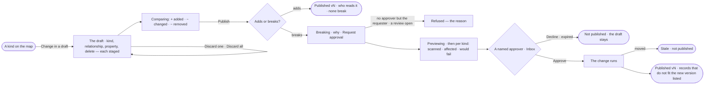

# SE-05 · Change a model and publish it

**As** a modeller **I want** to change a model in a draft, compare it with what is published on the map, and see who
reads the model and what breaks before I publish **so that** publishing never surprises anyone, and a breaking change
reaches its graph database only with a named approver's yes.

Tasks: [task.md](task.md) · Feature: [SE-F02](../../feature.md)

## Who can

| Lens | Can | Otherwise sees |
|---|---|---|
| Admin | Change a model in a draft, compare it, publish a change that only adds, request approval for a breaking one; approve or decline one as a named approver of the Modeller agent who did not ask | — |
| Operator | Read the model, its draft, the comparison and its reviews; a Modeller as Admin ([role table](../../../../../../os/access/features/AC-F02-access-policies/feature.md#the-role-table) › *Ontology*); anyone named an approver of the Modeller agent approves | *Change in a draft* disabled — *Needs the Modeller role — ask an Admin*; *Publish* hidden |

## Flow

## Acceptance criteria

| # | Given | When | Then |
|---|---|---|---|
| SE-05.1 | A published model and a person with *Can shape the model* | they pick *Change in a draft* on the map or a kind | the model's draft opens full-bleed on its canvas with the crumb `Model › <model> vN · draft` and the draft bar `n staged · Discard · Publish vN` |
| SE-05.2 | An open draft | the person adds a kind, adds a relationship between two kinds, adds or removes a property, or deletes | each joins the draft as a staged change, sorted first with a *staged* chip; nothing reaches the model yet |
| SE-05.3 | A staged delete with dependents | the person confirms it | the confirm says it goes when published and names what depends on it |
| SE-05.4 | Staged changes | the person discards one, or all | that change, or every change, leaves the draft; the model is as published |
| SE-05.5 | A draft | the person reloads, or someone else opens the model | the staged changes are still there for everyone |
| SE-05.6 | A draft held by one person | another opens it | they read it, with who holds it |
| SE-05.7 | An agent run that changes the model | it stages | its changes join the same draft, marked as the agent's, and publish with it |
| SE-05.8 | A model with a draft | the map opens | the Comparing bar reads *from* the active version *to* the draft, `+ n added · ~ n changed · − n removed`; each changed kind wears one chip of its lines, an added kind is a dashed ghost, a removed one keeps its place with its `−` chip |
| SE-05.9 | The Comparing bar | the person picks any two versions of one model | the counts and the marks change together, from one comparison; *Review and publish* shows only while *to* is the draft |
| SE-05.10 | A draft with nothing staged | the person reaches *Publish* | it is disabled with *Nothing to publish* |
| SE-05.11 | A draft that only adds | the person picks *Publish* | the confirm lists the changes, what the database is asked to hold, *Who reads it* — the loads into a touched kind, the rules on it and the links between models on it — and *None of them break*; *Publish vN* publishes it now |
| SE-05.12 | A draft with any breaking change | the person picks *Publish* | the confirm reads *Publish <model> — breaking · needs approval*, naming the approvers, a banner naming each breaking change and its reason, who reads it, a *Why* field and *Request approval* |
| SE-05.13 | The Modeller agent has no approver but the requester, or a review is already open on the model | the person requests approval | it is refused before anything opens, naming why or the open review |
| SE-05.14 | A requested review | the preview runs | the confirm reads *previewing* with its run, then per kind *scanned of total · affected · would fail* and up to three samples before and after; nothing is written |
| SE-05.15 | More records than the preview reads | it settles | the counts read *first 1,000 of 52,310*, never extrapolated |
| SE-05.16 | The preview fails, the graph database is unreachable or off, or an Access Policy rule stops it | it settles | the review is *failed* with why; nobody is asked; the draft stays |
| SE-05.17 | A settled preview | the ask is raised | every named approver of the Modeller agent but the requester sees it in Inbox › Needs you and their channels with the changes, the numbers and who reads it, frozen as shown, and a deadline — 72 hours unless set; unanswered, it reminds, escalates and expires as AC-F05 says |
| SE-05.18 | A named approver who did not ask | they approve | the change runs: if the draft or the published version moved since the request the review is *stale* and nothing publishes; else the version publishes and the records that do not fit the new version are listed on the run, unchanged |
| SE-05.19 | An approval | it is declined, or its deadline passes | *Not published* with the note or *expired*; the draft stays a draft |
| SE-05.20 | A published version | the person opens *How it got here* on it | it shows who published it, why, the review and its approver, and the runs that previewed and published it |
| SE-05.21 | A published version | anyone opens it | it reads; changing it opens the draft for the next version |
| SE-05.22 | An Operator | they select a kind | *Change in a draft* is disabled with *Needs the Modeller role — ask an Admin*; *Publish* is not shown |
| SE-05.23 | A model whose graph database is read-only | a version publishes | it publishes; the confirm and the version list each constraint and index as *not pushed — read-only*, and nothing is written to the graph database |
| SE-05.24 | A model whose kinds use a property type its graph database's server version cannot hold | the model or its draft opens | A banner on its head names each type and the server version, and *Publish* is refused naming them |
| SE-05.25 | An open draft | the person adds or removes an index, or a unique or exists constraint, on a kind's property | It is staged like any change and named in the comparison; adding an index only adds, and a unique or exists constraint breaks |
| SE-05.26 | A draft and a Modeller or an Admin | they publish from the command line | The command says whether the draft adds or breaks; one that adds publishes, one that breaks opens the same review as Studio, and `--dry-run` writes nothing |
| SE-05.27 | An open draft | the person gives a property a type its graph database's server version cannot hold | It is refused where it was picked, naming the type and the server version; nothing is staged |

## Screens

| Surface | Lens | First use | Empty after a filter | Loading | Has data | Failed | Agent working or proposing | No access |
|---|---|---|---|---|---|---|---|---|
| The map · Comparing | Admin | model.board | — | model.board · Comparing loading | model.board · Comparing | — | — | — |
| The map · Comparing | Operator | model.board | — | model.board · Comparing loading | model.board · Comparing | — | — | model.board · Read only |
| A kind | Admin | — | — | — | model.board.kind | — | — | — |
| A kind | Operator | — | — | — | model.board.kind · Read only | — | — | model.board.kind · Read only |
| The draft | Admin | model.board.draft · Nothing staged | — | model.board.draft · Saving | model.board.draft | model.board.draft · Change refused | model.board.draft · Agent staging | model.board.draft · Held by another |
| The draft | Operator | — | — | — | model.board.draft · Read only | — | — | model.board.draft · Read only |
| Publish | Admin | — | — | model.board.draft.publish · Checking | model.board.draft.publish | model.board.draft.publish · Refused | model.board.draft.publish · Previewing | — |
| Publish | Operator | — | — | — | — | — | — | — |
| Publish · breaking | Admin | — | — | model.board.draft.publish · Breaking previewing | model.board.draft.publish · Breaking | model.board.draft.publish · Review failed | model.board.draft.publish · Waiting on approval | — |
| Publish · breaking | Operator | — | — | — | — | — | — | — |
| The approval | Admin | — | — | inbox · Loading | inbox · Publish approval | inbox · Stale | — | — |
| The approval | Operator | — | — | inbox · Loading | inbox · Publish approval | inbox · Stale | — | — |
