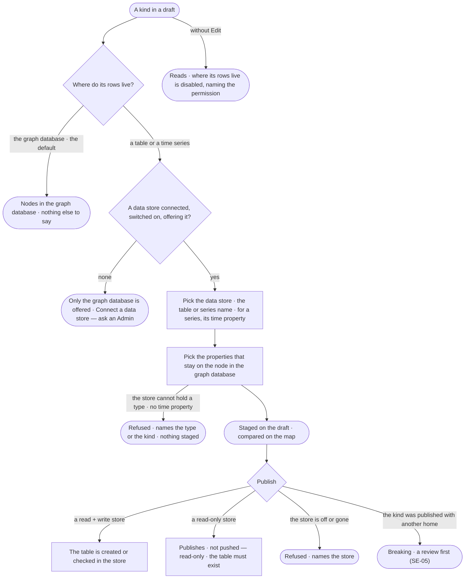

# SE-23 · Store a kind's rows in a table

**As** a modeller **I want** to say that a kind's rows live in a table or a time series of a connected data store **so that** bulk rows and measurements stay where they are held well, and the graph database holds only what points to them.

Tasks: [task.md](task.md) · Feature: [SE-F02](../../feature.md)

## Who can

Where a kind's rows live is part of the kind in a draft, so it needs Edit on `model/<model>` ([the permission catalogue](../../../../../../os/access/features/AC-F02-access-policies/feature.md#the-permission-catalogue)). The data stores offered are the ones an Admin connected ([CP-84](../../../../../../os/control/features/CP-F13-data-stores/stories/CP-84-connect-a-data-store/story.md)).

| Access | Can | Otherwise sees |
|---|---|---|
| Admin | In a draft, choose a kind's home — the graph database, a table or a time series of a connected, switched-on data store — and see what a change breaks | — |
| Operator | Read each kind's home and its store. With Edit on the model, chooses a home as an Admin does | *Where its rows live* is disabled — *Needs Edit on the {model} model — ask {who can grant}* |

## Flow

## Acceptance criteria

| # | Given | When | Then |
|---|---|---|---|
| SE-23.1 | A kind open in a draft | the person opens *Where its rows live* | it offers *The graph database* — chosen by default — and, for each connected, switched-on data store, each home its connector offers (*Table* · *Time series*), naming the store |
| SE-23.2 | *Table* chosen | the person picks a data store | they name the table, an existing one read from the store or a new one, and pick which properties stay on the node in the graph database; the rest are read from the store |
| SE-23.3 | *Time series* chosen | the person picks a data store | they also pick the one time property that orders the series; the series' points are never copied into the graph database |
| SE-23.4 | A data store whose connector does not offer a home | it is chosen for that home | it is refused — *{store} cannot hold a {home}.* — and nothing is staged |
| SE-23.5 | A series chosen for a kind with no time property | the person saves | it is refused — *A series needs a time property — {kind} has none.* |
| SE-23.6 | A property whose type the data store cannot hold | the person saves | it is refused — *{type} is not available in {store}.* |
| SE-23.7 | A kind whose rows live in a data store | its records are read | each record is one node holding its key, its pointer and the kept properties; every other property is read from the store when looked at, and *How it got here* names the store and the table |
| SE-23.8 | A kind staged with a home | the draft is compared | the kind shows a *staged* chip and its home among its changed lines |
| SE-23.9 | A draft whose kind lives in a data store that is switched off or removed | it is published | it is refused — *{store} is off — switch it on, or pick another home for {kind}.* |
| SE-23.10 | A kind publishing to a read + write data store | the publish runs | its table or series is created, or checked when it exists, in the store; the projection reads *pushed* |
| SE-23.11 | A kind publishing to a read-only data store | the publish runs | the version publishes and the projection reads *not pushed — read-only*; the table must already exist for its rows to read |
| SE-23.12 | A published kind | its home changes in a draft | the change is breaking — it opens the review of [SE-05](../SE-05-change-a-model-and-publish-it/story.md) with the kind's record count — and no rows are moved by publishing |
| SE-23.13 | A kind whose data store is switched off or failing | someone reads its records | the kind reads *Rows unavailable — {store} is off* or the store's own words; the nodes in the graph database still read |
| SE-23.14 | No data store connected | the person opens *Where its rows live* | only *The graph database* is offered, with *Connect a data store — ask an Admin* |
| SE-23.15 | A person without Edit on the model | they open a kind | its home reads; *Where its rows live* is disabled with *Needs Edit on the {model} model — ask {who can grant}*; the engine refuses it the same |
| SE-23.16 | An agent staging a kind | it proposes a home | the proposal waits as part of the draft for the person's yes, and *How it got here* shows the steps and the stores it read |

## Screens

| Surface | Access | First use | Empty after a filter | Loading | Has data | Failed | Agent working or proposing | No access |
|---|---|---|---|---|---|---|---|---|
| Where its rows live | Admin | model.models · Kind · Rows · The graph database | — | model.models · Kind · Rows · Loading stores | model.models · Kind · Rows · Table | model.models · Kind · Rows · Refused | model.models · Kind · Rows · Proposed | — |
| Where its rows live | Operator | model.models · Kind · Rows · Read only | — | model.models · Kind · Rows · Loading stores | model.models · Kind · Rows · Read only | model.models · Kind · Rows · Refused | — | model.models · Kind · Rows · Read only |
| A time series | Admin | — | — | — | model.models · Kind · Rows · Time series | model.models · Kind · Rows · Refused | — | — |
| A time series | Operator | — | — | — | model.models · Kind · Rows · Read only | — | — | model.models · Kind · Rows · Read only |
| No data store | Admin | model.models · Kind · Rows · No data store | — | — | — | — | — | — |
| No data store | Operator | model.models · Kind · Rows · No data store · Read only | — | — | — | — | — | model.models · Kind · Rows · Read only |
| A store that is off | Admin | — | — | — | — | model.models · Kind · Rows unavailable | — | — |
| A store that is off | Operator | — | — | — | — | model.models · Kind · Rows unavailable | — | — |
