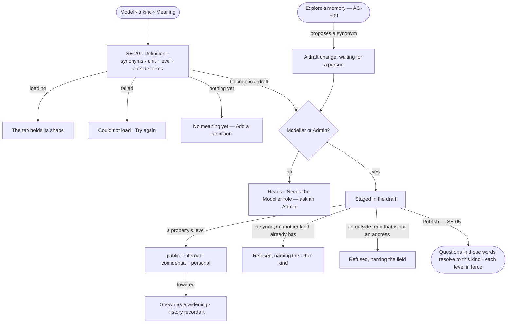

# Meaning

> What each kind and property means, in words people and agents share: a definition, the synonyms people ask with, the
> unit a value is in, the outside terms it is the same as — an address, a schema.org type, a *same as* elsewhere — and
> how sensitive each property is: one of four levels that decide which agents read it and where it may go. Published
> with the model. The decision it helps make: *when someone asks in their own words, which kind and property do they
> mean — and how carefully must it be kept?*

## User journey

## Stories

| ID | Story | Status |
|---|---|---|
| SE-20 | [Say what a kind means](stories/SE-20-say-what-a-kind-means/story.md) | idea |

## Access

| Act | Role ([the role table](../../../../os/access/features/AC-F02-access-policies/feature.md#the-role-table)) | Everyone else sees |
|---|---|---|
| Read a kind's and a property's meaning, and each property's level | Every signed-in person — Operator, Modeller, Admin | — |
| Change a definition, synonym, unit, outside term or a property's level in a draft · accept a proposed one | Modeller · Admin | Absent; *Needs the Modeller role — ask an Admin* |

## States

| State | What the person sees |
|---|---|
| First use | *No meaning yet — a definition and the words people ask with help every question find this kind*, with *Add a definition* |
| Empty after a filter | — |
| Loading | The tab holds its shape |
| Has data | The definition, synonyms as chips, the unit and the level per property, outside terms each with its source |
| Failed | *Could not load*, with *Try again*; a refused change names the field or the level |
| Agent working or proposing | A proposed synonym from Explore's memory, waiting with *Accept into the draft* · *Dismiss* |
| No access | Every part reads; the acts are absent |

## Rules

| Rule | Detail |
|---|---|
| Meaning is a tab on a kind | *Meaning* beside Properties · Indexes · Constraints · Mappings; a property's meaning sits on its row |
| Five parts | **Definition** — one or two sentences · **Synonyms** — the words people ask with, unique across the published models of a Graph · **Unit** — per number property, from a fixed list · **Outside terms** — an address (IRI), a schema.org type or property, or a *same as* address elsewhere · **Level** — per property, one of four |
| Four levels | `public` · `internal` · `confidential` · `personal`, set per property of a kind in Meaning. A property no one has set is `internal`. *Sensitive* means confidential or personal |
| A level is set in a draft | A Modeller or an Admin sets it in the model's draft; it is published with the model, in force from that version, and never changes a record. A level is the model's, never a policy file's |
| Access Policies read the level | A read of a property is checked as `data/<graph database>/<kind>/<level>` ([AC-F02](../../../../os/access/features/AC-F02-access-policies/feature.md#mechanisms)); an agent that may not Read that level does not receive the property, and the result counts it withheld |
| Confidential and personal stay inside | They never go to an external AI model, an outside tool or an outside agent; what an export, a published report, an MCP client, an outside runtime or a channel carries leaves them out, and says what it left out ([AC-F09](../../../../os/access/features/AC-F09-what-left-the-platform/feature.md#engine)) |
| A derived value keeps the highest level | A derived fact's property takes the highest level of the properties it was derived from; a derivation never lowers it ([SE-F08](../SE-F08-inference/feature.md)) |
| Lowering a level is a widening | A draft that lowers a property's level shows it as a widening — more agents and more exits reach it — in the review before publish, and History records who lowered it, from what, to what |
| Versioned with the model | Meaning is staged in the draft and published with it; it never changes a record and never breaks a version |
| Grounding reads it | A question's words resolve against kind names, then synonyms; the answer's *How it got here* names the synonym that matched |
| Imports carry meaning | A definition, alternative labels and source addresses from an import (SE-15 · SE-F05) land as meaning; an import never sets a level — a person does |
| A proposal is a draft change | A synonym or definition from Explore's memory (AG-F09) or an agent waits in the draft until a person accepts it |
| Leans on | SE-F02 — the draft and publish · SE-F05 — a standard's terms an outside term may name · SE-F06 — a mapping to a standard · AG-F09 — proposed synonyms · AC-F02 — the rules that read a level · AC-F09 — the outbound check · SE-F08 — derived values |

## Data touched

| Record | Read or write |
|---|---|
| Meaning of a kind or property — definition, synonyms, unit, outside terms, level, where each came from | Read · write (in the draft) |
| Model version | Read |
| The History row of each level change (AC-F06) | Write |

## Engine

The low-level design: what this feature stores, serves and refuses. Conventions — naming, errors, lists, events — are
[system-design.md](../../../../system-design.md) §§ 6–8; this section only fills them in. This feature owns the four
levels; [AC-F02](../../../../os/access/features/AC-F02-access-policies/feature.md#engine) reads them in its rules and
[AC-F09](../../../../os/access/features/AC-F09-what-left-the-platform/feature.md#engine) in the outbound check.

### Records

| Table | Columns | Notes |
|---|---|---|
| `model_meaning` | `version_id` · `type_id` · `type_property_id?` (empty on a kind's own row) · `definition?` · `synonyms[]` · `unit?` · `outside_terms[]` (`{address, label, source}`) · `sensitivity?` (`public` · `internal` · `confidential` · `personal`; a property's row only; empty reads as `internal`) · `source` (`person` · `import` · `proposal`) | Staged on the model's `draft` version and frozen with it; a published row never changes. `sensitivity` is the one place a property's level lives |

### Reads

| Record | Owner |
|---|---|
| The draft, the published versions, kinds and the properties a kind carries (`model_type_properties`) | [SE-F02 › Engine](../SE-F02-change-and-publish-a-model/feature.md#engine) |
| Which published version each model reads now (`GET /schema/active-version`) | [SE-F02 › Engine](../SE-F02-change-and-publish-a-model/feature.md#engine) |
| A proposed synonym from Explore's memory | [AG-F09 › Engine](../../../agents/features/AG-F09-learn-from-memory/feature.md#engine) |
| History — the row each staged change and level change writes | [AC-F06](../../../../os/access/features/AC-F06-history/feature.md#engine) |

### Routes

| Route, after `/api/v1/model/models/{id}/versions/{vid}` | Does | Story |
|---|---|---|
| `GET /meaning` · `GET /meaning/{type_id}` | A version's meaning, or one kind's with each property's unit and level | SE-20 |
| `PUT /meaning/{type_id}` · `DELETE /meaning/{type_id}` | Stage a kind's definition, synonyms and outside terms on the draft · stage their removal | SE-20 |
| `PUT /meaning/{type_id}/properties/{key}` | Stage a property's unit, outside terms and `sensitivity` on the draft | SE-20 |

| Route, after `/api/v1/model` | Does | Story |
|---|---|---|
| `GET /sensitivity?kind=&level=` | Every property of the published versions the Graph reads now — graph database · kind · property · level (`internal` where none is set) · who set it and when; the list [AC-F02](../../../../os/access/features/AC-F02-access-policies/feature.md#engine)'s `GET /kept-from-agents` and the outbound check read | SE-20 |

### Events

| Event | When |
|---|---|
| `model.meaning.stage` | Meaning staged on a draft |
| `model.meaning.level` | A property's level staged: `kind` · `property` · `from` · `to` · `widening` (true when lowered) |

### Refusals

| Status | When | Sentence | Criterion |
|---|---|---|---|
| 403 | A change by someone without the Modeller role | *Needs the Modeller role — ask an Admin.* | SE-20.8 |
| 409 | A synonym another published kind in the Graph has | *{synonym} already means {kind} in {model}.* | SE-20.4 |
| 422 | An outside term that is not an address | *{field}: not an address.* | SE-20.5 |
| 422 | A level that is not one of the four | *{level} is not a level — public, internal, confidential or personal.* | SE-20.11 |
| 422 | A level on a kind's own row, or on a property the kind does not carry | *{kind} has no property {property}.* | SE-20.11 |
| step | A call that would carry a confidential or personal property to an external target | [AC-F09 › Refusals](../../../../os/access/features/AC-F09-what-left-the-platform/feature.md#engine) | SE-20.14 |

### CLI

| Command | Does |
|---|---|
| `invana meaning list [--kind <name>] [--level confidential]` | The meaning and levels of the published version, as `GET /meaning` and `GET /sensitivity` |
| `invana meaning set-level <model> <kind>.<property> <level>` | Stage a level on the model's draft; a refusal is a sentence naming the next command |

### Mechanisms

| Mechanism | How |
|---|---|
| The level of a property | `sensitivity.of(kind, property)` reads the property's row in the published version the Graph reads now; no row, or an empty level, is `internal`. It is the one function the access check, the outbound check and lineage call |
| The resource a read is checked as | A property read names `data/<graph database>/<kind>/<level>` for [AC-F02](../../../../os/access/features/AC-F02-access-policies/feature.md#mechanisms)'s `decide()`; this feature supplies only `<level>` |
| Published with the model | A level is staged on the draft and frozen when it publishes; a version in force never changes, so a read meets one level per property |
| A lowered level | The draft review marks the change as a widening ([SE-F02](../SE-F02-change-and-publish-a-model/feature.md)); the publish writes the History row with who, from and to |
| Derived values | A derivation reads `sensitivity.of` for each premise and writes the highest to the derived fact's property ([SE-F08 › Engine](../SE-F08-inference/feature.md#engine)) |

## System impact

| HLD section | Change | NFRs |
|---|---|---|
| § 6 Data and storage | A `model_meaning` table in Invana's database, with each property's level, frozen with the model version | NFR-SEC-5 |
| § 10 AI and agents | The four levels are what the access check and the outbound check read; confidential and personal never go to an external target | NFR-SEC-8 · NFR-SEC-11 |

## Decisions

| Decision | Detail |
|---|---|
| Synonyms are unique in a Graph | One word leads to one kind; a second is refused naming the first, so grounding never guesses |
| Units come from a fixed list | A unit is picked, never typed, so two kinds in the same unit compare |
| Four levels, one default | `internal` is the default so an unmarked property is not public; *sensitive* means confidential or personal, and the two stay inside the deployment |
| A level is a model fact | It is set per property in a draft and published with the model, never by a policy file, so one level holds for every agent |
| Outside terms are addresses | An outside term is stored as its address and shown by its label; the engine never fetches it |

## Open questions

| Question | Who answers |
|---|---|
| — | — |

## Not building

| Item | Why not |
|---|---|
| Converting between units | A unit says what a value is in; converting is a derivation's job (SE-F08) |
| Synonyms per person | One Graph, one vocabulary |
| Fetching an outside term to show its definition | The engine never fetches |
| Translations of the meaning | One language per Graph until a person asks for more |
| A level per record or per value | A level belongs to a property of a kind; one record's value is as sensitive as its property |
