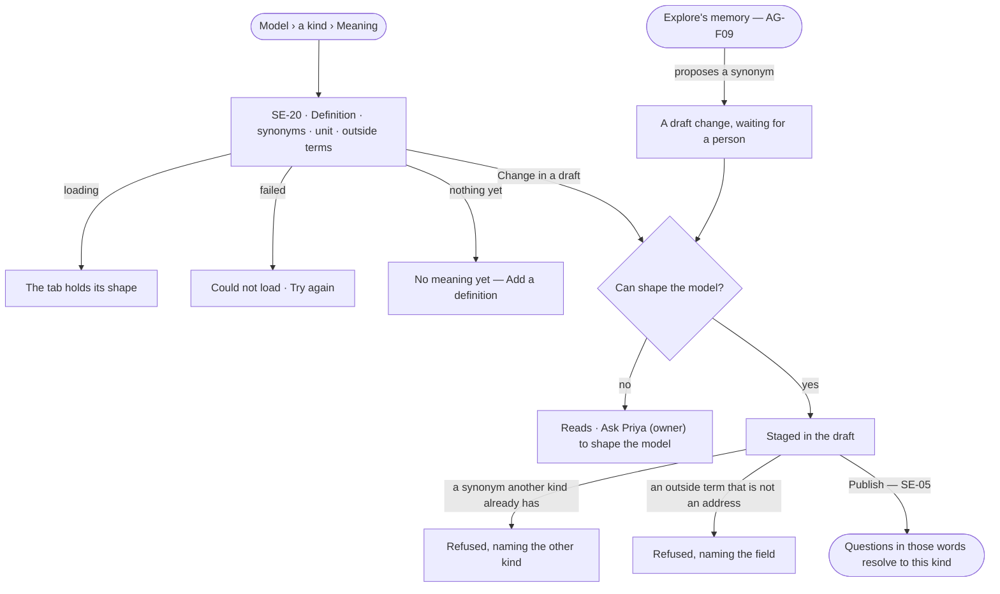

# Meaning

> What each kind and property means, in words people and agents share: a definition, the synonyms people ask with, the
> unit a value is in, and the outside terms it is the same as — an address, a schema.org type, a *same as* elsewhere.
> Published with the model. The decision it helps make: *when someone asks in their own words, which kind and property
> do they mean?*

## User journey

## Stories

| ID | Story | Status |
|---|---|---|
| SE-20 | [Say what a kind means](stories/SE-20-say-what-a-kind-means/story.md) | idea |

## Access

| Act | Role (`.claude/team/TEAM.md` §7) | Everyone else sees |
|---|---|---|
| Read a kind's and a property's meaning | Operator — every member | — |
| Change a definition, synonym, unit or outside term in a draft · accept a proposed one | `modeller` · shown as *Can shape the model* | Absent; *Ask Priya (owner) to shape the model* |

## States

| State | What the person sees |
|---|---|
| First use | *No meaning yet — a definition and the words people ask with help every question find this kind*, with *Add a definition* |
| Empty after a filter | — |
| Loading | The tab holds its shape |
| Has data | The definition, synonyms as chips, the unit per property, outside terms each with its source |
| Failed | *Could not load*, with *Try again*; a refused change names the field |
| Agent working or proposing | A proposed synonym from Explore's memory, waiting with *Accept into the draft* · *Dismiss* |
| No access | Every part reads; the acts are absent |

## Rules

| Rule | Detail |
|---|---|
| Meaning is a tab on a kind | *Meaning* beside Properties · Indexes · Constraints · Mappings; a property's meaning sits on its row |
| Four parts | **Definition** — one or two sentences · **Synonyms** — the words people ask with, unique across the published models of a Graph · **Unit** — per number property, from a fixed list · **Outside terms** — an address (IRI), a schema.org type or property, or a *same as* address elsewhere |
| Versioned with the model | Meaning is staged in the draft and published with it; it never changes a record and never breaks a version |
| Grounding reads it | A question's words resolve against kind names, then synonyms; the answer's *How it got here* names the synonym that matched |
| Imports carry meaning | A definition, alternative labels and source addresses from an import (SE-15 · SE-F05) land as meaning |
| A proposal is a draft change | A synonym or definition from Explore's memory (AG-F09) or an agent waits in the draft until a person accepts it |
| Leans on | SE-F02 — the draft and publish · SE-F05 — a standard's terms an outside term may name · SE-F06 — a mapping to a standard · AG-F09 — proposed synonyms |

## Data touched

| Record | Read or write |
|---|---|
| Meaning of a kind or property — definition, synonyms, unit, outside terms, where each came from | Read · write (in the draft) |
| Model version | Read |

## Engine

> Placeholder — its records, reads, routes, events, refusals, CLI and mechanisms.

## System impact

`None` — meaning is part of a model version; grounding already reads the published model.

## Decisions

| Decision | Detail |
|---|---|
| Synonyms are unique in a Graph | One word leads to one kind; a second is refused naming the first, so grounding never guesses |
| Units come from a fixed list | A unit is picked, never typed, so two kinds in the same unit compare |
| Outside terms are addresses | An outside term is stored as its address and shown by its label; the engine never fetches it |

## Open questions

| Question | Who answers |
|---|---|
| — | — |

## Not building

| Item | Why not |
|---|---|
| Converting between units | A unit says what a value is in; converting is a derivation's job (SE-F08) |
| Synonyms per person | One Graph, one vocabulary |
| Fetching an outside term to show its definition | The engine never fetches |
| Translations of the meaning | One language per Graph until a person asks for more |
