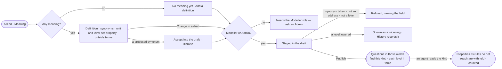

# SE-20 · Say what a kind means

**As** a modeller **I want** each kind and property to carry its definition, the synonyms people ask with, its unit,
the outside terms it is the same as and how sensitive it is **so that** a question in anyone's words finds the right
kind, an answer can be compared with data elsewhere, and agents read only the properties their rules reach.

Tasks: [task.md](task.md) · Feature: [SE-F03](../../feature.md)

## Who can

Changing meaning is the Modeller's and the Admin's ([the role table](../../../../../../os/access/features/AC-F02-access-policies/feature.md#the-role-table)).

| Lens | Can | Otherwise sees |
|---|---|---|
| Admin | Read meaning and every property's level; change them in a draft; accept or dismiss a proposed synonym | — |
| Operator | Read meaning and levels. A Modeller changes them as an Admin does | *Change in a draft*, *Set level* and *Accept into the draft* disabled — *Needs the Modeller role — ask an Admin* |

## Flow

## Acceptance criteria

| # | Given | When | Then |
|---|---|---|---|
| SE-20.1 | A kind with no meaning | Meaning opens | it reads *No meaning yet*, with *Add a definition* for a Modeller or an Admin |
| SE-20.2 | A kind with meaning | Meaning opens | it shows the definition, the synonyms, each property's unit and level, and each outside term with its label and address |
| SE-20.3 | A Modeller or an Admin | they add a definition, a synonym, a unit or an outside term | it is staged on the model's draft and published with it, never changing a record |
| SE-20.4 | A synonym another published kind in the Graph already has | it is staged | it is refused, naming the other kind and model |
| SE-20.5 | An outside term that is not an address | it is staged | it is refused, naming the field |
| SE-20.6 | A published synonym | someone asks a question in that word | the answer resolves to the kind, and *How it got here* names the synonym that matched |
| SE-20.7 | A synonym proposed by Explore's memory | the kind's Meaning opens | it waits with *Accept into the draft* · *Dismiss*, naming where it came from; accepting stages it |
| SE-20.8 | An Operator | they open Meaning | it reads; the acts are disabled, and a line reads *Needs the Modeller role — ask an Admin*; the API refuses the write |
| SE-20.9 | Meaning that cannot be read | the tab opens | it says it could not load, with *Try again* |
| SE-20.10 | A Modeller or an Admin on a property | they set its level to public, internal, confidential or personal | the level is staged on the draft and in force when the model publishes; a property nobody set reads *internal* |
| SE-20.11 | A level that is not one of the four, or a level on a property its kind does not carry | it is staged | it is refused, naming the level or the property |
| SE-20.12 | A draft that lowers a property's level | it is reviewed before publish | the change shows as a widening, naming the property, the old and the new level; once published, History records who lowered it, from what, to what |
| SE-20.13 | An agent whose Access Policies Allow Read `data/*/*` and Deny Read `data/*/*/personal` | it reads a kind with a personal property | the personal property is left out of the result and the result says how many properties it withheld — the read is not refused ([AC-F02](../../../../../../os/access/features/AC-F02-access-policies/feature.md#mechanisms)) |
| SE-20.14 | A call to an external AI model, an outside tool or an outside agent that would carry a confidential or personal property | it is made | it is refused before it leaves, naming the property and its level ([AC-F09](../../../../../../os/access/features/AC-F09-what-left-the-platform/feature.md#engine)) |
| SE-20.15 | An export, a published report or a message to an MCP client that would carry a confidential or personal property | it is made | the value is left out and what was left out is named ([AC-F09](../../../../../../os/access/features/AC-F09-what-left-the-platform/feature.md#engine)) |
| SE-20.16 | A level change | the model publishes | the one level holds for every agent and every exit; no policy file sets or changes it |

## Screens

| Surface | Lens | First use | Empty after a filter | Loading | Has data | Failed | Agent working or proposing | No access |
|---|---|---|---|---|---|---|---|---|
| A kind · Meaning | Admin | model.meaning · No meaning yet | — | model.meaning · Loading | model.meaning | model.meaning · Could not load | model.meaning · Proposed synonym | — |
| A kind · Meaning | Operator | model.meaning · No meaning yet | — | model.meaning · Loading | model.meaning · Read only | model.meaning · Could not load | model.meaning · Read only | model.meaning · Read only |
| A property · Level | Admin | model.meaning · Levels | — | model.meaning · Loading | model.meaning · Levels | model.meaning · Level refused | — | — |
| A property · Level | Operator | model.meaning · Levels | — | model.meaning · Loading | model.meaning · Levels · Read only | model.meaning · Could not load | — | model.meaning · Levels · Read only |
| The draft · meaning staged | Admin | — | — | — | model.board.draft · Widening | model.meaning · Refused | — | — |
| The draft · meaning staged | Operator | — | — | — | — | — | — | — |
