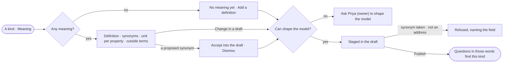

# SE-20 · Say what a kind means

**As** a modeller **I want** each kind and property to carry its definition, the synonyms people ask with, its unit
and the outside terms it is the same as **so that** a question in anyone's words finds the right kind, and an answer
can be compared with data elsewhere.

Tasks: [task.md](task.md) · Feature: [SE-F03](../../feature.md)

## Who can

| Lens | Can | Otherwise sees |
|---|---|---|
| Admin | Read meaning; change it in a draft; accept or dismiss a proposed synonym | — |
| Operator | Read meaning | *Change in a draft* and *Accept into the draft* absent — *Ask Priya (owner) to shape the model*. With *Can shape the model*: as Admin |

## Flow

## Acceptance criteria

| # | Given | When | Then |
|---|---|---|---|
| SE-20.1 | A kind with no meaning | Meaning opens | it reads *No meaning yet*, with *Add a definition* for someone who can shape the model |
| SE-20.2 | A kind with meaning | Meaning opens | it shows the definition, the synonyms, each number property's unit and each outside term with its label and address |
| SE-20.3 | Someone who can shape the model | they add a definition, a synonym, a unit or an outside term | it is staged on the model's draft and published with it, never changing a record |
| SE-20.4 | A synonym another published kind in the Graph already has | it is staged | it is refused, naming the other kind and model |
| SE-20.5 | An outside term that is not an address | it is staged | it is refused, naming the field |
| SE-20.6 | A published synonym | someone asks a question in that word | the answer resolves to the kind, and *How it got here* names the synonym that matched |
| SE-20.7 | A synonym proposed by Explore's memory | the kind's Meaning opens | it waits with *Accept into the draft* · *Dismiss*, naming where it came from; accepting stages it |
| SE-20.8 | An Operator without *Can shape the model* | they open Meaning | it reads; the acts are absent and a line reads *Ask Priya (owner) to shape the model* |
| SE-20.9 | Meaning that cannot be read | the tab opens | it says it could not load, with *Try again* |

## Screens

| Surface | Lens | First use | Empty after a filter | Loading | Has data | Failed | Agent working or proposing | No access |
|---|---|---|---|---|---|---|---|---|
| A kind · Meaning | Admin | model.meaning · No meaning yet | — | model.meaning · Loading | model.meaning | model.meaning · Could not load | model.meaning · Proposed synonym | — |
| A kind · Meaning | Operator | model.meaning · No meaning yet | — | model.meaning · Loading | model.meaning · Read only | model.meaning · Could not load | model.meaning · Read only | model.meaning · Read only |
| The draft · meaning staged | Admin | — | — | — | model.board.draft | model.meaning · Refused | — | — |
| The draft · meaning staged | Operator | — | — | — | — | — | — | — |
