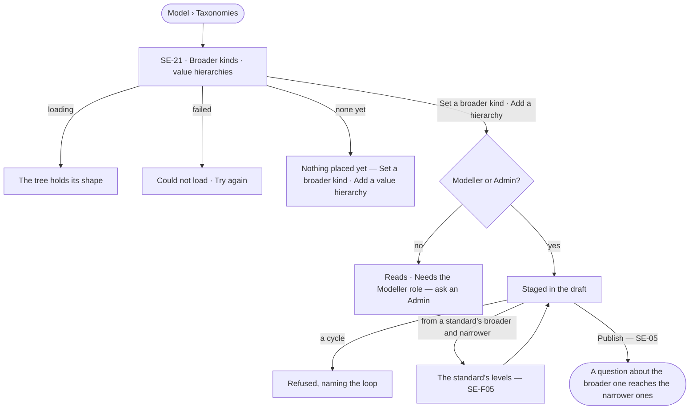

# Taxonomies

> What sits under what: a **broader kind** a kind belongs to — meaning only, so storage and queries stay flattened —
> and **value hierarchies**, where a property's values nest broader and narrower, as a SKOS scheme does. A question
> about the broader one reaches the narrower ones. The decision it helps make: *when someone asks about a broad
> class, which kinds and values does that include?*

## User journey

## Stories

| ID | Story | Status |
|---|---|---|
| SE-21 | [Place kinds and values under broader ones](stories/SE-21-place-kinds-and-values-under-broader-ones/story.md) | idea |

## Access

| Act | Role ([the role table](../../../../os/access/features/AC-F02-access-policies/feature.md#the-role-table)) | Everyone else sees |
|---|---|---|
| Read broader kinds and value hierarchies | Every signed-in person — Operator, Modeller, Admin | — |
| Set a broader kind · add or change a value hierarchy, in a draft | Modeller · Admin | Absent; *Needs the Modeller role — ask an Admin* |

## States

| State | What the person sees |
|---|---|
| First use | *Nothing placed yet — a broader kind groups kinds by meaning; a value hierarchy nests a property's values*, with both acts |
| Empty after a filter | *No kind or value matches*, with the filter to clear |
| Loading | The tree holds its shape |
| Has data | Kinds under their broader kinds; each value hierarchy as a tree with its property and source |
| Failed | *Could not load*, with *Try again*; a refused change names the loop or the field |
| Agent working or proposing | — |
| No access | The trees read; the acts are absent |

## Rules

| Rule | Detail |
|---|---|
| Broader kind, meaning only | A kind may name one broader kind in the same model or a linked one. It adds meaning: a question about the broader kind reaches every kind under it. It never adds a property, a label or a relationship to a stored record — each kind carries its own properties |
| Value hierarchies | A property's allowed values may nest — broader and narrower — from a standard's levels (SE-F05) or written here. A question for a broader value reaches its narrower ones |
| No cycles | A kind or value placed under itself, directly or not, is refused naming the loop |
| Versioned with the model | Staged in the draft and published with it; adding a broader kind never breaks a version, and removing one does |
| Grounding reads it | *How it got here* names the broader kind or value a question was widened through |
| Leans on | SE-F02 — the draft · SE-F03 — meaning · SE-F05 — a standard's levels · SE-F01 — subclasses from an ontology land as broader kinds |

## Data touched

| Record | Read or write |
|---|---|
| A kind's broader kind | Read · write (in the draft) |
| Value hierarchy — property, values, each value's broader one, where it came from | Read · write (in the draft) |

## Engine

> Placeholder — its records, reads, routes, events, refusals, CLI and mechanisms.

## System impact

`None` — part of a model version; the query planner widens a question at grounding, never in storage.

## Decisions

| Decision | Detail |
|---|---|
| Storage stays flattened | A broader kind is never a database label or an inherited property; widening happens when a question is grounded |
| One broader kind | A kind has at most one broader kind; a kind that is two things is two links (SE-F06) |
| SKOS levels carry over | A SKOS `broader` and `narrower` become a value hierarchy; alternative labels become synonyms (SE-F03) |

## Open questions

| Question | Who answers |
|---|---|
| — | — |

## Not building

| Item | Why not |
|---|---|
| Inherited properties or constraints | Inheritance leaks into every query; a broader kind is meaning only |
| Several broader kinds for one kind | One answer to *what is this a kind of* keeps widening explainable |
| Polyhierarchies of values | One broader value per value, as one level in a standard |
