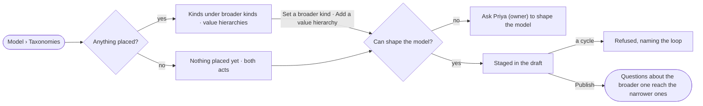

# SE-21 · Place kinds and values under broader ones

**As** a modeller **I want** to say which broader kind a kind belongs to, and how a property's values nest
**so that** a question about a broad class reaches every kind and value under it, without changing how records are stored.

Tasks: [task.md](task.md) · Feature: [SE-F04](../../feature.md)

## Who can

| Lens | Can | Otherwise sees |
|---|---|---|
| Admin | Read the trees; set a broader kind; add or change a value hierarchy, in a draft | — |
| Operator | Read the trees | *Set a broader kind* and *Add a value hierarchy* absent — *Ask Priya (owner) to shape the model*. With *Can shape the model*: as Admin |

## Flow

## Acceptance criteria

| # | Given | When | Then |
|---|---|---|---|
| SE-21.1 | A model with nothing placed | Taxonomies opens | it reads *Nothing placed yet*, with *Set a broader kind* and *Add a value hierarchy* for someone who can shape the model |
| SE-21.2 | Someone who can shape the model | they set a kind's *Broader kind* | it is staged on the draft; no property, label or relationship is added to any stored record |
| SE-21.3 | A published broader kind | someone asks about it | the answer reaches every kind under it, and *How it got here* names the broader kind it widened through |
| SE-21.4 | A property held to a standard with levels | they pick *Add a value hierarchy* from it | the standard's broader and narrower values are staged as the property's hierarchy, naming the standard version |
| SE-21.5 | A published value hierarchy | someone asks for a broader value | records with any narrower value are included, and *How it got here* names the value it widened through |
| SE-21.6 | A kind or value placed under itself, directly or not | it is staged | it is refused, naming the loop |
| SE-21.7 | A published broader kind removed in a draft | the draft publishes | it is a breaking change, reviewed as SE-05 says |
| SE-21.8 | An Operator without *Can shape the model* | they open Taxonomies | the trees read; the acts are absent with *Ask Priya (owner) to shape the model* |
| SE-21.9 | Taxonomies that cannot be read | it opens | it says it could not load, with *Try again* |

## Screens

| Surface | Lens | First use | Empty after a filter | Loading | Has data | Failed | Agent working or proposing | No access |
|---|---|---|---|---|---|---|---|---|
| Taxonomies | Admin | model.taxonomies · Nothing placed yet | model.taxonomies · No match | model.taxonomies · Loading | model.taxonomies | model.taxonomies · Could not load | — | — |
| Taxonomies | Operator | model.taxonomies · Nothing placed yet | model.taxonomies · No match | model.taxonomies · Loading | model.taxonomies · Read only | model.taxonomies · Could not load | — | model.taxonomies · Read only |
| The draft · placed | Admin | — | — | — | model.board.draft | model.taxonomies · Loop refused | — | — |
| The draft · placed | Operator | — | — | — | — | — | — | — |
