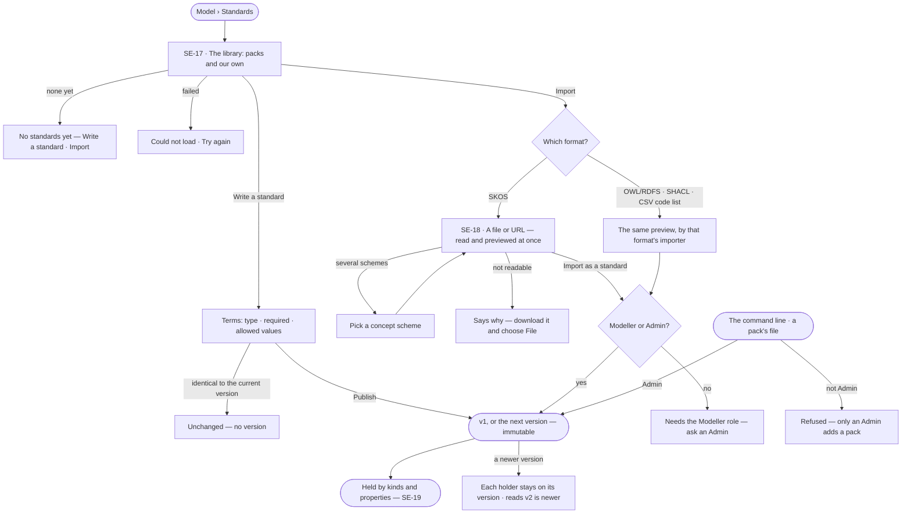

# Standards

> One install-wide library of standards — shared, versioned sets of terms with their types, allowed values and
> required fields — written in Invana, imported from an outside format, or applied from a pack a field publishes. A
> kind or a property in any Graph's model holds one exact version (SE-F07). The decision it helps make: *which terms
> did our field agree, and which version do we follow?*

## User journey

## Stories

| ID | Story | Status |
|---|---|---|
| SE-17 | [Keep a library of standards](stories/SE-17-keep-a-library-of-standards/story.md) | idea |
| SE-18 | [Import a standard from a SKOS vocabulary](stories/SE-18-import-a-standard-from-a-skos-vocabulary/story.md) | idea |

## Access

| Act | Role ([the role table](../../../../os/access/features/AC-F02-access-policies/feature.md#the-role-table)) | Everyone else sees |
|---|---|---|
| Read every standard, its versions and who holds it | Every signed-in person — Operator, Modeller, Admin | — |
| Write a standard or import one · publish the next version of a standard | Modeller · Admin | *Write a standard*, *Import* and *New version* absent; *Needs the Modeller role — ask an Admin* |
| Apply a pack | Admin | Refused — *Needs the Admin role* |

## States

| State | What the person sees |
|---|---|
| First use | *No standards yet — a standard is a shared set of terms a kind or a property can hold*, with *Write a standard* and *Import* |
| Empty after a filter | *No standard matches* — the filter named, with *Clear* |
| Loading | Rows hold their shape; an import preview reads *Reading the vocabulary…* |
| Has data | Standards with their origin, current version and how many kinds and properties hold them |
| Failed | A refused publish or import names why; a library that cannot be read says so, with *Try again* |
| Agent working or proposing | — |
| No access | Every standard reads; the writes are absent, naming the Modeller role |

## Rules

| Rule | Detail |
|---|---|
| A standard is install-wide | Kept once in the install's library and always readable; a range or vocabulary used once is a constraint on a model's property (SE-F02) |
| A version is immutable | Hashed over its terms; an identical one is refused as *unchanged* |
| A term | Name (unique in the version) · type `text · integer · number · boolean · date` · required · allowed values, each a code with a label · description · its source address when imported |
| Importers per format | SKOS (SE-18) · OWL/RDFS — classes and their properties as terms, named individuals as values · SHACL — shapes as terms, `sh:in` as values, `sh:minCount` as required · CSV code lists — one column of codes, one of labels. Each previews before it imports, and keeps every source address |
| A SKOS scheme is a standard | Concepts become terms and values: `prefLabel` the names and labels, `notation` the codes, `broader` the levels; each keeps its source address. A value hierarchy a model's property follows is SE-F04's |
| Packs per standard | A pack is one standard's file — IAB Content Taxonomy, ISO 3166, Darwin Core — applied by an Admin from the command line, marked *pack*; a Team pack may carry several (CP-F02) |
| A holder pins a version | A newer standard version never moves a kind or property that holds one; the holder reads that a newer one exists |
| The engine never fetches | The browser or the CLI reads a file or URL and sends its text; the engine reads only what it is sent |
| The engine counts | Holders per standard and the library's totals are the engine's |
| Leans on | SE-F02 — a constraint that names a standard's values · SE-F07 — holding a kind or property to a standard, and what breaks it · RC-F03 — the records that break it · SE-F04 — value hierarchies · CP-F02 — packs |

## Data touched

| Record | Read or write |
|---|---|
| Standard and its versions — terms, hash, origin, why | Read · write |
| Who holds each version — kinds and properties, per Graph | Read |
| Events — standard create and version, pack applied | Write |

## Engine

> Placeholder — its records, reads, routes, events, refusals, CLI and mechanisms.

## System impact

> Placeholder — `None`, or the `system-design.md` sections it changes and the NFRs it touches.

## Decisions

| Decision | Detail |
|---|---|
| Standards is a sheet of Model | *Library* · *Import*; who holds a standard is its page's *Used by* |
| Packs are applied, not browsed | A pack is a standard file an Admin applies; there is no registry to check for newer packs |
| Import previews first | Reading a file previews at once — the source, its terms and values, the name it publishes under, the mapping, notes and skips; *Import as a standard* waits for a preview |
| Several schemes are a choice | A file with several schemes offers a picker; one import is one scheme |
| The imported name is editable | It defaults to the slug of the source's title; the publisher is the person who imports it, shown as a fact — it grants nothing |
| Experimental | Standards and their importers carry an *Experimental* badge; constraints on a model's properties stay core |

## Open questions

| Question | Who answers |
|---|---|
| — | — |

## Not building

| Item | Why not |
|---|---|
| The packs' content | Curating the files is content work; a pack is applied like any standard file |
| Standards in the change log | Versions and their hashes are readable already |
| SKOS related and mapping properties as links | A mapping between standards is SE-F06's; listed in the import report |
| SKOS collections and SKOS-XL labels | Listed, not imported |
| Several schemes into several standards at once | One import, one scheme |
| Export back to an outside format | Import only |
| A standard private to one Graph | A private range or vocabulary is a constraint on one property |
