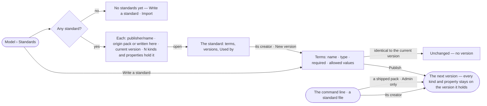

# SE-17 · Keep a library of standards

**As** a data curator **I want** a library of standards — the packs Invana ships and our own — each in immutable
versions — that any Graph's kinds and properties can hold **so that** data follows the terms our field agreed.

Tasks: [task.md](task.md) · Feature: [SE-F05](../../feature.md)

## Who can

| Lens | Can | Otherwise sees |
|---|---|---|
| Admin | Read every standard; write one; publish the next version of any; apply a shipped pack | — |
| Operator | Read every standard; write one; publish the next version of one they created | *New version* absent on a standard they did not create, naming its creator |

## Flow

## Acceptance criteria

| # | Given | When | Then |
|---|---|---|---|
| SE-17.1 | An install with no standard | Standards opens | it reads *No standards yet*, with *Write a standard* and *Import*, and an *Experimental* badge |
| SE-17.2 | Standards | the library lists | each row shows `publisher/name`, whether it is a shipped pack or written here, its current version and how many kinds and properties hold it — the engine's count |
| SE-17.3 | A person writing a standard | they add a term | it has a name unique in the version, a type (text · integer · number · boolean · date), whether it is required, and allowed values, each a code with a label |
| SE-17.4 | Terms identical to the current version | the person publishes | it is refused as *unchanged* and no version is minted |
| SE-17.5 | A changed standard | its creator publishes | the next version is minted; every kind and property that holds it stays on the version it holds |
| SE-17.6 | A standard | the person opens *Used by* | it lists each kind and property that holds it, with its Graph, model, version and mode; ones in a Graph the person cannot read are counted as not readable |
| SE-17.7 | An Operator on a standard they did not create | they open it | *New version* is absent and a line names its creator |
| SE-17.8 | The library cannot be read | Standards opens | it says it could not load, with *Try again* |
| SE-17.9 | An Admin with a shipped pack's file | they apply it from the command line | it is published as a standard marked *pack*, or as its next version when the terms changed; identical terms read *unchanged* |
| SE-17.10 | An Operator with a pack's file | they apply it | it is refused: only an install Admin adds a shipped pack |
| SE-17.11 | A standard's creator with a standard file | they apply it from the command line | its next version is published as if written here; another person's standard is refused, naming its creator |

## Screens

| Surface | Lens | First use | Empty after a filter | Loading | Has data | Failed | Agent working or proposing | No access |
|---|---|---|---|---|---|---|---|---|
| Standards | Admin | data.checks · No standards yet | data.checks · No standard matches | data.checks · Loading | data.checks | data.checks · Could not load | — | — |
| Standards | Operator | data.checks · No standards yet | data.checks · No standard matches | data.checks · Loading | data.checks | data.checks · Could not load | — | — |
| A standard | Admin | — | — | data.checks · Loading | data.checks · Standard | data.checks · Could not load | — | — |
| A standard | Operator | — | — | data.checks · Loading | data.checks · Standard | data.checks · Could not load | — | data.checks · Standard read only |
| Write a standard | Admin | data.checks · Write a standard | — | — | data.checks · Write a standard | data.checks · Standard unchanged | — | — |
| Write a standard | Operator | data.checks · Write a standard | — | — | data.checks · Write a standard | data.checks · Standard unchanged | — | data.checks · Standard read only |
