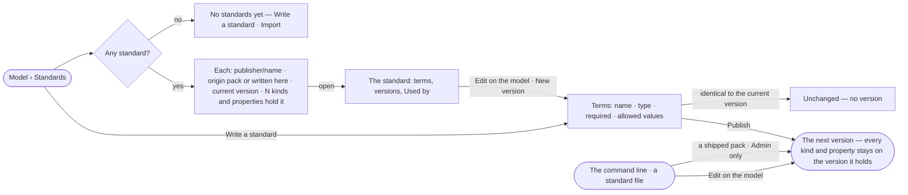

# SE-17 · Keep a library of standards

**As** a data curator **I want** a library of standards — the packs Invana ships and our own — each in immutable
versions — that any model's kinds and properties can hold **so that** data follows the terms our field agreed.

Tasks: [task.md](task.md) · Feature: [SE-F05](../../feature.md)

## Who can

Writing and publishing a standard needs Edit on `model/<model>`; applying a shipped pack needs Create on `setting/team-packs` ([the permission catalogue](../../../../../../os/access/features/AC-F02-access-policies/feature.md#the-permission-catalogue)).

| Access | Can | Otherwise sees |
|---|---|---|
| Admin | Read every standard; write one; publish the next version of any; apply a shipped pack | — |
| Operator | Read every standard. With Edit on the model, writes and publishes a standard as an Admin does | *Write a standard*, *Import* and *New version* absent — *Needs Edit on model/{model} — ask {who can grant}*; a pack refused — *Needs Create on setting/team-packs — ask {who can grant}* |

## Flow

## Acceptance criteria

| # | Given | When | Then |
|---|---|---|---|
| SE-17.1 | An install with no standard | Standards opens | it reads *No standards yet*, with *Write a standard* and *Import*, and an *Experimental* badge |
| SE-17.2 | Standards | the library lists | each row shows `publisher/name`, whether it is a shipped pack or written here, its current version and how many kinds and properties hold it — the engine's count |
| SE-17.3 | A person writing a standard | they add a term | it has a name unique in the version, a type (text · integer · number · boolean · date), whether it is required, and allowed values, each a code with a label |
| SE-17.4 | Terms identical to the current version | the person publishes | it is refused as *unchanged* and no version is minted |
| SE-17.5 | A changed standard | a person with Edit on the model publishes | the next version is minted; every kind and property that holds it stays on the version it holds |
| SE-17.6 | A standard | the person opens *Used by* | it lists each kind and property that holds it, with its model, version and mode; ones the person cannot read are absent, with no count and no note |
| SE-17.7 | An Operator | they open a standard | *New version* is absent and a line reads *Needs Edit on model/{model} — ask {who can grant}* |
| SE-17.8 | The library cannot be read | Standards opens | it says it could not load, with *Try again* |
| SE-17.9 | An Admin with a shipped pack's file | they apply it from the command line | it is published as a standard marked *pack*, or as its next version when the terms changed; identical terms read *unchanged* |
| SE-17.10 | An Operator, with a pack's file, | they apply it | it is refused: only Create on `setting/team-packs` adds a shipped pack |
| SE-17.11 | A person with Edit on the model, with a standard file | they apply it from the command line | its next version is published as if written here; an Operator is refused, naming *Needs Edit on model/{model} — ask {who can grant}* |

## Screens

| Surface | Access | First use | Empty after a filter | Loading | Has data | Failed | Agent working or proposing | No access |
|---|---|---|---|---|---|---|---|---|
| Standards | Admin | model.standards · No standards yet | model.standards · No standard matches | model.standards · Loading | model.standards | model.standards · Could not load | — | — |
| Standards | Operator | model.standards · No standards yet | model.standards · No standard matches | model.standards · Loading | model.standards | model.standards · Could not load | — | — |
| A standard | Admin | — | — | model.standards · Loading | model.standards · Detail | model.standards · Could not load | — | — |
| A standard | Operator | — | — | model.standards · Loading | model.standards · Detail | model.standards · Could not load | — | model.standards · Detail · Read only |
| New standard · 1 Name · 2 Start from | Admin | model.standards · New | — | — | model.standards · New · Write picked | — | — | — |
| New standard · 1 Name · 2 Start from | Operator | model.standards · New | — | — | model.standards · New · Write picked | — | — | model.standards · Detail · Read only |
| New standard · 3 Write the terms | Admin | model.standards · New · No terms yet | — | — | model.standards · New · Terms | model.standards · New · Standard unchanged | — | — |
| New standard · 3 Write the terms | Operator | model.standards · New · No terms yet | — | — | model.standards · New · Terms | model.standards · New · Standard unchanged | — | model.standards · Detail · Read only |
| New version | Admin | — | — | — | model.standards · Write a standard | model.standards · Detail · Unchanged | — | — |
| New version | Operator | — | — | — | model.standards · Write a standard | model.standards · Detail · Unchanged | — | model.standards · Detail · Read only |
