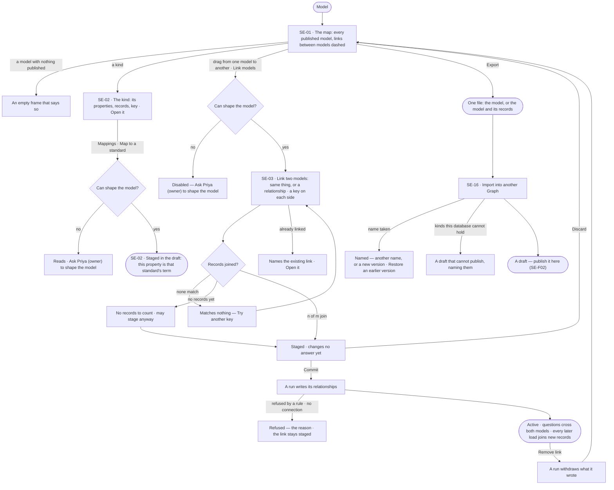
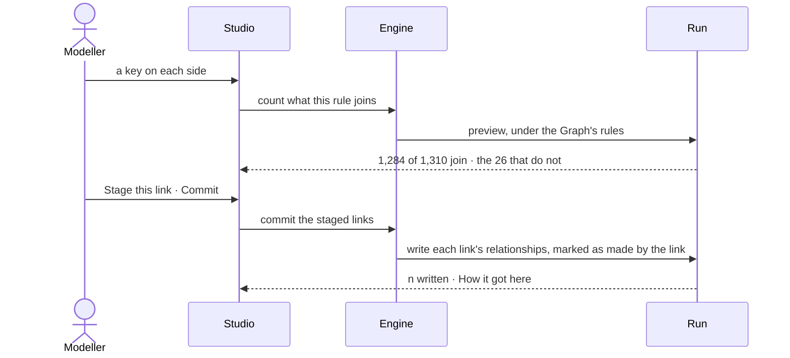

# Links and mappings

> Every published model on one map, the links between them declared by a person — never guessed — the mappings from
> a model to a standard and between standards, and each model carried to another Graph as one file. The decision it helps make: *do these two models describe the same thing, and
> on which key?* — answered with the count of records each rule joins before it is made.

## User journey

## Stories

| ID | Story | Status |
|---|---|---|
| SE-01 | [See every model on one map](stories/SE-01-see-every-model-on-one-map/story.md) | idea |
| SE-02 | [Open a model and a kind](stories/SE-02-open-a-model-and-a-kind/story.md) | idea |
| SE-03 | [Link two models](stories/SE-03-link-two-models/story.md) | idea |
| SE-16 | [Export and import a model](stories/SE-16-export-and-import-a-model/story.md) | idea |

## Access

| Act | Role (`.claude/team/TEAM.md` §7) | Everyone else sees |
|---|---|---|
| Read the map, a model, a kind, the links between models and their history | Operator — every member | — |
| Link two models · commit or discard staged links · remove a link | `modeller` · shown as *Can shape the model* | *Link models* disabled — *Ask Priya (owner) to shape the model*; a drag between models does nothing and says why |
| Rename a model · change its description | `modeller` · shown as *Can shape the model* | *Rename* disabled — *Ask Priya (owner) to shape the model* |
| Export a model, with or without its records | Operator — every member — a read; carrying confidential or personal data, or made by a key or an agent, a send ([An export](../../../../os/access/product.md#decisions)) | — |
| Import a model · restore an earlier version | `modeller` · shown as *Can shape the model* | *Import a model file* disabled — *Ask Priya (owner) to shape the model* |

## States

| State | What the person sees |
|---|---|
| First use | No model published: each model an empty frame saying *Nothing published yet*; no link: *Links between models 0 — drag from one model to another to link them* |
| Empty after a filter | *Show* one model, or a search on links that matches none: *No link matches "<text>"* · *Clear* |
| Loading | The map lays out and frames itself before it shows; a link's count reads *Counting…*; the links count reads `—`, never `0` |
| Has data | Frames per model in their own hue, links dashed, the left section listing models, kinds and links |
| Failed | A refused link names the side, kind or key; a commit or removal refused by a rule or a missing connection keeps the link as it was; an unreadable file says why |
| Agent working or proposing | A run counting, writing or withdrawing a link's relationships; an ontology's equivalences offered as links to confirm |
| No access | The map, kinds and links read; linking, committing, removing and importing are disabled with *Ask Priya (owner) to shape the model* |

## Rules

| Rule | Detail |
|---|---|
| Declared, never guessed | Every link is declared by a person, on a key on each side matched exactly or ignoring case; nothing is inferred, no similarity score, no key guessed from a name |
| Two kinds of link | *Same thing* — two kinds are one entity, both kept, joined by a *same as* relationship. *Relationship* — a relationship between two kinds, its ends found by a key on each side, or by its own rows in a load — never both |
| Linking never merges | Both records stay; questions cross the link |
| Three shapes, and nothing else is a link | *Same thing* on keys that differ in name — `Company.ticker` is `Stock.nse_symbol`, matched exactly, both records stay · *Relationship* on keys the records already carry — `Order.instrument_isin` to `Stock.isin`, because an order is not a stock · *Relationship* from its own rows — `Observation` to `Stock`, when each relationship is a fact of its own in a load's rows |
| Links bind published versions | A draft cannot be linked. A new version carries its links; links on the version it replaced stay as history |
| The whole model is derived | Every published model plus its active links, computed when read, never stored — and it is what every question is grounded in |
| A link stages before it counts | Declared links are listed, drawn and counted as *staged* and change no answer until committed; *Commit* activates every staged link at once, *Discard* drops them |
| An active link stands | Committing writes its relationships; every later load joins the records it brings. Writing again never writes twice |
| A link's relationships say so | Each is marked as made by its link, with the rule and when; removing the link removes exactly those, and only once they are gone does the link go |
| Every read and write is a run, under the Graph's rules | Counting, committing and removing a link; a rule that denies either model refuses it, with the reason — never counted around |
| A model travels as one file | A published version exports with its kinds, keys and constraints; links travel only when both ends are in the same file. Its identity is its package and its content, not its name, so a later import is recognised as a new version. Files and git are the registry |
| Three kinds of mapping | *Model to model* — a link between models, above · *Model to standard* — a kind or property means a standard's term or value, staged in the model's draft and published with it; a question may then be asked in the standard's words · *Standard to standard* — a term or value in one standard is the same as, broader than or narrower than one in another, kept on the newer standard's version |
| A mapping is declared | Like a link, a mapping is a person's, or an agent's proposal a person accepts; never inferred |
| Leans on | SE-F01 · SE-F02 — the versions links and mappings bind · SE-F05 — the standards mapped · RC-F02 — loads that bring a relationship's rows · Explore — questions that cross links |

## Data touched

| Record | Read or write |
|---|---|
| Model versions — published, and each kind's latest record count | Read |
| Link between models — kind, both models and kinds, both keys, match, relationship, status, who declared it, when, where from, relationships held | Read · write |
| Relationships a link writes in the graph | Write on commit and on each load · delete on removal |
| The link's history — declared, committed, removed, with the rule and what was withdrawn | Read · write |
| Queries that crossed each link over 30 days | Read |
| Model file — package, content hash, kinds, keys, constraints, links in the file; records, one file per kind, with where they came from | Read · write |
| Mapping — from a kind or property, or a standard's term, to a standard's term or value; same as · broader · narrower; who declared it | Read · write |

## Engine

The low-level design: what this feature stores, serves and refuses. Conventions — naming, errors, lists, events — are
[system-design.md](../../../../system-design.md) §§ 6–8; this section only fills them in. The engine's word for a link
between models is *stitch*: the packaged plans, the catalogue keys `graph.stitch.*`, the address
`graph_data/stitch/<source>_<target>` and the command `invana stitches`; the record is `model_links`.

### Records

| Table | Columns | Notes |
|---|---|---|
| `model_links` | `graph_id` · `kind` (`same` · `relationship`) · `status` (`staged` · `active`) · `source_version_id` · `target_version_id` · `source_type` · `target_type` · `source_property` · `target_property` · `match` (`exact` · `ignore_case`) · `edge_type` · `source_model_id` · `edges` · `declared_by_id` · `declared_at` | One per pair of kinds, staged or active. `edges` is null until the first solve. `source_model_id` is set on a relationship from its own rows, which carries no keys |

### Reads

| Record | Owner |
|---|---|
| Models and their published versions | [SE-F01](../SE-F01-start-a-model/feature.md#engine) · [SE-F02](../SE-F02-change-and-publish-a-model/feature.md#engine) |
| Each kind's latest record count · the queries that crossed a link | [SE-F10](../SE-F10-health-and-history/feature.md#engine) |
| The Graph's rules on properties a count, commit or removal runs under · the touches it records | [SE-F09](../SE-F09-views-of-the-graph/feature.md#engine) |
| Loads that join new records and bring a relationship's rows · record stamps | [RC-F02](../../../records/features/RC-F02-bring-records-in/feature.md#engine) |
| Standards a mapping names | [SE-F05](../SE-F05-standards/feature.md#engine) |
| Runs and the packaged plans they run | [CP-F10](../../../../os/control/features/CP-F10-runs-and-how-the-agents-are-doing/feature.md#engine) · [AG-F06](../../../agents/features/AG-F06-plans-and-workflows/feature.md#engine) |
| History — every event this feature writes | [AC-F06](../../../../os/access/features/AC-F06-history/feature.md#engine) |

### Routes

| Route, after `/api/v1/u/{u}/{g}/model` | Does | Story |
|---|---|---|
| `GET /links` · `POST /links` | The links with `edges`, no history · stage one | SE-01 · SE-03 |
| `GET /links/{id}` | One link whole: `declared_by` · `declared_at` · `history[]` (its declare and commit events) and each end's latest counted `records` | SE-03 |
| `POST /links/preview` | Count what a rule joins: totals, resolved and unresolved, up to 25 samples and a verdict; writes nothing | SE-03 |
| `POST /links/commit` · `POST /links/discard` | Activate every staged link in one run · drop them | SE-03 |
| `DELETE /links/{id}` | Remove a link — an active one through a withdrawal run | SE-03 |
| `GET /links/removed` | Removals from History, with who, when and what was withdrawn | SE-03 |
| `GET /global-model` | The whole model: published models plus active links, computed on each read; `staged_count` and `mirror_label_count` beside the counts, never in them | SE-01 |
| `GET /models/{id}/export` | One file of a published version; `?with_records` a bundle with a records file per kind and where they came from | SE-16 |
| `POST /models/{id}/upgrade` | A file of the same package with new content, opened as the model's draft | SE-16 |

### Events

| Event | When |
|---|---|
| `model.links.declare` · `model.links.discard` | A link staged · staged links dropped |
| `model.links.commit` · `model.links.remove` | Committed or withdrawn, with what was written or withdrawn |
| `model.models.export` · `model.models.upgrade` | A file written · a new version opened from a file |

### Refusals

| Status | When | Sentence | Criterion |
|---|---|---|---|
| 403 | A link, commit, removal or import by someone without *Can shape the model* | *This needs Can shape the model — ask {owner}.* | SE-03.18 · SE-16.12 |
| 422 | A side's kind its published version does not declare (`type_not_in_version`) | *{model} v{n} has no kind {kind}.* | API only — the card offers only declared kinds |
| 422 | A side that is a draft, the same model on both sides, or a model with nothing published (`version_is_draft`) | *A link joins two published models — {why}.* | SE-03.8 |
| 422 | A key not on its kind, or a kind with no properties | *{side}: {kind} has no property {key}.* | SE-03.6 |
| 422 | A *same thing* link or a keyed relationship without a key on each side (`key_required_on_each_side`) | *Name a key on each side.* | API only — the card asks both keys |
| 422 | A *same thing* link with a relationship name or a source model (`edge_type_on_anchor` · `source_model_on_anchor`) · a relationship without its name or its ends (`edge_type_required` · `endpoints_required`) · with keys and rows together (`keys_and_source_model`) | *{field}: {why}.* | API only — the card offers each field only for its kind |
| 409 | A pair already linked, staged or active (`link_already_declared`) — carries the existing link's rule | *{source} and {target} are already linked by {rule}.* | SE-03.7 |
| 409 | A count, commit or removal a rule in the Graph's rules refuses (`preview_refused`) — the link stays as it was | *{rule} denies {model} — nothing was counted.* | SE-03.13 |
| 409 | A count while the preview is queued (`preview_queued`) | *The count is waiting for a worker — try again.* | SE-03.19 |
| 409 | A commit with nothing staged, no connection, or a read-only connection — before a run exists | *{why} — nothing was written.* | SE-03.13 |

### CLI

| Command | Does |
|---|---|
| `invana models list` · `export` · `import` · `upgrade` · `starters` | What the dialogs do, under the same access; a refusal names the next command |
| `invana stitches` | List, stage, commit and remove links between models |

### Mechanisms

| Mechanism | How |
|---|---|
| Counting is a run | A run of `graph.stitch.preview` bound `graph_read`, under the Graph's rules on properties, awaited; a rule naming a kind or key the rules deny comes back refused, never counted around |
| Committing is a run, whoever commits | `stitch-commit@1`, no agent and no view, the Graph's rules admitting each side; one `MERGE` per link, each relationship carrying `_inv_origin` · `_inv_link_id` · `_inv_rule` · `_inv_at` |
| What each kind writes | *Same thing* writes `SAME_AS` source → target, read undirected; a keyed relationship writes its `edge_type`; a row-sourced relationship writes nothing at commit — committing loads its rows, the files' place read back from the load's run |
| Nothing written says so | A link that wrote nothing — a side the rules refuse — commits, says why, and never reports success; the others still solve |
| Every later load joins | A load's link step runs the same `MERGE`, scoped to that load's stamp; writing again never writes twice |
| A loaded row carries both marks | A relationship a row-sourced link loads carries the link's marks and the load's record stamps (`_inv_model_id` · `_inv_record_id` · `_inv_file` · `_inv_run_id`) |
| `edges` is counted | Re-counted after every solve that writes, never summed — a `MERGE` re-matches |
| A touch per side | Counting, committing and withdrawing record one touch per model with the relationships written into it; a side a rule refuses skips that link only; a model checked but not written gets no touch |
| Removal withdraws | An active link runs `stitch-withdraw@1`, deleting exactly the relationships marked with its id; the row goes only once they are gone. A rule denying either model refuses the whole removal. A staged link's row is deleted with no run |
| A new version carries its links | Publishing re-binds active links to the new version; links on the replaced version stay as history, not counted twice |
| The whole model | Computed on each read of `GET /global-model`; the database's own label count is compared, never added |
| Identity | A file's identity is `package_id` plus `content_hash`: a later file of the same package is a new version, opened by `upgrade` as a draft |
| What a file carries | Kinds, keys, constraints and axes; a link only when both models are in the file, else dropped naming the missing model; a kind the target cannot hold arrives as an unpublishable draft |
| A bundle's records | Load as an ordinary load once the model is published; a restore loads none unless asked |
| Packaged plans | `stitch-preview@1` · `stitch-apply@1` · `stitch-commit@1` · `stitch-withdraw@1` |

## System impact

| HLD section | Change | NFRs |
|---|---|---|
| § 6 Data and storage | `model_links` in Invana's own store; the whole model is derived on read, never stored | — |
| § 8 APIs and events | The routes and events above, under `model` | — |
| § 11 Failure modes and the outside boundary | Commit and removal write and delete relationships in the customer's graph database, each marked with its link | — |

## Decisions

| Decision | Detail |
|---|---|
| The map is Model's landing | Every published model on one full-bleed canvas, each a frame in its own hue with its kinds inside; a link is the only line that crosses a frame, and every link is dashed. *Show* draws all models or one; *Detail* is circles · cards · property cards. Map · Health · History are its tabs |
| The left section lists | Models · Kinds of node · Links between models, each with its count; a model is opened from the list, the map or a breadcrumb |
| A kind opens in a peek | Its properties with type and *Must be*, its records, its key, *Change in a draft* and *Open <kind>*; open, it is a page of its model with Properties · Indexes · Constraints · Mappings |
| Link from the map or the list | Dragging a kind onto a kind in another model, or *Link models*, opens one card with both sides filled: *Same thing* or *Relationship*, *Source* and *Target*, a key on each side; a relationship adds its name and where its ends come from — *These keys* or *Its own rows* |
| The count fires itself | Naming both keys counts what they join — *1,284 of 1,310 join* — before anything is made; a zero disables *Stage this link* and offers *Try another key*, listing the keys that matched nothing |
| No records is not a verdict | With nothing loaded on a side, the card reads *No records to count* and stages anyway: a model is linked before its data lands |
| A refusal names what it refused | A pair already linked shows the existing link's rule with *Open the existing link* |
| A link reads whole | Selected, it shows its ends with their records, the rule with *n joined* or *n relationships*, the queries that crossed it in 30 days, who declared it and when, and its history; *Remove link* confirms first |
| Removed links are listed | From their removal, with who removed them, when and what was withdrawn |
| Export and import live in New model | *Export a model* is one act from *New model*; *Import a model file* opens a file as a draft, or, onto a model of the same name, *Restore* — a new draft with the exported version's kinds, what returns and what goes listed, a breaking removal reviewed at publish |
| Records travel in a bundle | *The model and its records* writes one file with the model, a records file per kind, and where they came from; importing it loads the records as an ordinary load after the model is published. Restore does not load records by default — the database already holds them |
| *Same thing* is every record | It says every record of one kind is a record of the other; where only some match, the link is a *Relationship*. A *same thing* link is about kinds, so an over-claim shows in the whole model — anchoring `Account` to `Airline` because some accounts are airlines collapses every account into an airline there |
| A name is not a version | A model's name and description change at once, outside the draft, recorded in History |
| The map is canvas's schema board | `@invana/canvas-ui`'s `SchemaBoard` draws it — its config, Detail levels, kind cards, hover cards and connect gesture. Studio adds only the link: its dash, its staged colour, its hover card, a kind's link count and the drag that declares one. The map and one model's canvas (SE-F02) draw on the same board, so a model reads the same alone and among the others |
| ELK is the only layout | `layered`, on the map and on one model alike; no Layout switch and no force layout — force pulls a model's kinds together and its frames overlap |
| Detail is a config patch | *Circles* (an icon ringed in its model's hue) · *Cards* (icon, name, model, two-line description, property count, key, *anchored*) · *Property cards* (one row per property: type, name, key), each built from the kind's own properties, never from a config naming a model or a kind. A switch re-runs the layout. The map opens on *Circles* |
| A hue is a slot of the categorical ramp, chosen by name | A model's slot comes from its name, so it keeps its hue when another model is added, deleted or re-sorted; a kind's comes from its own name, so it wears the colour Explore paints it. A frame is washed in its model's hue — a 10% fill, a 60% border, the name on its tab |
| A link is dashed; a model's own relationship is solid | A link joins two models' kinds by a rule, and the dash keeps it from reading as a relationship the model declares. A staged link is dashed in the success tone. Its hover card reads its kind, the rule and the match |
| A drag links only on purpose | A plain drag moves a kind; **Shift**-drag from a kind onto a kind in another model, or the header's *Link mode* toggle, declares a link. The drag never adds a line: a link is a declared row and returns as data, dashed and staged |
| The link card docks | An accepted drag docks its card on the right, not in a modal, so both frames stay in view while the keys are named; the dock closes when the card does |

## Open questions

| Question | Who answers |
|---|---|
| Which story carries standard-to-standard mappings | Product manager — a story of its own when SE-F06 is specified |

## Not building

| Item | Why not |
|---|---|
| Inferred links, guessed keys, key transforms (trim, prefix, pattern) | A person decides what is the same; data that needs reshaping is reshaped before it is loaded |
| Merging linked records | Lossy, with no undo |
| A stored whole model | Derived when read, so nothing to keep in sync |
| Linking drafts | Links bind published versions |
| Composite keys | One property a side — a rule read in one line is a rule someone audits |
| A relationship with both keys and its own rows | Two sources of truth for one relationship |
| Editing a model on the map | The map draws published versions; a model changes in its draft |
| A saved map layout | The arrangement is a view |
| Removing a link from the canvas | A link is removed where it is named in words |
| A hosted model registry | Files and git version and share them |
| Automatic upgrade on import | A schema change is a decision |
| Zoom-driven collapse | Detail is how the map changes altitude |
| An icon chosen per kind on the canvas | The API carries no icon for a kind; every kind draws `lucide/box` until it does |
| A layout switch, or a force layout | ELK is the one layout; force overlaps the frames |
| Importing some kinds of a model file | A model is the unit; splitting it is a new model |
