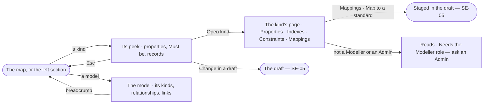

# SE-02 · Open a model and a kind

**As** a modeller **I want** to go from the map into one model and one kind **so that** I read any part of the model
in detail — its properties, records, key and constraints.

Tasks: [task.md](task.md) · Feature: [SE-F06](../../feature.md)

## Who can

Changing a model or a kind is the Modeller's and the Admin's ([the role table](../../../../../../os/access/features/AC-F02-access-policies/feature.md#the-role-table)).

| Access | Can | Otherwise sees |
|---|---|---|
| Admin | Open a model and a kind, and from a kind change it in a draft; rename a model and change its description | — |
| Operator | Open a model and a kind and read them. A Modeller changes a model or a kind as an Admin does | *Change in a draft* and *Rename* disabled — *Needs the Modeller role — ask an Admin* |

## Flow

## Acceptance criteria

| # | Given | When | Then |
|---|---|---|---|
| SE-02.1 | The map | the person clicks a kind, or picks it in the left section | a peek opens beside it: the kind, its model and record count, its description, and each property with its type and *Must be*; the left section marks it and the footer reads *<kind> selected · Esc to close* |
| SE-02.2 | A kind's peek | the person picks *Open <kind>* | the kind opens as a page of its model, header `Invana Model / Models › <model> › <kind>`, with its records and key and tabs Properties · Indexes · Constraints · Mappings, each with its count |
| SE-02.3 | A model in the left section | the person picks it | the model opens with its kinds of node, its relationships and the links touching it from either side, each with its count; an empty list says what would go there |
| SE-02.4 | A kind's peek with constraints that records break | it shows | it names how many records break each, and whether new ones are rejected |
| SE-02.5 | A kind | the person presses Esc or picks the breadcrumb | they are back on the map as they left it |
| SE-02.6 | A model with a draft | its kind opens | the page shows the draft's chip and, for a Modeller or an Admin, *Add property* |
| SE-02.7 | An Operator | they open a kind | it reads; *Change in a draft* is disabled with *Needs the Modeller role — ask an Admin* |
| SE-02.8 | A model's head and a Modeller or an Admin | they rename it or change its description | It saves at once, outside the draft — a name and a description are not part of a version — and History names who changed it |
| SE-02.9 | A kind's Mappings and a Modeller or an Admin | they pick *Map to a standard* and a property, a standard and a term or value | the mapping — same as · broader · narrower — is staged on the model's draft and publishes with it |
| SE-02.10 | A kind's Mappings | it opens | each mapping lists its property, the standard's term or value and version, and who declared it; an Operator reads them with *Map to a standard* absent |
| SE-02.11 | Published models | a person opens Model › Models | the left section is a tree: every model, and under it its Kinds, each with the record count the engine sends; picking a kind opens the kind |
| SE-02.12 | Published models | a person expands a model in the Models tree | its Relationships list under its Kinds, each naming the two kinds it joins; picking one opens it on its model |
| SE-02.13 | A kind's Properties tab | it opens | each property reads its type, *Must be*, whether it is the key, and where it comes from — *Authored*, *Read from {graph database}*, *A starter*, *From {ontology}* with its source IRI, or *A model file* — with the version that added it and who published it |
| SE-02.14 | A kind's Properties tab | it opens | each property row also reads its index — *unique*, *range*, *point* or none — and its constraint, with *+ staged* on one only the draft holds; the tab titles carry their counts |
| SE-02.15 | A kind's Indexes tab | it opens | each index lists its kind (unique · range · point), its properties and whether it is published or staged; a Modeller or an Admin adds one in a draft (SE-05), and an Operator reads them |

## Screens

| Surface | Access | First use | Empty after a filter | Loading | Has data | Failed | Agent working or proposing | No access |
|---|---|---|---|---|---|---|---|---|
| A kind | Admin | model.kinds · Detail · No properties | — | model.kinds · Detail · Loading | model.kinds · Detail | model.kinds · Detail · Could not load | — | — |
| A kind | Operator | model.kinds · Detail · No properties | — | model.kinds · Detail · Loading | model.kinds · Detail · Read only | model.kinds · Detail · Could not load | — | model.kinds · Detail · Read only |
| A model | Admin | model.models · Model with nothing yet | — | model.models · Loading | model.models · Detail | model.models · Could not load | — | — |
| A model | Operator | model.models · Model with nothing yet | — | model.models · Loading | model.models · Detail | model.models · Could not load | — | model.models · Read only |
| A kind · Change in a draft | Admin | — | — | — | model.kinds · Detail · Edit | — | — | — |
| A kind · Change in a draft | Operator | — | — | — | model.kinds · Detail · Read only | — | — | model.kinds · Detail · Edit disabled |
| A relationship | Admin | — | — | model.relationships · Detail · Loading | model.relationships · Detail | model.relationships · Detail · Could not load | — | — |
| A relationship | Operator | — | — | model.relationships · Detail · Loading | model.relationships · Detail | model.relationships · Detail · Could not load | — | model.relationships · Detail · Read only |
| Kinds in the Models tree | Admin | model.models · Tree · No kinds yet | model.models · Tree · No kind matches | model.models · Tree · Loading | model.models · Tree | model.models · Tree · Could not load | — | — |
| Kinds in the Models tree | Operator | model.models · Tree · No kinds yet | model.models · Tree · No kind matches | model.models · Tree · Loading | model.models · Tree | model.models · Tree · Could not load | — | model.models · Tree · Read only |
| Relationships in the Models tree | Admin | model.models · Tree · No relationships yet | model.models · Tree · No relationship matches | model.models · Tree · Relationships loading | model.models · Tree · Relationships | model.models · Tree · Relationships could not load | — | — |
| Relationships in the Models tree | Operator | model.models · Tree · No relationships yet | model.models · Tree · No relationship matches | model.models · Tree · Relationships loading | model.models · Tree · Relationships | model.models · Tree · Relationships could not load | — | model.models · Tree · Read only |
| A kind · Indexes | Admin | model.kinds · Detail · No indexes | — | model.kinds · Detail · Loading | model.kinds · Detail · Indexes | model.kinds · Detail · Could not load | — | — |
| A kind · Indexes | Operator | model.kinds · Detail · No indexes | — | model.kinds · Detail · Loading | model.kinds · Detail · Indexes · Read only | model.kinds · Detail · Could not load | — | model.kinds · Detail · Indexes · Read only |
