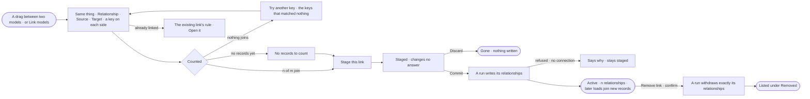

# SE-03 · Link two models

**As** a modeller with several models in one Graph **I want** to declare how two of them meet — the same thing, or a
relationship between them — on a key on each side, and see how many records it joins before I make it **so that** a
question can cross them without anyone guessing which `Stock` is which.

Tasks: [task.md](task.md) · Feature: [SE-F06](../../feature.md)

## Who can

Linking models is the Modeller's and the Admin's ([the role table](../../../../../../os/access/features/AC-F02-access-policies/feature.md#the-role-table)).

| Lens | Can | Otherwise sees |
|---|---|---|
| Admin | Link two published models, commit or discard staged links, and remove a link | — |
| Operator | Read every link, its rule, its counts and its history. A Modeller links, commits and removes as an Admin does | *Link models* disabled and a drag between models refused — *Needs the Modeller role — ask an Admin* |

## Flow

## Acceptance criteria

| # | Given | When | Then |
|---|---|---|---|
| SE-03.1 | Two published models | the person drags a kind onto a kind in the other model, or picks *Link models* | one card opens with both sides filled as *Source* and *Target*, the choice *Same thing* or *Relationship*, and a key on each side |
| SE-03.2 | A relationship link | the person fills the card | they name the relationship and choose where its ends come from — *These keys* or *Its own rows* from a load — never both |
| SE-03.3 | Both keys named | the card completes | it counts what the rule joins at once — *1,284 of 1,310 join* — with the sentence naming both keys and *Show the 26* listing the keys that matched nothing |
| SE-03.4 | A rule that joins nothing against records that exist | it is counted | *Stage this link* is disabled and the card offers *Try another key* |
| SE-03.5 | A side with no records yet | it is counted | the card reads *No records to count* and the link may still be staged |
| SE-03.6 | A key that is not a property of its kind, or a kind with no properties | the person picks keys | it is refused naming the side and the kind; a kind with no properties says so in place of the picker |
| SE-03.7 | A pair already linked | the person stages | the card names the existing link's rule with *Open the existing link* |
| SE-03.8 | A drag inside one model, or onto a model with nothing published | it ends | the footer says why: a relationship inside a model is changed in its draft; a link needs a published version |
| SE-03.9 | A staged link | anyone reads the map or asks a question | it is listed, drawn and counted as *staged*, and no answer changes until it is committed |
| SE-03.10 | Staged links | the person picks *Commit* | every staged link becomes active in one run, which writes each link's relationships — *same as* for the same thing, the named relationship for a keyed one — and returns how many it wrote; committing again writes nothing twice |
| SE-03.11 | Staged links | the person picks *Discard* | they go and nothing was written |
| SE-03.12 | An active link | new records are loaded | the load joins them by the link's rule without anyone re-running it |
| SE-03.13 | A rule that denies either model, no connection, or a read-only one | the person counts, commits or removes | it is refused with the reason; nothing is counted around it and the link stays as it was |
| SE-03.14 | An active link | the person selects it | it reads whole: its ends with their records, the rule with *n joined* or *n relationships*, the queries that crossed it in 30 days, who declared it, when and where from, and its history — declared, committed |
| SE-03.15 | An active link | the person picks *Remove link* and confirms | a run withdraws exactly the relationships it wrote, then the link goes and is listed under *Removed* with who removed it, when and what was withdrawn |
| SE-03.16 | A relationship the link wrote | the person opens *How it got here* on it | it names the link, its rule and when it was written |
| SE-03.17 | A model republished | its links show | they carry onto the new version; links on the version it replaced stay as history and are not counted twice |
| SE-03.18 | An Operator | they drag between models or reach *Link models* | it is refused with *Needs the Modeller role — ask an Admin*; every link still reads |
| SE-03.19 | Both keys named while no worker is free to count | the card counts | It reads that the count is waiting for a worker, with *Try again*; nothing is staged |

## Screens

| Surface | Lens | First use | Empty after a filter | Loading | Has data | Failed | Agent working or proposing | No access |
|---|---|---|---|---|---|---|---|---|
| Link two models | Admin | model.board · Link card | — | model.board · Link counting | model.board · Link joins | model.board · Link refused | — | — |
| Link two models | Operator | — | — | — | — | — | — | model.board · Link refused |
| Links between models | Admin | model.board · No links | model.board · No link matches | model.board · Links loading | model.board · Links | model.board · Commit refused | model.board · Committing | — |
| Links between models | Operator | model.board · No links | model.board · No link matches | model.board · Links loading | model.board · Links | — | model.board · Committing | model.board · Read only |
| A link | Admin | — | — | model.board · Link loading | model.board · Link | model.board · Remove refused | model.board · Withdrawing | — |
| A link | Operator | — | — | model.board · Link loading | model.board · Link | — | — | model.board · Read only |
