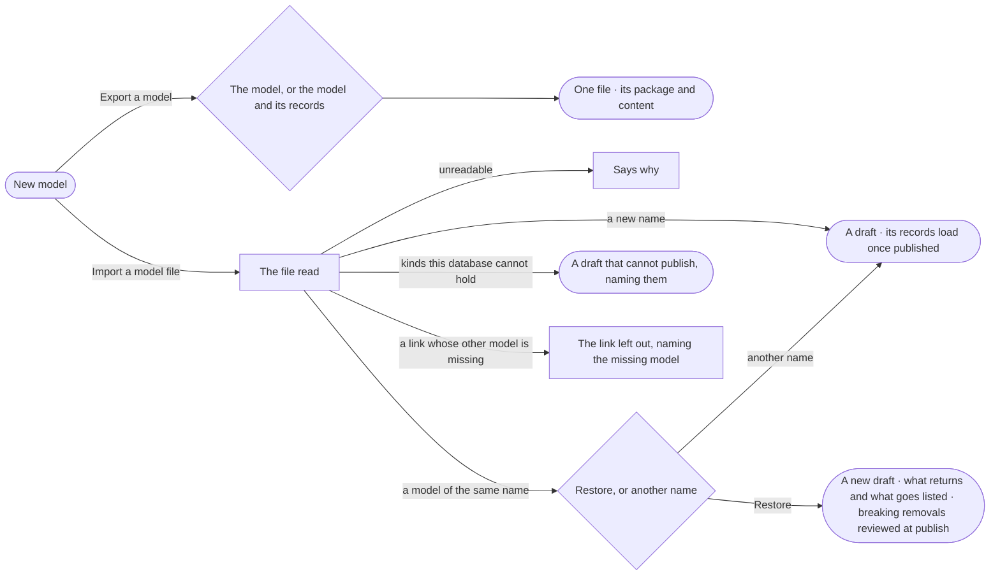

# SE-16 · Export and import a model

**As** a modeller **I want** to export a model — alone or with its records — and import one back, as a new model or to
restore an earlier version **so that** a model moves between Graphs and installs, and a bad change can be undone.

Tasks: [task.md](task.md) · Feature: [SE-F06](../../feature.md)

## Who can

Importing and restoring a model is the Modeller's and the Admin's; exporting is every signed-in person's ([the role table](../../../../../../os/access/features/AC-F02-access-policies/feature.md#the-role-table)).

| Lens | Can | Otherwise sees |
|---|---|---|
| Admin | Export a model with or without its records, import a model file as a new model, and restore an earlier version | — |
| Operator | Export a model with or without its records, the records being those their default agent may read. A Modeller imports and restores as an Admin does | *Import a model file* disabled — *Needs the Modeller role — ask an Admin* |

## Flow

## Acceptance criteria

| # | Given | When | Then |
|---|---|---|---|
| SE-16.1 | A published model | the person picks *Export a model* | they choose *The model* or *The model and its records* and get one file |
| SE-16.2 | *The model and its records* | it exports | the file holds the model, one records file per kind and where they came from, with their hashes |
| SE-16.3 | Several models exported together | a link joins two of them | the link travels; a link whose other model is not in the file is left out, naming that model |
| SE-16.4 | A model file and a Modeller or an Admin | they pick *Import a model file* | it opens as a new draft under the name typed |
| SE-16.5 | A file with records | the imported model is published | its records load as an ordinary load |
| SE-16.6 | A file whose model shares a name with one in this Graph | it is imported | the dialog offers *Restore* or another name; *Restore* makes a new draft with the exported version's kinds and lists what returns and what goes; a breaking removal is reviewed when published (SE-05) |
| SE-16.7 | A restore | it lands | records are not loaded unless the person asks — the database already holds them |
| SE-16.8 | A file of the same package with new content | it is imported | it is recognised as a new version of that model, with what changes; the local draft is never overwritten silently |
| SE-16.9 | A property type this database cannot hold | the file is imported | it lands as a draft that cannot publish, naming each such type and why |
| SE-16.10 | A file that cannot be read | it is imported | the dialog says why; nothing is made |
| SE-16.11 | Any import or export | the dialog shows | it prints the matching `invana models` command |
| SE-16.12 | An Operator | they open *New model* | *Export a model* works; *Import a model file* is disabled with *Needs the Modeller role — ask an Admin* |
| SE-16.13 | A model file declaring an axis on a property the model lacks | it is imported | The import is refused naming the model, the axis and the property; nothing is made |
| SE-16.14 | A Modeller or an Admin | they list, export, import or upgrade models, or list the starters, from the command line | The command does what the dialog does, under the same access; a refusal is a sentence naming the next command |
| SE-16.15 | *The model and its records* where a property's level is confidential or personal | it exports | those values are left out of the records files; the dialog and the file name each property and level left out ([AC-F09](../../../../../../os/access/features/AC-F09-what-left-the-platform/feature.md#engine)) |
| SE-16.16 | An export | it is made | it passes the outbound check with lineage, and a person whose default agent may not Read a property's level gets the records without that property |

## Screens

| Surface | Lens | First use | Empty after a filter | Loading | Has data | Failed | Agent working or proposing | No access |
|---|---|---|---|---|---|---|---|---|
| Export | Admin | model.new · Export | — | model.new · Exporting | model.new · Export | model.new · Export failed | — | — |
| Export | Operator | model.new · Export | — | model.new · Exporting | model.new · Export | model.new · Export failed | — | — |
| Export · values left out | Admin | — | — | — | model.new · Export · Redacted | — | — | — |
| Export · values left out | Operator | — | — | — | model.new · Export · Redacted | — | — | — |
| Import a model file | Admin | model.new · Import | — | model.new · Reading the file | model.new · Restore | model.new · Import unreadable | — | — |
| Import a model file | Operator | — | — | — | — | — | — | model.new · No access |
| The imported draft | Admin | — | — | model.board.draft · Arriving | model.board.draft · Restored | model.board.draft · Cannot publish | — | — |
| The imported draft | Operator | — | — | — | model.board.draft · Read only | — | — | model.board.draft · Read only |
