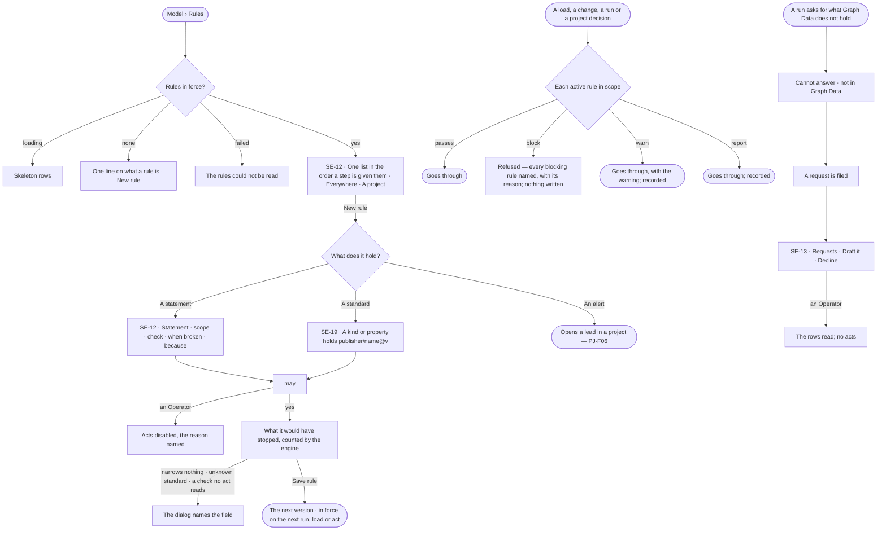

# Rules

> Everything that must hold, written once and published with the contract: **constraints** refuse data that breaks
> them, **act rules** block, warn on or report what people and agents do, and **alerts** notice a pattern and open a
> lead in a project. Every rule is scoped to *Everywhere* or a project. Facts a model derives are written in
> [Inference](../SE-F08-inference/feature.md), never here. What a person or an
> agent may see of a property is an Access Policy ([AC-F02](../../../../os/access/features/AC-F02-access-policies/feature.md#property-access)), never a rule here. The
> decision it helps make: *what must hold before data lands, a run acts, or a project decides — and what
> would this rule have stopped?*

## User journey

## Stories

| ID | Story | Status |
|---|---|---|
| SE-12 | [State what must always hold](stories/SE-12-state-what-must-always-hold/story.md) | idea |
| SE-19 | [Hold a kind or property to a standard](stories/SE-19-hold-a-kind-to-a-standard/story.md) | idea |
| SE-13 | [Act on what people and agents ask of the model](stories/SE-13-act-on-what-people-and-agents-ask-of-the-model/story.md) | idea |

## Access

Permissions are [the permission catalogue](../../../../os/access/features/AC-F02-access-policies/feature.md#the-permission-catalogue)'s; an act a person lacks shows disabled, naming the permission and who can grant it.

| Act | Permission | Everyone else sees |
|---|---|---|
| Read every rule in force and its evidence | Read on `model/<model>` | The model absent |
| Read every request | Read on `model/<model>` | The model absent |
| Create, edit, stop offering or offer again a rule *Everywhere* or on *A project* · hold a kind or property to a standard | Edit on `model/<model>` | Acts disabled, the permission named — *Needs Edit on the Orders model — ask Priya or Lee* |
| Install a shipped pack's rules | Create on `setting/team-packs` | Disabled, the permission named |
| Draft it from a request | Create on `model/*` | The rows read; the act disabled, the permission named |
| Decline a request | Edit on `model/<model>` | The rows read; the act disabled, the permission named |
| File a request — *Ask for a change* | None — every signed-in person | — |

## States

| State | What the person sees |
|---|---|
| First use | No rule in force: one line on what a rule is, and *New rule*. No request: *Nothing asked yet — asks Graph Data did not hold, and asks for a change, land here* |
| Empty after a filter | *No rules — Everywhere* · *checked on A load*, with the filter to clear |
| Loading | Skeleton rows; the impact line reads *Counting…* while the dialog's check changes |
| Has data | One list in the order a step is given them, each row with what it holds · scope · checked on · when broken · broken in 30 days; a rule not offered dimmed in place; requests Open, then Done folded |
| Failed | *The rules could not be read*; a save the engine refused names the field, rule or standard behind it |
| Agent working or proposing | — |
| No access | Every rule and request reads; acts are disabled with the reason |

## Rules

| Rule | Detail |
|---|---|
| Three kinds of rule | **Constraint** — refuses data that breaks it, closed-world: what is not allowed is refused, checked when a record is loaded or changed — a property's range (SE-08) or a standard a kind or property holds (SE-19) · **Act rule** — blocks, warns on or reports what people and agents do: a checked statement (SE-12); Access enforces it · **Alert** — notices a pattern in the records and opens a lead in a project (PJ-F06). A derivation is none of these: it is written only in Inference ([SE-F08](../SE-F08-inference/feature.md)) |
| One statement | A statement rule is one sentence; a long one is accepted, with a nudge that it reads better as two |
| Two scopes, fixed once saved | *Everywhere* — the whole deployment · *A project* — one project. A person with Edit on the model writes both; installing a shipped pack is Create on `setting/team-packs` |
| Inherited, in order | A step is given the *Everywhere* rules, then its project's — each by itself, with its id, never run together. A project shows the *Everywhere* rules above its own, read-only |
| Offered and cited | A step records the rules it was offered and the ones it says it followed; a citation is never enforcement |
| A check is picked, never written | A statement may carry one check from a fixed list, and the check names the acts it is read at — *A load* · *Project decision*. A statement with no check is offered only |
| The checks | *Load meets a standard* (the standard, a minimum score) — at a load · *Load licence is one of* (the licences) — at a load · *Evidence was reviewed by a person* — at a decision · *Evidence is not undone* — at a decision, failing when a cited load was undone. A project rule may carry only the two evidence checks |
| When broken | *Block* refuses the act, naming the rule · *Warn* lets it through and says so · *Report* records it only. A check with no mode warns |
| Every block in one refusal | An act reads every active rule in its scope before writing; a blocked act writes nothing, and the refusal names each blocking rule, its *because* and the reason. A load refuses record by record (RC-F02) |
| A hold is a constraint | A kind or property holding a standard is a constraint naming its values, versioned with the model; a newer standard version never moves it (SE-19) |
| A request for hidden data is stored like any other | A run that needs a kind or property an Access Policy hides ends *cannot answer · not in Graph Data* and may file a request here; it is stored and shown like any other, to those who read requests, with nothing marking that something was hidden; Invana never names a hidden kind or property to a person who may not read it, and the asker learns nothing more — no refusal, no ask to an approver ([AC-F02 › Property access](../../../../os/access/features/AC-F02-access-policies/feature.md#property-access)) |
| Because | One optional line said to whoever the rule stops |
| Versioned | Changing a rule publishes its next version; a past run, load and check name the version they read |
| Stop offering, not delete | *Stop offering it* stops offering and checking; its versions and past citations stay, and *Offer it again* reverses it |
| Impact before saving | The engine reads the last 30 days of the rule's acts back through it — the count read, the count broken and the newest five — worded *would have stopped* · *would have warned on* · *would have reported* |
| A statement opens its rule | On a step and in *How it got here*, each rule is its statement — the version the step was given — and opens the rule's evidence |
| Cited is self-reported | Where a rule was cited says so: *N steps said they used it. Nothing checks they used it well* — shown only when a step cited it |
| The engine counts every number | Broken in 30 days, what a rule would stop, scores against a standard, the open requests — Studio formats, never derives |
| Every edit is recorded | Creating, editing, stopping and resolving are events with before and after, in History |
| Leans on | SE-F02 — constraints on a property · SE-F05 — the standards a kind holds · RC-F02 — loads · RC-F03 — the records that break a rule · AC-F02 — enforcing act rules · PJ-F01 — a project's rules on its Details · PJ-F06 — alerts · Agents › Runs — a step's offered and cited rules |

## Data touched

| Record | Read or write |
|---|---|
| Rule — kind, scope, order, offered or not, its current version | Read · write |
| Rule version — statement, check, mode, because, when published | Read · write |
| A hold — kind or property, standard version, mapping, mode | Read · write |
| Scores per kind and standard version — records, conforming, score, problems | Read · write (engine) |
| Request — the ask, who asked through what, what it met, its resolution | Read · write |
| Run step — the rules offered and cited; a run's frozen rules | Read |
| Acts of the last 30 days — loads, project decisions, runs | Read |
| Events — create, publish, stop and resume offering, resolve, a failed warn or report | Write |

## Engine

The low-level design: what this feature stores, serves and refuses. Conventions — naming, errors, lists, events — are
[system-design.md](../../../../system-design.md) §§ 6–8; this section only fills them in.

### Records

| Table | Columns | Notes |
|---|---|---|
| `model_rules` | `kind` (`act` · `alert`) · `scope` (`install` · `project`) · `project_id?` · `order` · `active` · `current_version_id` | Never deleted — `active` stops offering and checking |
| `model_rule_versions` | `rule_id` · `statement` · `check` · `params` · `mode` (`block` · `warn` · `report`) · `because` · `published_at` | A past run, load and check names the version it read |
| `model_requests` | `graph_id` · `kind` (`unanswered` · `change`) · `title` · `detail` · `source` (`explorer` · `agent` · `schedule` · `api`) · `asked_by_id` · `agent_id` · `run_id` · `session_id` · `asks` · `last_asked_at` · `status` (`open` · `done`) · `resolution` (`declined` · `modelled`) · `resolution_note` · `model_id?` · `resolved_by_id` · `resolved_at` | The same open ask by the same person or agent adds to `asks`. No column records that an Access Policy hides what was asked: a request about hidden data is stored and shown like any other, to those who may read requests; a kind or property is named only as the asker or the reader may read it |

### Reads

| Record | Owner |
|---|---|
| A step's offered and cited rules · the runs a request was filed from | [CP-F10](../../../../os/control/features/CP-F10-runs-and-how-the-agents-are-doing/feature.md#engine) |
| Loads a check reads at | [RC-F02](../../../records/features/RC-F02-bring-records-in/feature.md#engine) |
| Project decisions a check reads at · a project's rules on its Details | [PJ-F03](../../../projects/features/PJ-F03-branches-findings-and-decisions/feature.md#engine) · [PJ-F01](../../../projects/features/PJ-F01-projects-and-tasks/feature.md#engine) |
| The leads an alert rule opens | [PJ-F06](../../../projects/features/PJ-F06-alerts/feature.md#engine) |
| Who may act — the act rules' enforcement among every check | [AC-F02](../../../../os/access/features/AC-F02-access-policies/feature.md#engine) |
| History — every event this feature writes | [AC-F06](../../../../os/access/features/AC-F06-history/feature.md#engine) |

### Routes

| Route, after `/api/v1/model` | Does | Story |
|---|---|---|
| `GET /rules` · `POST /rules` | The deployment's rules in order · create one | SE-12 |
| `GET /rules/{id}` · `PATCH /rules/{id}` · `GET /rules/{id}/versions` | A rule with `acts` (read off the check; empty on a rule only offered) · `because` · `citations` · `project_key` · `project_name` · `broken_30d` (null with no check) · publish its next version · its versions | SE-12 |
| `POST /rules/{id}/activate` · `POST /rules/{id}/deactivate` | *Offer it again* · *Stop offering it* | SE-12 |
| `GET /rules/{id}/citations` | `offered` · `total` (cited) · `versions[]` (`rule_version_id` · `version` · `statement` · `published_at` · `cited`, newest first) · `items[]` | SE-12 |
| `POST /rules/impact` | `{scope, project_key?, check}` → `{days: 30, read, broken, items[≤5 {act, subject, at, reason}]}`, newest first | SE-12 |
| `GET /projects/{key}/rules` | A project's own rules, with the *Everywhere* rules above them | SE-12 |
| `GET /requests?status=&kind=` · `POST /requests` | A page of requests, plus `open` (whatever the filter) and `may_resolve` · *Ask for a change* | SE-13 |
| `POST /requests/{id}/resolve` | `{action: model · decline, model_id?, note?}` → the request | SE-13 |

### Events

| Event | When |
|---|---|
| `model.rules.create` · `model.rules.publish` | A rule created · its next version published |
| `model.rules.activate` · `model.rules.deactivate` | Offered again · stopped |
| `model.rules.check` | A failed `warn` or `report`: `act` · `subject` · `mode` · `version` · `reason` |
| `model.requests.create` · `model.requests.resolve` | A request filed · resolved |

### Refusals

| Status | When | Sentence | Criterion |
|---|---|---|---|
| 403 | A rule or a resolve by someone without Edit on the model | *Needs Edit on {model} — ask {who can grant}.* | SE-12.16 · SE-13.14 |
| 409 | An act a `block` rule refuses — on the act's route; every blocking rule in one refusal, nothing written | *{act} is blocked: {rule} — {because} ({reason}).* | SE-12.9 |
| 409 | Resolving a request already resolved | *Already resolved.* | SE-13.12 |

### CLI

| Command | Does |
|---|---|
| `invana requests list [--status] [--kind]` | The deployment's requests |
| `invana requests resolve <id> --decline · --model [<model>] [--note]` | Resolve one |

### Mechanisms

| Mechanism | How |
|---|---|
| Where each kind lives | **Constraint** — a property's range is a [SE-F02](../SE-F02-change-and-publish-a-model/feature.md#engine) `model_constraints` row and a hold is versioned with the model (SE-19), both checked when a record is loaded or changed; never a `model_rules` row · **Act rule** — a statement, `kind = act`, read by `enforce` at its acts · **Alert** — `kind = alert`, its condition, the kinds it watches and the project, task or branch it opens leads in the version's `params`; evaluated on a queue worker after a load or change settles, never blocking the write, and the lead opened by [PJ-F06](../../../projects/features/PJ-F06-alerts/feature.md#engine) |
| The checks | `load.conforms` (`standard` as `publisher/name`, `min_score` 0 to 1, default 1) and `load.licence` (`allowed`, compared case-blind), read at a load, on *Everywhere* rules · `evidence.reviewed` and `evidence.not_undone`, read at a project decision, on *Everywhere* and project rules |
| `enforce` | Reads every active checked rule in scope before the act writes; every block in one refusal; a failed `warn` or `report` writes `model.rules.check` |
| Offered and cited | A step is given the rules in order, each with its version id; its citations are stored on the step and counted per version (`rule_citation_counts`), offers per rule (`rule_offer_counts`). Until the deployment has offers, the offered and never-cited tiles are absent, not 0 |
| Impact | The last 30 days of the check's acts read back through the rule; the list's *broken in 30 days* is the same read |
| Filed where the ask fails | The run loop files a request on an unanswered ask by a person or an agent — never an eval |

## System impact

| HLD section | Change | NFRs |
|---|---|---|
| § 6 Data and storage | Rule, rule version and request tables in Invana's own store | — |
| § 8 APIs and events | The routes and events above, under `model` | — |
| § 9 Distributed execution | Alert rules evaluated on a queue worker after a load or change settles | — |
| § 10 AI and agents | A step is offered rules and records what it cited; a citation is never enforcement | — |

## Decisions

| Decision | Detail |
|---|---|
| One list of what must always hold | The Rules section lists every rule in force in the deployment — *Everywhere* and every project's the reader can see — filtered by what it holds, scope and what it is checked on, the filters held in the URL and applied by the engine |
| New rule asks what it holds | *A statement* · *A standard* · *An alert* — each opens its own dialog |
| The rule opens as a modal | Statement · scope · check and its fields · *Checked on* (read off the check, never picked) · *When broken* · *Because* · the impact line; footer *Stop offering it* or *Offer it again* · *Cancel* · *Save rule* |
| Evidence is a reading | Offered · cited · never cited, each version with its own cited count, and where each was cited; until the deployment has offers, the two derived tiles are absent rather than zero |
| A project's rules sit in its Details | The inherited rules first, dimmed and read-only, then the project's own — never a tab of their own (PJ-F01) |
| Order is the priority | A step is given the rules in the list's order — *Everywhere*, then its project's, each in its own order; a rule carries no priority |
| Requests are filed by the engine | Where the ask fails — *cannot answer · not in Graph Data* asked by a person or an agent, never an eval — and by *Ask for a change* |
| Draft it opens New model | Described by the ask; creating the draft resolves the request as modelled |
| Done rows say what was done | *declined* · *modelled in Fares*, written by the engine |
| An agent's own bound is the agent's | Authored on the agent (AG-F01); this list holds the deployment's rules alone |

## Open questions

| Question | Who answers |
|---|---|
| — | — |

## Not building

| Item | Why not |
|---|---|
| Rules on properties | What a person or an agent may see of a property is an Access Policy ([AC-F02 › Property access](../../../../os/access/features/AC-F02-access-policies/feature.md#property-access)); a second place would disagree. SE-11 is retired with its ID |
| Statement rules a step must obey while it runs | A run is bounded by *What it may do* and its Access Policies; a statement's check is read at acts, never mid-run |
| A free-text or scripted check | A check is a fixed list an auditor can read |
| A rule checked at a finding | A finding is evidence, not an act; the decision citing it is where a rule reads it |
| Choosing the acts a check is read at | The check names its acts |
| Detecting rules that contradict | Two rules in tension is a judgement, and *How it got here* shows which was used |
| Rules on an agent | An agent carries skills and bounds; rules describe the world |
| Most-specific-rule-wins | A deny a narrower allow can punch through is not a bound; a deny wins at any level |
| An approval for a rule change | The event is the record |
| Rules that expire | A bound with a timer is a bound nobody watches |
| Applying a rule to past runs | A run keeps what it was frozen with, so its answer can be rebuilt |
| Starter sets of rules | A set that fits nobody is edited blindly; a Team pack's rules are a person's choice to apply |
| Assigning a request to a person | One list for the deployment's modellers; the event names who resolved it |
| Reopening a done request | Asking again files a new one |
| A notification per request | The open count carries it |
