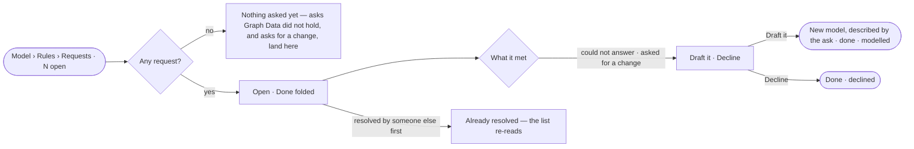

# SE-13 · Act on what people and agents ask of the model

**As** a modeller **I want** one list of what analysts and agents asked to have modelled — what Graph Data did not hold, and what they asked to change **so that** gaps get
fixed, not lost.

Tasks: [task.md](task.md) · Feature: [SE-F07](../../feature.md)

## Who can

Answering a request is Edit on the model — *Draft it* also Create on `model/*`; any signed-in person files one.

| Access | Can | Otherwise sees |
|---|---|---|
| Admin | Read every request; *Draft it* or *Decline* one | — |
| Operator | Read every request; file one with *Ask for a change*; answer requests when their policies hold Edit on the model | Rows without *Draft it* or *Decline* — *Needs Edit on the Orders model — ask Priya or Lee* |

## Flow

## Acceptance criteria

| # | Given | When | Then |
|---|---|---|---|
| SE-13.1 | Nothing asked | the person opens Requests | it reads *Nothing asked yet — asks Graph Data did not hold, and asks for a change, land here* |
| SE-13.2 | Open requests | Model opens | *Rules* in the leftNav and *Requests* in its leftSection carry the open count, as counted by the engine |
| SE-13.3 | Requests | the person opens Requests | Open lists first and Done folded; a row is the ask over who · from where · what it met (*Graph Data did not hold it*, or *asked for a change*) · how many times asked · when |
| SE-13.4 | A run ending *cannot answer · not in Graph Data*, asked by a person or an agent | it settles | a request is filed by the engine; an eval or a test files none |
| SE-13.5 | The same open ask by the same person or agent | it is asked again | it adds to the one request's count and last asked, never a second row |
| SE-13.6 | A person in Explore | they pick *Ask for a change* | a request is filed with their words |
| SE-13.8 | A request | they pick *Draft it* | New model opens described by the ask; creating the draft moves the row to Done reading *modelled in <model>* |
| SE-13.9 | Any request | they pick *Decline* | the row moves to Done reading *declined* |
| SE-13.12 | A request resolved by someone else first | they act on it | it says *already resolved* and the list re-reads |
| SE-13.13 | A resolution | it is made | History records who resolved it, how and when |
| SE-13.14 | A person without Edit on the model | they open Requests | the rows read without *Draft it* or *Decline*, and a line reads *Needs Edit on the Orders model — ask Priya or Lee* |
| SE-13.15 | A person with Edit on the model | they list or resolve requests from the command line | The same two resolutions as Studio — draft it, decline — under the same access |
| SE-13.16 | A run that ends *cannot answer · not in Graph Data* for a kind or property an Access Policy hides from the asker | it settles | a request may be filed like any other, naming what was asked in the asker's own words; it is stored and shown like any other request to the people who may read requests, with no flag, no mark and no count that says something was hidden; a kind or property a Deny Read hides is never named by Invana to a person who may not read it, and the asker learns nothing more |

## Screens

| Surface | Access | First use | Empty after a filter | Loading | Has data | Failed | Agent working or proposing | No access |
|---|---|---|---|---|---|---|---|---|
| Requests | Admin | model.rules · No requests | — | model.rules · Requests loading | model.rules · Requests | model.rules · Already resolved | — | — |
| Requests | Operator | model.rules · No requests | — | model.rules · Requests loading | model.rules · Requests | model.rules · Could not load | — | model.rules · Requests read only |
