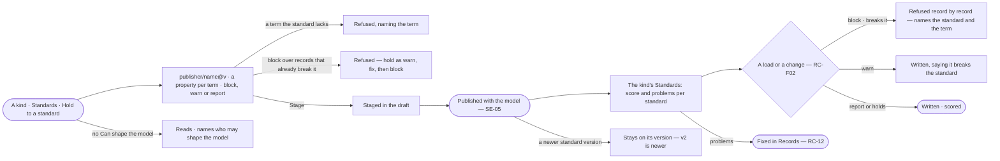

# SE-19 · Hold a kind or property to a standard

**As** a data curator **I want** a kind or a property in a model to hold one version of a standard as block, warn or
report, and see how its records score against it **so that** records that break the terms our field agreed are caught
when they are loaded or changed.

Tasks: [task.md](task.md) · Feature: [SE-F07](../../feature.md)

## Who can

| Lens | Can | Otherwise sees |
|---|---|---|
| Admin | Hold any kind or property to a standard, change its mode or mapping, or let it go, in a draft; read every score | — |
| Operator | Read the standards a kind or property holds and its scores | *Hold to a standard* absent, naming who may shape the model. *With Can shape the model: as Admin* |

## Flow

## Acceptance criteria

| # | Given | When | Then |
|---|---|---|---|
| SE-19.1 | A kind in a draft, opened by someone who can shape the model | they pick *Hold to a standard* | they pick a standard and version (the current by default), a property for each term — same-named properties preselected — and *block*, *warn* or *report* |
| SE-19.2 | A property held to one term of a standard | it is staged | it is a constraint naming the standard's values (SE-08), versioned with the model |
| SE-19.3 | A mapping that names a term the standard lacks | it is staged | it is refused, naming the term |
| SE-19.4 | A required term with no property | records are scored | every record has that term *missing*; no property is guessed |
| SE-19.5 | *Block* over a kind whose records already break the standard | it is staged | it is refused: *hold as warn, fix, then block* |
| SE-19.6 | A published hold | the kind's *Standards* opens | each standard shows its version, mode, records, conforming, the score and its problems — *missing · not allowed · wrong type* — up to the first 50, with the whole count, as the engine stores them |
| SE-19.7 | A *block* hold | a load or a change writes a record that breaks it | that record is refused, naming the standard and the term; the rest of the load goes on (RC-F02) |
| SE-19.8 | A *warn* hold | a record that breaks it is written | it is written and the load's report says it breaks the standard |
| SE-19.9 | A *report* hold | a record that breaks it is written | it is written and scored, with nothing said |
| SE-19.10 | A standard that publishes a newer version | the hold is read | it stays on its version and reads *v2 is newer* |
| SE-19.11 | A hold whose mapping or mode changes and publishes | the model publishes | the kind's score is recomputed by the engine |
| SE-19.12 | A kind that holds no standard | *Standards* opens | it reads *No standards held*, with *Hold to a standard* for someone who can shape the model |
| SE-19.13 | An Operator without *Can shape the model* | they open a kind's *Standards* | scores read; *Hold to a standard* and *Let go* are absent and a line names who may shape the model |
| SE-19.14 | Someone who can shape the model, on a hold | they pick *Let go* and publish | the hold goes, later loads are not scored against that standard, earlier scores stay readable and the model's history names who let it go |
| SE-19.15 | A model with holds | someone checks it from the command line | each hold's score and first problems print, and the command exits non-zero when a kind breaks a *block* hold, so a pipeline can branch on it |

## Screens

| Surface | Lens | First use | Empty after a filter | Loading | Has data | Failed | Agent working or proposing | No access |
|---|---|---|---|---|---|---|---|---|
| Hold to a standard | Admin | data.checks · Hold to a standard | — | data.checks · Loading | data.checks · Hold to a standard | data.checks · Hold refused | — | — |
| Hold to a standard | Operator | — | — | — | — | — | — | model.board.kind · Standards read only |
| A kind · Standards | Admin | model.board.kind · No standards held | — | model.board.kind · Standards loading | model.board.kind · Standards | model.board.kind · Could not load | — | — |
| A kind · Standards | Operator | model.board.kind · No standards held | — | model.board.kind · Standards loading | model.board.kind · Standards | model.board.kind · Could not load | — | model.board.kind · Standards read only |
| A record refused by a block hold | Admin | — | — | — | — | data.checks · Blocked by a standard | — | — |
| A record refused by a block hold | Operator | — | — | — | — | data.checks · Blocked by a standard | — | — |
