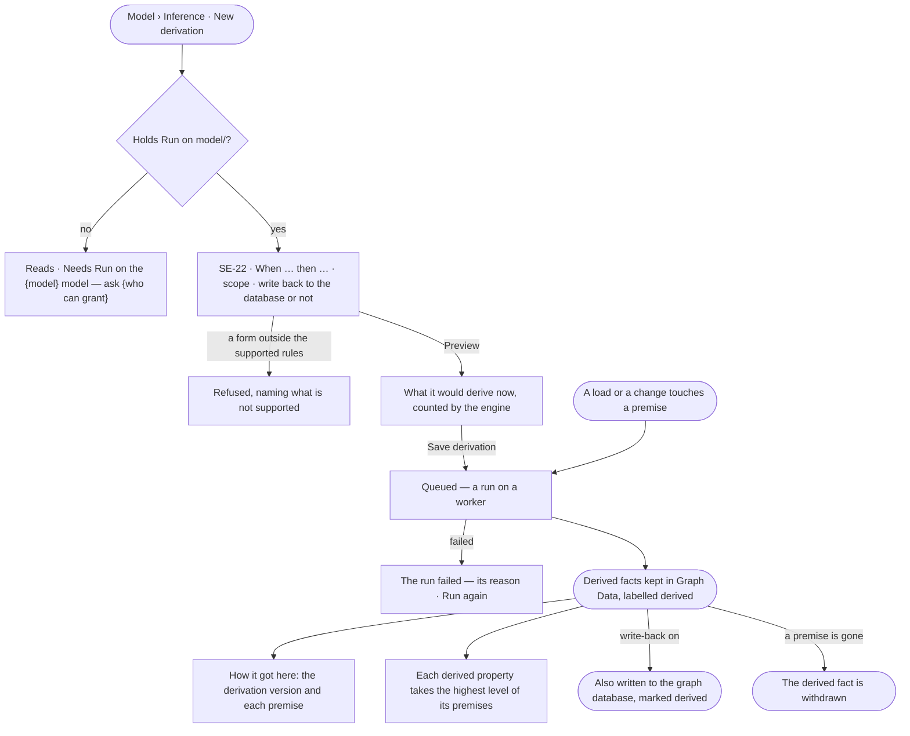
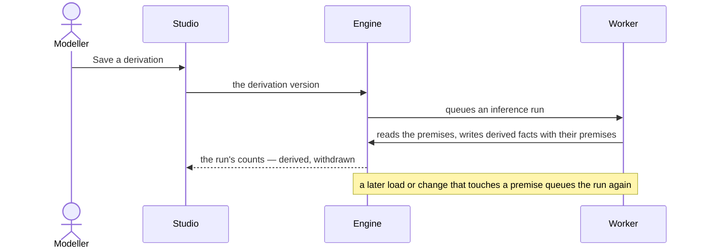

# Inference

> Facts Invana can derive from what Graph Data holds: a **derivation** says *when these facts hold, this one does too*, and
> Inference runs it in the background, keeping each derived fact with the derivation and the facts it came from. Derivations are written here and only here — never as a rule in [Rules](../SE-F07-rules/feature.md). The
> decision it helps make: *what follows from what we know — and can I trust it?*

## User journey

## Stories

| ID | Story | Status |
|---|---|---|
| SE-22 | [Derive facts from a rule](stories/SE-22-derive-facts-from-a-rule/story.md) | idea |

## Access

| Act | Permission ([the permission catalogue](../../../../os/access/features/AC-F02-access-policies/feature.md#the-permission-catalogue)) | Everyone else sees |
|---|---|---|
| Read derivations, their runs and every derived fact with its premises | Read on `model/<model>` — as far as their default agent reads the premises | A premise or a property their agent may not read is absent, with no count and no note |
| Create, change, stop or run a derivation | Run on `model/<model>` | Absent; *Needs Run on the {model} model — ask {who can grant}* |
| Turn on write-back to the graph database for a derivation | Edit on `data/<graph database>` | Absent; *Needs Edit on {graph database} data — ask {who can grant}* |

## States

| State | What the person sees |
|---|---|
| First use | *No derivations yet — a derivation adds facts that follow from the ones you hold*, with *New derivation* |
| Empty after a filter | *No derivation matches*, with the filter to clear |
| Loading | Rows hold their shape; a preview reads *Counting…* |
| Has data | Each derivation with its scope, last run, facts derived and withdrawn, and whether it writes back |
| Failed | A run that failed names its reason, with *Run again*; a refused derivation names what is not supported |
| Agent working or proposing | A run in progress, with its progress counted by the engine |
| No access | Derivations and derived facts read; the acts are absent |

## Rules

| Rule | Detail |
|---|---|
| Rule-based only | A derivation is stated in a supported form — OWL 2 RL, SHACL rules, or a Datalog-style *when … then …* over kinds, relationships and properties. A form outside them is refused at save |
| Runs on the queue | Each derivation runs as an inference run on a worker (CP-F03), within the deployment's limits; a load or a change that touches a premise queues it again |
| Derived facts are records | Each derived fact is stored in Invana's store as a record labelled *derived*, with the derivation version and its premises (RC-F06); it is read beside loaded records and never mistaken for one |
| How it got here | A derived fact opens on its derivation version and each premise, each premise opening its own provenance |
| A derived value keeps the highest level | Each property of a derived fact takes the highest of the levels ([SE-F03](../SE-F03-meaning/feature.md)) of the premise properties it was derived from; public, internal, confidential, personal rise in that order. A derivation cannot lower a level, and a later change to a premise's level reaches the derived fact in the next run. A premise a person's agent may not read is absent from the fact's premises, with no note |
| Withdrawn when its premise goes | When a premise is changed or removed, the facts that rested on it are withdrawn in the next run |
| Write-back is opt-in | Off by default; turned on per derivation by a person with Edit on `data/<graph database>`, the facts are also written to the graph database, marked derived, and removed when withdrawn |
| No loops forever | A run stops when no new fact is derived; a run that passes the deployment's limit stops and says so |
| The engine counts | Facts derived and withdrawn per run and per derivation are the engine's |
| Leans on | RC-F06 — provenance of each fact · CP-F03 — workers and the queue · AC-F02 — who may read the premises · SE-F03 — the levels a derived value inherits |

## Data touched

| Record | Read or write |
|---|---|
| Derivation — its versions: form, scope, write-back | Read · write |
| Inference run — the derivation version, started, ended, derived, withdrawn, failed and why | Write |
| Derived fact — a record labelled *derived*, its derivation version and premises | Write (into Records) |
| Records the premises match | Read |

## Engine

The low-level design: what this feature stores, serves and refuses. Conventions — naming, errors, lists, events — are
[system-design.md](../../../../system-design.md) §§ 6–8; this section only fills them in. A derivation is Inference's own
record, never a row of [SE-F07](../SE-F07-rules/feature.md#engine)'s `model_rules`.

### Records

| Table | Columns | Notes |
|---|---|---|
| `model_derivations` | `graph_id` · `scope` (`install` · `project`) · `project_id?` · `active` · `write_back` (bool) · `current_version_id` | Never deleted — `active` stops running it |
| `model_derivation_versions` | `derivation_id` · `form` (`owl_rl` · `shacl` · `when_then`) · `statement` · `params` · `published_at` | A fact names the version that derived it |
| `derived_facts` | `graph_id` · `fact_id` · `derivation_version_id` · `premises` · `run_id` · `written_back` · `levels` (property → level) · `created_at` · `withdrawn_at` | One row per derived fact; `premises` are record ids; `levels` holds each derived property's inherited level; a withdrawn fact keeps its row for provenance |

### Reads

| Record | Owner |
|---|---|
| Provenance of a record | [RC-F06 › Engine](../../../records/features/RC-F06-provenance/feature.md#engine) |
| A property's level | [SE-F03 › Engine](../SE-F03-meaning/feature.md#engine) |

### Routes

| Route, after `/api/v1/model` | Does | Story |
|---|---|---|
| `GET /derivations` · `POST /derivations` | The deployment's derivations with last run, facts derived and withdrawn · create one | SE-22 |
| `GET /derivations/{id}` · `PATCH /derivations/{id}` | A derivation with its versions · publish its next version, queueing a run | SE-22 |
| `POST /derivations/preview` | What a form would derive now, counted by the engine | SE-22 |
| `POST /derivations/{id}/run` · `POST /derivations/{id}/stop` | Run again · stop | SE-22 |
| `PUT /derivations/{id}/write-back` | Turn write-back on or off — Edit on `data/<graph database>` | SE-22 |

### Events

| Event | When |
|---|---|
| `model.derivations.create` · `model.derivations.publish` | A derivation created · its next version published |
| `model.derivations.run` · `model.derivations.stop` | A run queued · a derivation stopped |

### Refusals

| Status | When | Sentence | Criterion |
|---|---|---|---|
| 422 | A derivation outside OWL 2 RL, SHACL rules or the *when … then …* form — nothing saved | *{form} is not supported: {what}.* | SE-22.3 |
| 403 | Turning on write-back without Edit on the graph database | *Needs Edit on data/{graph database} — ask {who can grant}.* | SE-22.10 |
| 403 | Creating, changing, stopping or running a derivation without Run on the model | *Needs Run on model/{model} — ask {who can grant}.* | SE-22.12 |

### Mechanisms

| Mechanism | How |
|---|---|
| An inference run | A worker job kind `inference`: reads the premises the derivation matches, writes new derived facts, withdraws those whose premises are gone, until nothing new is derived or the deployment's limit is reached |
| Inherited level | When a run writes a derived fact it reads `sensitivity.of` ([SE-F03 › Engine](../SE-F03-meaning/feature.md#engine)) for each premise property each derived property depends on and stores the highest in `levels`; reads of the fact check that level like any property's, and the highest of a fact's premises is the level of a copy that shows it ([GP-F02 › Engine](../../../../os/graph/features/GP-F02-memory/feature.md#engine)) |
| Requeue on change | A load or a change that touches a kind a derivation reads queues one run for that derivation; runs for one derivation never overlap |

## System impact

| HLD section | Change | NFRs |
|---|---|---|
| § 9 Distributed execution | A new worker job kind, `inference`, on the queue (CP-F03) | NFR-PERF-2 · NFR-REL-1 |
| § 6 Data and storage | The derived-fact store in Invana's database, each fact carrying its inherited levels | NFR-OPS-2 · NFR-SEC-8 |
| § 11 Failure modes and the outside boundary | Opt-in write-back of derived facts to the graph database, per derivation | NFR-REL-3 |

## Decisions

| Decision | Detail |
|---|---|
| Inference, not reasoning | The word on screen is *Derivation*; Explore's assistant *reasons*, Inference derives |
| Kept in Invana's store | Derived facts live beside the provenance that explains them; the graph database gets them only when write-back is on |
| A derivation never lowers a level | A derived value is at least as sensitive as the most sensitive thing it was derived from, so deriving is never a way round a level |
| A derivation is versioned | Changing it publishes its next version and queues a run; facts derived by the earlier version are withdrawn or re-derived by that run |

## Open questions

| Question | Who answers |
|---|---|
| — | — |

## Not building

| Item | Why not |
|---|---|
| Full OWL DL reasoning in core | Open-world reasoning does not fit validation that rejects what is not allowed; it can come as an outside plugin |
| Statistical or learned inference | A derived fact must name the derivation and facts it came from |
| Derivations that run inside a question | A question reads derived facts; deriving is a background run |
| Derived facts written back by default | The graph database is the customer's; writing to it is the choice, per derivation, of a person with Edit on `data/<graph database>` |
