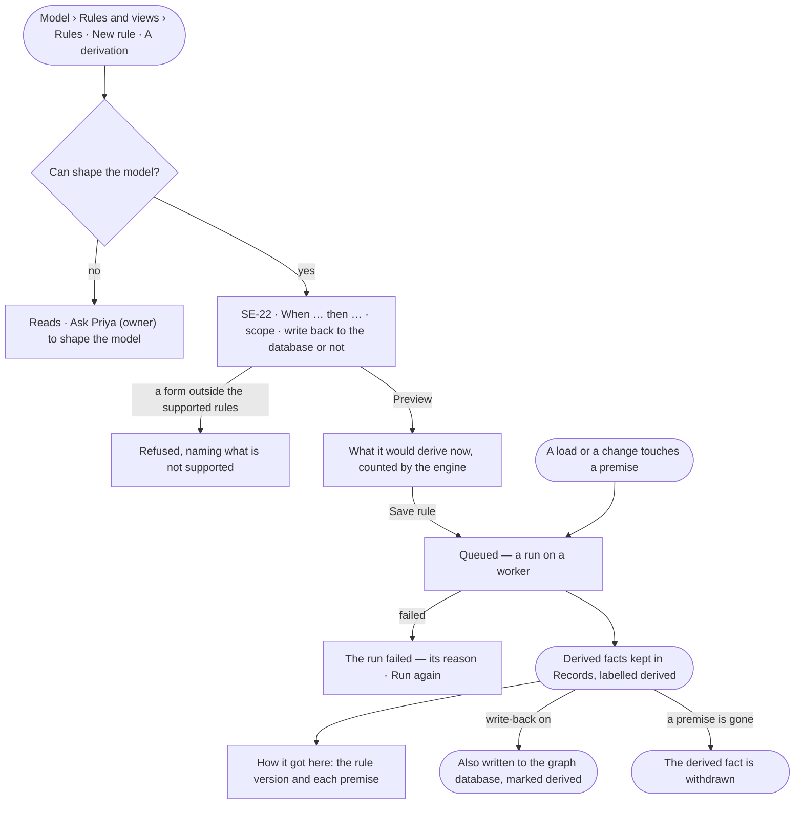
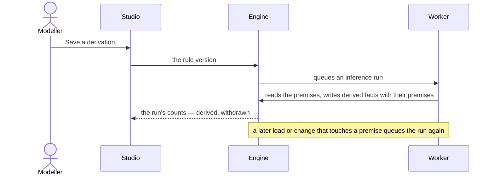

# Inference

> Facts the Graph can derive from what it holds: a **derivation** says *when these facts hold, this one does too*, and
> Inference runs it in the background, keeping each derived fact with the rule and the facts it came from. The
> decision it helps make: *what follows from what we know — and can I trust it?*

## User journey

## Stories

| ID | Story | Status |
|---|---|---|
| SE-22 | [Derive facts from a rule](stories/SE-22-derive-facts-from-a-rule/story.md) | idea |

## Access

| Act | Role (`.claude/team/TEAM.md` §7) | Everyone else sees |
|---|---|---|
| Read derivations, their runs and every derived fact with its premises | Operator — every member, inside their access to the premises | — |
| Create, change, stop or run a derivation | `modeller` · shown as *Can shape the model* | Absent; *Ask Priya (owner) to shape the model* |
| Turn on write-back to the graph database for a derivation | Admin | Absent; *Ask an Admin* |

## States

| State | What the person sees |
|---|---|
| First use | *No derivations yet — a derivation adds facts that follow from the ones you hold*, with *New rule · A derivation* |
| Empty after a filter | *No derivation matches*, with the filter to clear |
| Loading | Rows hold their shape; a preview reads *Counting…* |
| Has data | Each derivation with its scope, last run, facts derived and withdrawn, and whether it writes back |
| Failed | A run that failed names its reason, with *Run again*; a refused rule names what is not supported |
| Agent working or proposing | A run in progress, with its progress counted by the engine |
| No access | Derivations and derived facts read; the acts are absent |

## Rules

| Rule | Detail |
|---|---|
| Rule-based only | A derivation is a rule in a supported form — OWL 2 RL, SHACL rules, or a Datalog-style *when … then …* over kinds, relationships and properties. A form outside them is refused at save |
| Runs on the queue | Each derivation runs as an inference run on a worker (RT-F03), within the Graph's limits; a load or a change that touches a premise queues it again |
| Derived facts are records | Each derived fact is stored in Invana's store as a record labelled *derived*, with the rule version and its premises (RC-F06); it is read beside loaded records and never mistaken for one |
| How it got here | A derived fact opens on its rule version and each premise, each premise opening its own provenance |
| Withdrawn when its premise goes | When a premise is changed or removed, the facts that rested on it are withdrawn in the next run |
| Write-back is opt-in | Off by default; turned on per derivation by an Admin, the facts are also written to the graph database, marked derived, and removed when withdrawn |
| No loops forever | A run stops when no new fact is derived; a run that passes the Graph's limit stops and says so |
| The engine counts | Facts derived and withdrawn per run and per derivation are the engine's |
| Leans on | SE-F07 — a derivation is a rule · RC-F06 — provenance of each fact · RT-F03 — workers and the queue · AC-F02 — who may read the premises |

## Data touched

| Record | Read or write |
|---|---|
| Derivation — a rule version of kind derivation, its form, scope, write-back | Read · write |
| Inference run — the derivation version, started, ended, derived, withdrawn, failed and why | Write |
| Derived fact — a record labelled *derived*, its rule version and premises | Write (into Records) |
| Records the premises match | Read |

## Engine

The low-level design: what this feature stores, serves and refuses. Conventions — naming, errors, lists, events — are
[system-design.md](../../../../system-design.md) §§ 6–8; this section only fills them in. A derivation is a
[SE-F07](../SE-F07-rules/feature.md#engine) `model_rules` row of `kind = derivation`, written on its routes.

### Records

| Table | Columns | Notes |
|---|---|---|
| `derived_facts` | `graph_id` · `fact_id` · `rule_version_id` · `premises` · `run_id` · `written_back` · `created_at` · `withdrawn_at` | One row per derived fact; `premises` are record ids; a withdrawn fact keeps its row for provenance |

### Reads

| Record | Owner |
|---|---|
| Rule versions | [SE-F07 › Engine](../SE-F07-rules/feature.md#engine) |
| Provenance of a record | [RC-F06 › Engine](../../../records/features/RC-F06-provenance/feature.md#engine) |

### Refusals

| Status | When | Sentence | Criterion |
|---|---|---|---|
| 422 | A derivation outside OWL 2 RL, SHACL rules or the *when … then …* form — nothing saved | *{form} is not supported: {what}.* | SE-22.3 |
| 403 | Turning on write-back by someone who is not an Admin | *Writing back to the graph database is an Admin's — ask an Admin.* | SE-22.10 |
| 403 | Creating, changing, stopping or running a derivation without *Can shape the model* | *This needs Can shape the model — ask {owner}.* | SE-22.12 |

### Mechanisms

| Mechanism | How |
|---|---|
| An inference run | A worker job kind `inference`: reads the premises the rule matches, writes new derived facts, withdraws those whose premises are gone, until nothing new is derived or the Graph's limit is reached |
| Requeue on change | A load or a change that touches a kind a derivation reads queues one run for that derivation; runs for one derivation never overlap |

## System impact

| HLD section | Change | NFRs |
|---|---|---|
| § 9 Distributed execution | A new worker job kind, `inference`, on the queue (RT-F03) | NFR-PERF-2 · NFR-REL-1 |
| § 6 Data and storage | The derived-fact store in Invana's database | NFR-OPS-2 |
| § 11 Failure modes and the outside boundary | Opt-in write-back of derived facts to the graph database, per derivation | NFR-REL-3 |

## Decisions

| Decision | Detail |
|---|---|
| Inference, not reasoning | The word on screen is *Derivation*; Explore's assistant *reasons*, Inference derives |
| Kept in Invana's store | Derived facts live beside the provenance that explains them; the graph database gets them only when write-back is on |
| A derivation is versioned | Changing it publishes its next version and queues a run; facts derived by the earlier version are withdrawn or re-derived by that run |

## Open questions

| Question | Who answers |
|---|---|
| — | — |

## Not building

| Item | Why not |
|---|---|
| Full OWL DL reasoning in core | Open-world reasoning does not fit validation that rejects what is not allowed; it can come as an outside plugin |
| Statistical or learned inference | A derived fact must name the rule and facts it came from |
| Derivations that run inside a question | A question reads derived facts; deriving is a background run |
| Derived facts written back by default | The graph database is the customer's; writing to it is an Admin's choice per derivation |
