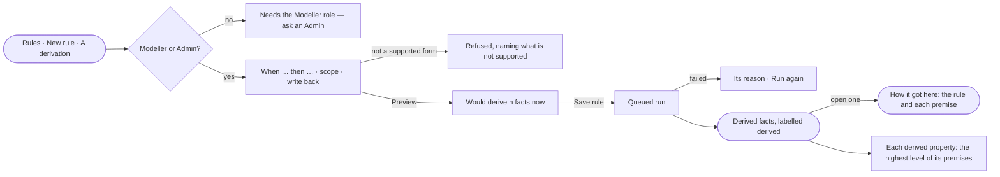

# SE-22 · Derive facts from a rule

**As** a modeller **I want** to write a derivation — when these facts hold, this one does too — and have it run in
the background, each derived fact kept with its rule and premises **so that** people and agents can ask about what
follows from the records, and see why each derived fact is there.

Tasks: [task.md](task.md) · Feature: [SE-F08](../../feature.md)

## Who can

Running a derivation is the Modeller's and the Admin's; write-back is the Admin's alone ([the role table](../../../../../../os/access/features/AC-F02-access-policies/feature.md#the-role-table)).

| Lens | Can | Otherwise sees |
|---|---|---|
| Admin | Read derivations and derived facts; create, change, stop or run a derivation; turn on write-back | — |
| Operator | Read derivations and the derived facts whose premises their default agent may read. A Modeller also creates, changes, stops and runs a derivation; write-back stays an Admin's | *New rule · A derivation*, *Run again* and *Stop* disabled — *Needs the Modeller role — ask an Admin*; *Write back* disabled — *Needs the Admin role — ask an Admin* |

## Flow

## Acceptance criteria

| # | Given | When | Then |
|---|---|---|---|
| SE-22.1 | No derivation | Derivations opens | it reads *No derivations yet*, with *New rule · A derivation* for a Modeller or an Admin |
| SE-22.2 | A Modeller or an Admin | they write a derivation in a supported form and pick *Preview* | the engine counts what it would derive now, before anything is saved |
| SE-22.3 | A derivation outside the supported forms | it is saved | it is refused, naming what is not supported, and nothing is saved |
| SE-22.4 | A saved derivation | it is saved | an inference run is queued on a worker, and the derivation shows it running |
| SE-22.5 | A run that ends | Derivations opens | the derivation shows its last run and the facts derived and withdrawn, counted by the engine |
| SE-22.6 | A derived fact | someone opens it | it is labelled *derived*, and *How it got here* shows its rule version and each premise, each opening its own provenance |
| SE-22.7 | A load or a change that removes a premise | the next run ends | the facts that rested on it are withdrawn |
| SE-22.8 | A derivation with write-back off | it runs | nothing is written to the graph database |
| SE-22.9 | An Admin | they turn on write-back for a derivation | its facts are also written to the graph database, marked derived, and removed when withdrawn |
| SE-22.10 | Someone who is not an Admin | they open a derivation | write-back reads; turning it on is disabled with *Needs the Admin role — ask an Admin*, and the API refuses it |
| SE-22.11 | A run that fails or passes the Graph's limit | it stops | the derivation names the reason, with *Run again* |
| SE-22.12 | An Operator | they open Derivations | the list and derived facts read; the acts are disabled with *Needs the Modeller role — ask an Admin*, and the API refuses them |
| SE-22.13 | A derivation whose premises hold properties of different levels | it derives a fact | each derived property takes the highest level of the properties it was derived from, and shows it; a derivation cannot give a derived property a lower level |
| SE-22.14 | A premise property whose level is changed in a later published version | the next run ends | the derived property's level follows it |
| SE-22.15 | A derived fact whose premise property the reader's default agent may not read | the fact opens | the premise is named and not opened, and the derived property reads only as far as that agent's rules reach its level |

## Screens

| Surface | Lens | First use | Empty after a filter | Loading | Has data | Failed | Agent working or proposing | No access |
|---|---|---|---|---|---|---|---|---|
| Derivations | Admin | model.inference · No derivations | model.inference · No match | model.inference · Loading | model.inference | model.inference · Run failed | model.inference · Running | — |
| Derivations | Operator | model.inference · No derivations | model.inference · No match | model.inference · Loading | model.inference · Read only | model.inference · Run failed | model.inference · Running | model.inference · Read only |
| A derivation | Admin | model.rules · New derivation | — | model.inference · Counting | model.inference · Derivation | model.rules · Derivation refused | model.inference · Running | — |
| A derivation | Operator | — | — | model.inference · Counting | model.inference · Derivation read only | model.inference · Could not load | model.inference · Running | model.inference · Derivation read only |
| A derived fact | Admin | — | — | model.inference · Loading | model.inference · Derived fact | model.inference · Could not load | — | — |
| A derived fact | Operator | — | — | model.inference · Loading | model.inference · Derived fact | model.inference · Could not load | — | model.inference · Not readable |
