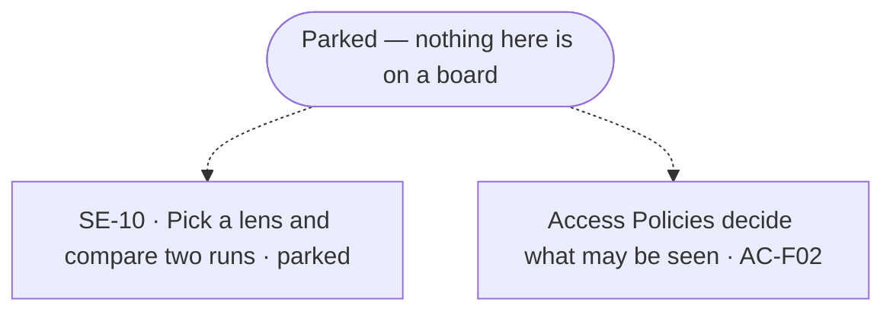

# Lenses of the graph

> **Parked.** A lens is a named, versioned selection of the model that a question is asked through. It is not built and
> not on any board: Access Policies alone decide what people and AI may see
> ([AC-F02](../../../../os/access/features/AC-F02-access-policies/feature.md#property-access)). Taking it up sets its
> story back to `idea`. The decision it would help make: *what is this answer about — and what was left out of it on
> purpose?*

## User journey

Parked — no journey is drawn until it is taken up. What the person does today: asks, and reads what their Access
Policies allow ([AC-F02](../../../../os/access/features/AC-F02-access-policies/feature.md)).

## Stories

| ID | Story | Status |
|---|---|---|
| SE-10 | [Pick a lens and compare two runs](stories/SE-10-pick-a-lens-and-compare-two-runs/story.md) | later |

## Access

| Act | Permission ([the permission catalogue](../../../../os/access/features/AC-F02-access-policies/feature.md#the-permission-catalogue)) | Everyone else sees |
|---|---|---|
| Every act of this feature | None — parked, nothing is built | — |

## States

| State | What the person sees |
|---|---|
| First use · Empty after a filter · Loading · Has data · Failed · Agent working or proposing · No access | — — parked; there is no screen |

## Rules

| Rule | Detail |
|---|---|
| Nothing is in force | The rules of the design are in [Parked design](#parked-design); none binds a run, a query or a screen |

## Data touched

| Record | Read or write |
|---|---|
| None — parked | — |

## Parked design

The scope-only design the team converged on, kept for when it is taken up. Nothing below is built, drawn or tested.

| Part | The design |
|---|---|
| What a lens is | A named, versioned selection of the model, in this order: graph databases → models at exact versions → kinds and relationships → properties → optional slices and an as-of date |
| It selects, never grants | A lens never grants and never denies. A query under a lens reads *the lens ∩ what the person's or agent's Access Policies allow* |
| Two refusals, two sentences | *Outside this lens* — the lens leaves it out, a setting a person can widen · *Not allowed by your access* — an Access Policy refuses it, an ask to an approver ([AC-F05](../../../../os/access/features/AC-F05-asks-and-approvals/feature.md#rules)). *Cannot answer · not in Graph Data* stays for what Graph Data does not hold |
| Versions are never edited | Changing a lens publishes its next version. Agents, schedules and projects pin an exact version; a run keeps the version it opened with |
| Archived, never deleted | A lens no one should use any more is archived; its versions and the runs that cite them stay readable |
| It spans graph databases | One lens may select across several graph databases, each with its models |
| Selection only | No AI model per role, no what-may-leave, no cache or people layers: those are Access Policies, Control Plane settings and the agent's own bound |
| Slices need declared axes | Time, place and selectable dimensions are sliced only where a published model declared the axis ([SE-F02](../SE-F02-change-and-publish-a-model/feature.md)) |
| Where it would live | Model › Rules and meaning › Lenses, a picker in the Explore composer, and *Compare* from a run — none exists now |

## Engine

Not built. The records, routes, events, refusals and CLI of the earlier lens design are removed; no table, route or
command named for a lens exists, and nothing cites one. Taking the feature up starts its Engine from
[Parked design](#parked-design).

## System impact

None

## Decisions

| Decision | Detail |
|---|---|
| Access Policies alone decide what may be seen | A lens is not a second place to say who sees what; the parked design only selects |
| The word stays in the glossary, marked parked | So that *view* and *world* are never reintroduced for it |

## Open questions

| Question | Who answers |
|---|---|
| *Compare two runs of one question* was SE-10's second half; it is parked with the lens. Is it wanted on its own, over runs (CP-F10), without a lens? Recommend: yes, later, as a story of Runs | Ravi |

## Not building

| Item | Why not |
|---|---|
| A lens that grants or denies | Access Policies are the one place; a second would disagree with them |
| A lens that picks the AI model, what may leave, a cache or who may be asked | Not a selection of the model; each has its own home |
| A lens per step | The lens is the run's circumstances; narrowing a step is its plan's job |
| Lenses suggested from run history | The runs already show what was read |
| Folders or tags for lenses | A deployment that needs to file its lenses has too many; naming is the filter |
