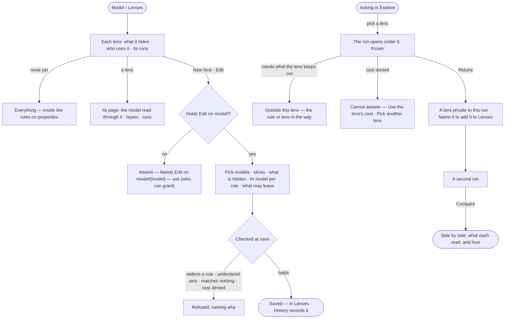

# SE-10 · Pick a lens and compare two runs

**Parked.** Access Policies alone decide what may be seen; this story is taken up again only with its feature ([SE-F09 › Parked design](../../feature.md#parked-design)).

**As** a modeller or an analyst **I want** to keep named lenses of Graph Data — what an answer may rest on — pick one
when I ask, and compare two runs of one question side by side **so that** I know what each answer was allowed to read,
and choose the lens I can defend.

Tasks: [task.md](task.md) · Feature: [SE-F09](../../feature.md)

## Who can

Reading, picking and comparing are every signed-in person's; naming and authoring a lens need Edit on `model/<model>`
([SE-F09 › Access](../../feature.md#access)).

| Access | Can | Otherwise sees |
|---|---|---|
| Admin | Read every lens; pick one for a question; compare two runs; retune from their own run; name, create, edit, duplicate and delete lenses | — |
| Operator | Read every lens; pick one for a question; compare two runs; retune from their own run into a lens private to that run. With Edit on the model, also names and authors lenses, as Admin | Authoring acts absent; under the list *Needs Edit on model/{model} — ask {who can grant}* |

## Flow

## Acceptance criteria

| # | Given | When | Then |
|---|---|---|---|
| SE-10.1 | The deployment's lenses | a person opens Model › Lenses | each lens lists with what it hides, who uses it and its runs in 30 days, as the engine counts them |
| SE-10.2 | No lens yet | Lenses opens | it reads *Everything — inside the rules on properties*, with *New lens* for a person with Edit on the model |
| SE-10.3 | A lens | a person opens it in Lenses | the model reads through it — hidden kinds dimmed, protected properties shielded — beside *Sees · Answers go · Used by* |
| SE-10.4 | Lenses in the deployment | a person picks one in the composer and asks | the run opens under that lens and keeps it; a later edit of the lens reaches only the next run |
| SE-10.5 | A person with Edit on the model | they save a new lens | its models, slices, hidden kinds and properties, AI model per role and what may leave are each picked from what the deployment declares, never typed, and the lens lists in Lenses |
| SE-10.6 | A lens that would widen a rule on a property | it is saved | it is refused — *{lens} would widen {rule}.* |
| SE-10.7 | A slice on an axis the model never declared | the lens is saved | it is refused — *{model} declares no {axis} axis.* |
| SE-10.8 | A run the person started | they pick *Retune* | a narrower lens private to that run opens, named *this run only*, its name field reading *Name it to add it to Lenses* |
| SE-10.9 | A lens private to a run | a person with Edit on the model names it | it joins Lenses; a later rename changes its name and keeps the schedules that pinned it working |
| SE-10.10 | A name already used by a lens | a lens is named with it | it is refused — *A lens named {name} already exists.* |
| SE-10.11 | Two runs of one question | the person picks *Compare* from a run | both show side by side — what each read, what both read, what only one read, and how a shared read differed in slice, hidden properties, projection and models |
| SE-10.12 | A lens | its own page opens | its tiles read rules · closed layers · in force · runs in 30 days · last used, with the five layers and the agents whose runs asked under it |
| SE-10.13 | A lens a schedule or an agent uses | a person with Edit on the model deletes it | it is refused — *{lens} is used by {schedules and agents}.* |
| SE-10.14 | A lens naming a model version that is not published | it is listed, then picked | it lists with a warning naming the version; picking it is refused before a run opens — *{lens} names {model} v{n}, which is not published.* |
| SE-10.15 | A lens created, edited, named or deleted | History is read | each is an event with its before and after |
| SE-10.16 | An Operator without Edit on the model | they reach Lenses | *New lens*, *Edit*, *Duplicate*, *Delete* and naming are absent and a line reads *Needs Edit on model/{model} — ask {who can grant}*; the engine refuses the same with 403 |
| SE-10.17 | No outside service configured | a person picks what may leave | it reads *No third-party endpoints are configured* where the matches would be |
| SE-10.18 | A run under a lens | the person opens *How it got here* | it shows its steps and sources, and names the lens and the rules it ran under |
| SE-10.19 | A lens whose cast names an AI model its rules deny for a role | a run opens in it | the run reads *Cannot answer: {rule} in {denied_in} denies {address} for {role}.*, with *Use the lens's cast* · *Pick another lens* |
| SE-10.20 | A lens that matches nothing, or whose cast names an AI model its rules deny | it is saved | it is refused — *{lens}: {why}.* |
| SE-10.21 | A lens casting an AI model whose provider is gone | a run starts in it | it is refused before the run is written — *{provider} is gone — {role} cannot be cast.* |
| SE-10.22 | A lens file whose rule sets properties or a slice on a layer other than Graph Data | it is applied | it is refused — *A {layer} participant carries no {field}; it is allowed or denied whole.* |
| SE-10.23 | A question that needs what the lens keeps out | the run settles | it reads *outside this lens*, naming what it was grounded in and the rule or lens in the way — never *cannot answer* |

## Screens

Parked — no board is drawn.

| Surface | Access | First use | Empty after a filter | Loading | Has data | Failed | Agent working or proposing | No access |
|---|---|---|---|---|---|---|---|---|
| Lenses | Admin | — | — | — | — | — | — | — |
| Lenses | Operator | — | — | — | — | — | — | — |
