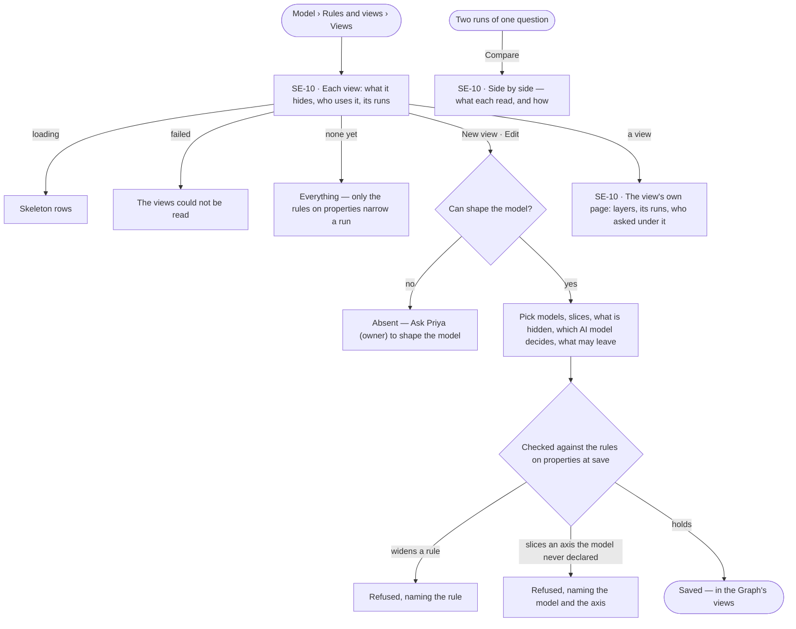
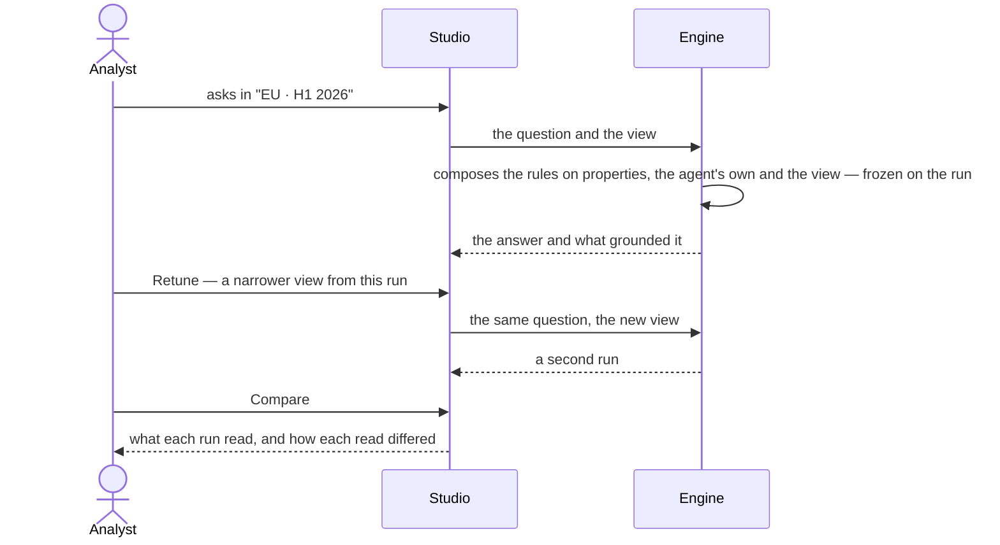

# Views of the graph

> What agents may see when they answer — a view of the graph picked per question and compared — inside the rules on
> properties that hold in every view (SE-F07). The decision it helps make: *what may this answer rest on?*

## User journey

## Stories

| ID | Story | Status |
|---|---|---|
| SE-10 | [Narrow what agents may see](stories/SE-10-narrow-what-agents-may-see/story.md) | idea |

## Access

| Act | Role (`.claude/team/TEAM.md` §7) | Everyone else sees |
|---|---|---|
| Read every view | Operator — every member | — |
| Pick a view for a question · compare two runs | Operator — every member | — |
| Retune from their own run into a view kept private to that run | Operator — every member | — |
| Name a view (it joins the Graph's views) · create, edit, duplicate or delete a view | `modeller` · shown as *Can shape the model* | Absent; *Ask Priya (owner) to shape the model* under the list |

## States

| State | What the person sees |
|---|---|
| First use | No view: *Everything — inside the rules on properties*, with *New view* |
| Empty after a filter | *No views match*, with the filter to clear |
| Loading | The section head holds its shape; rows are skeletons |
| Has data | Views with what they hide and who uses them |
| Failed | The section says it could not load and why; a save the engine refused names the rule, model, axis or view behind it |
| Agent working or proposing | — |
| No access | Every view reads; authoring acts are absent, and a line names who may act |

## Rules

| Rule | Detail |
|---|---|
| Rules and views is one sheet | Opened from Model: *Rules* (SE-F07) · *Views* (what agents may see) · *Requests* (SE-13), the open requests counted in its head |
| Outside this view is not cannot answer | A question that needs what the view keeps out reads *outside this view*, naming what it was grounded in and the rule or view in the way — a setting the person can widen. *Cannot answer* is kept for what the Graph does not hold |
| A view narrows, never widens | A view may hide models, kinds and properties, slice a model, pick the AI model that decides, say what may leave, cap how old a cached answer may be and say who may be asked and how often. It never widens a rule on a property; one that would is refused at save, naming the rule |
| Five layers | A view narrows along graph data · AI models · outside services · cache · people; worker capacity is not a layer |
| Hidden is structural | A hidden property does not exist for the run — a query naming it is refused, and a whole record comes back without it. Nothing is filtered afterwards |
| Only declared axes slice | A published model declares which property carries time, which carries place and which are selectable dimensions; it declares none until a person does. A view slices only along declared axes — any other is refused naming the model and the axis. The axes travel with the model's file, and a declared axis naming a property the model lacks is refused at import |
| Default is the widest | A Graph with no view and no rule sees every published model, every AI model its owner configured and every outside service its agents may use |
| Naming shares | A view made by retuning a run is private to that run. Naming it adds it to the Graph's views; the name field reads *Name it to add it to Views*. The name is unique in the Graph; only the first naming shares, a rename renames |
| One view per run | A run composes the rules on properties, its agent's own bound and its view once, when it opens, and keeps that; a later edit reaches only the next run |
| A view is picked, never typed | Every control offers what the Graph declares — published model versions, their axes, configured AI models, caches — with *any version* beside each exact version |
| Transaction time is the view's | A view may be pinned to what was known on a date; it is a field of the view, never a control beside the question |
| A layer with nothing configured says so | Picking what may leave to outside services, with none configured, reads *No third-party endpoints are configured* where the matches would be — never an empty list |
| A cast that names a denied AI model | The run does not open: it reads *cannot answer*, naming the rule, with *Use the view's cast* · *Pick another view* |
| Every edit is recorded | Creating, editing and deleting a view are events with before and after, in History |
| The engine counts every number | A view's runs and compare's tallies — Studio formats, never derives |
| Leans on | SE-F02 — declaring axes in a draft · SE-F07 — the rules on properties a view sits inside · Explore — the view in the composer · Agents › Runs — *Retune* and each run's layers |

## Data touched

| Record | Read or write |
|---|---|
| View — name, what it narrows per layer, the AI model per role, transaction time, its version | Read · write |
| Rule on a property — the bound a view sits inside (SE-F07) | Read |
| Run — the frozen view and rules, what each step touched and what it was refused | Read |
| Published model versions and their declared axes | Read |
| Events — every edit | Write |

## Engine

The low-level design: what this feature stores, serves and refuses. Conventions — naming, errors, lists, events — are
[system-design.md](../../../../system-design.md) §§ 6–8; this section only fills them in. The engine's word for a view
and a rule on a property is *lens*: a view is `kind = world`, a rule on a property or an agent's own bound
`kind = guardrail`.

### Records

| Table | Columns | Notes |
|---|---|---|
| `model_lenses` | `graph_id` · `kind` (`guardrail` · `world`) · `key` · `name` · `scope` (`graph` · `agent:<id>`; a guardrail's only) · `rules` · `closed_layers` · `cast` · `egress` · `as_of` · `created_in_run_id` · `created_by_id` · `version` · `target` · `access` · `leaves` · `allowed_in` | Unique (`graph_id`, `key`), plain — unnamed lenses (`key` null) coexist. CHECK a guardrail has `scope` and `key`, a world has `scope` null; CHECK a Graph guardrail carries `target` · `access` · `leaves`. Index (`graph_id`, `kind`). `key` is derived from `name` at the first naming and frozen. `version` is bumped on every `rules` or `cast` edit. `as_of` null is now |
| `model_run_touches` | `run_id` · `graph_id` · `seq` · `step_key` · `address` · `layer` · `sublayer` · `participant` · `direction` (`out` · `in` · `refused` · `skipped`) · `rule_matched` · `why` · `volume` {`rows` · `tokens_in` · `tokens_out` · `bytes` · `cache_hit` · `age_s`} · `applied` {`models` · `select` · `properties_excluded` per kind} · `sent` {`to` · `classes[]` · `cut[]`} · `query` {`generated_sha256` · `executed_sha256`} · `duration_ms` · `at` | Unique (`run_id`, `seq`); index (`graph_id`, `address`) · (`run_id`, `direction`). A projection of the run's ledger, rebuildable from it and losing to it on any disagreement. Tokens in and out, never one sum; digests, never query texts; a refusal is a row |

| `rules[]` element | Carries |
|---|---|
| `match` | An address with `*` (one segment), `**` (the rest) and `*` inside a segment — `graph_data/model/<model>@*` |
| `allow` | `true` · `false` |
| `properties.exclude[]` · `properties.counts_only[]` | A bare property name or `Kind.property`; `graph_data` rules only |
| `select` | `time` (`between` · `since` · `at`) · `geo` (`in` · `not_in`) · `dims` (`in` · `eq` · `range`), on axes the model declared; `graph_data` rules only |
| `egress.may_send[]` | What may accompany a call to this destination, a closed set — `type_names` · `property_names` · `the_question` · `property_values` · `record_ids` · `aggregates` · `everything` |
| `options` | `max_age_s` on a `cache` rule · `max_rounds` on a `human` rule; no other option, and none on another layer |

| Layer | Slug | Sublayers — the touch's `sublayer` | A participant's address |
|---|---|---|---|
| `graph_data` | Graph data | `model` · `stitch` (a link between models) · `load` | `graph_data/model/<model>@<version>` · `graph_data/stitch/<source>_<target>` · `…@<edge type>` for a relationship link |
| `llm` | AI models | One per configured provider row | `llm/<provider row>/<model>` |
| `third_party` | Outside services | `api` · `app` · `db` · `agent` · `internet` | `third_party/api/<host>/<path>` · `third_party/agent/<name>` for a peer agent |
| `cache` | Cache | — | `cache/answer` · `cache/schema` · `cache/result` · `cache/prefix` |
| `human` | People | `person` · `role` | `human/role/<role>` · `human/person/<id>` |

| Address rule | Detail |
|---|---|
| One address per participant | `<layer>/<sublayer>/<name>`; layer and sublayer are read off it, never authored |
| A layer is not switched off | A layer is a category; a sublayer is governed as an address prefix, a participant as the leaf a rule names |
| The agent is the spine | Never a layer: an agent is bounded by its access rules and its tokens, never by a lens |

### Reads

| Record | Owner |
|---|---|
| Published versions and their declared `axes` | [SE-F02](../SE-F02-change-and-publish-a-model/feature.md#engine) |
| Rules on properties — their compile into `rules[]` and their routes | [SE-F07](../SE-F07-rules/feature.md#engine) |
| A run's `lens_snapshot`, its steps and its ledger | [AG-F03](../../../agents/features/AG-F03-runs-and-how-the-agents-are-doing/feature.md#engine) |
| A run's `result.json` — `touches[]`, `tokens` with `tokens_cached_in`, `result.cache` — and its cost by layer and participant | [AG-F03](../../../agents/features/AG-F03-runs-and-how-the-agents-are-doing/feature.md#engine) |
| A Task's `role` · the plan a lens may sit on | [AG-F06](../../../agents/features/AG-F06-plans-and-functions/feature.md#engine) |
| A peer agent called as an outside party | [AG-F05](../../../agents/features/AG-F05-delegation-and-outside-agents/feature.md#engine) |
| The connector composing a predicate and a projection into the query it runs (`run_query`) | [RT-F05](../../../../os/runtime/features/RT-F05-graph-database-connectors/feature.md#engine) |
| The checks every act passes, the view among them | [AC-F02](../../../../os/access/features/AC-F02-access-rules/feature.md#engine) |
| An agent's own bound | [AG-F01](../../../agents/features/AG-F01-build-an-agent/feature.md#engine) |
| Schedules that pin a view | [AG-F07](../../../agents/features/AG-F07-schedules/feature.md#engine) |
| Configured AI model providers and models — `llm/<provider>/<model>` | [RT-F01](../../../../os/runtime/features/RT-F01-ai-models/feature.md#engine) |
| Who holds *Can shape the model* | [AC-F02](../../../../os/access/features/AC-F02-access-rules/feature.md#engine) |
| History — every event this feature writes | [AC-F06](../../../../os/access/features/AC-F06-history/feature.md#engine) |

### Routes

| Route, after `/api/v1/u/{u}/{g}/model` | Does | Story |
|---|---|---|
| `GET /lenses` · `POST /lenses` | The list — `items` · `may_edit_guardrails` in one read; each item's `usage` is `runs` · `last_used_at` · create one | SE-10 |
| `GET /lenses/{id}` · `PATCH /lenses/{id}` · `DELETE /lenses/{id}` | One lens: the record, `display_name` (*this run only* while unnamed), `is_named`, `allow_rules` · `deny_rules`, and on the detail alone `usage` and `cast_resolved` (each role: `address` · `allowed` · `rule_matched` · `source` · `refusal`) · edit or name it · delete it | SE-10 |
| `POST /lenses/{id}/duplicate` | A copy, unnamed until named | SE-10 |
| `GET /lenses/{id}/usage` | `runs` · `last_used_at` · `actor_ids` · `people` · `runs_30d` · `by_agent[{agent_id, name, runs, last_at}]`, most runs first | SE-10 |
| `POST /lenses/validate` · `POST /lenses/impact` | Check a draft lens as at save · what saving changes, view by view | SE-10 |
| `GET /view?world=` | A view read on the model: `world` · `models[{name, version, seen: all · sliced · hidden}]` · `types[{model, type, hidden, sliced, excluded[], guarded[{property, guardrail_id, guardrail, access, leaves}]}]` · `hidden_types[]` · `guarded` · `window{time, geo}` · `thinks_with` · `answers_go[{address, may_send[] or null}]` · `used_by[{kind: agent · person, id, name, runs}]`; without `world`, the Graph's rules alone | SE-10 |
| `GET /participants` | Every address the Graph can name, resolved live, never stored | SE-10 |
| `GET /runs/{id}/touches` | The ledger `items` · `total` · `counts`; `allowed` · `touched` · `never_touched` · `refused`; `participants[{address, layer, verdict, why, calls, rows, tokens}]` — `verdict` is `refused` over `touched` over `miss` over `never_touched`; `layers[{layer, allowed, touched, refused, touches, calls, rows}]` · `tallies` | SE-10 |
| `GET /compare?a=&b=` | Two runs: `touched_a` · `touched_b` · `shared` · `only_one` · `read_differently` | SE-10 |

### Events

| Event | When |
|---|---|
| `model.lenses.create` | A lens, a rule on a property or a duplicate created — `kind` · `key` · the rule count |
| `model.lenses.update` | Edited — `before` and `after` of `rules` · `cast` · `key` |
| `model.lenses.name` | The first naming, which shares it — `before` and `after` |
| `model.lenses.delete` | Removed |

### Refusals

| Status | When | Sentence | Criterion |
|---|---|---|---|
| 403 | Naming, creating, editing, duplicating or deleting a view without *Can shape the model* | *This needs Can shape the model — ask {owner}.* | SE-10.16 |
| 422 | A view that would widen a rule on a property | *{view} would widen {rule}.* | SE-10.6 |
| 422 | A slice on an axis the model never declared | *{model} declares no {axis} axis.* | SE-10.7 |
| 422 | A view that matches nothing, or whose cast names an AI model its rules deny | *{view}: {why}.* | SE-10.20 |
| 422 | A rule setting `properties` or `select` on a layer other than `graph_data`, or an option its layer does not take | *A {layer} participant carries no {field}; it is allowed or denied whole.* | SE-10.22 |
| 422 | `cast_refused` — a run whose effective cast names an AI model the effective rules deny; the body carries `role` · `address` · `rule` · `denied_in` (the agent's own, a Graph rule, the view) · `world` (*Everything* when none); the opening role at the send, a later role when its step resolves | *Cannot answer: {rule} in {denied_in} denies {address} for {role}.* | SE-10.19 |
| 422 | A run whose cast names an AI model whose provider is gone — at the start, before the run is written | *{provider} is gone — {role} cannot be cast.* | SE-10.21 |
| 409 | A name already used by a view in the Graph | *A view named {name} is in this graph.* | SE-10.10 |
| 409 | Deleting a view a schedule or an agent uses | *{view} is used by {schedules and agents}.* | SE-10.13 |
| 409 | A run opened in a view naming a version that is not published — before the run is written | *{view} names {model} v{n}, which is not published.* | SE-10.14 |
| 409 | A run opened in a view from another Graph — before the run is written | *That view belongs to another graph.* | API only — Studio offers only this Graph's views |

### CLI

| Command | Does |
|---|---|
| `invana govern apply --graph <g> --file <f>` | Reads `guardrails: [{target, access, leaves}]` and `worlds: [{name, rules, cast, closed_layers}]`, the rules first, then each view checked against them; applying again updates in place |
| `invana rebuild-touches` | Rebuilds `model_run_touches` from the runs' ledgers |

### Mechanisms

| Mechanism | How |
|---|---|
| Resolution | `effective = agent ∩ plan ∩ todo`, computed once at run open and frozen on the run as `lens_snapshot` — the whole record, all five layers, each contributor named `{id, kind, key, name, version}`; never recomputed mid-run |
| Composition | Allows intersect, denies accumulate, selectors intersect per model, `closed_layers` union, the strictest `max_age_s` and the smallest `max_rounds` hold, the cast's innermost wins (task over plan over agent) and is then checked against the effective rules. Every operation narrows, so no level can widen another in any layer |
| `closed_layers` | A layer named admits only what this lens's rules allow; a layer not named is permitted whole. Each contributor's closure is kept whole and frozen with its name, so another level's broader allow never satisfies it. Narrowing to a set is a closed layer and the allows that name it — never a broad deny with allows punched through |
| Matching | `match` is a glob; a deny wins over any allow at any specificity; a participant no rule matches takes the default, the widest. A refused participant reads *outside the lens* whatever its layer — an endpoint, a link and a year alike |
| A closed layer refuses by name | A step needing a layer a lens closes is refused naming which view closed which layer; its touch's `rule_matched` stays empty, because the closure refused it, not a rule |
| The grounding version | A lens binds on the Graph's introspected `global` version — the one version whose types cover every type a query can reach; `open_graph` checks it and the connector's `QueryLens` compiles over its types |
| An authored model is bindable | A rule naming an authored version — `graph_data/model/<model>@*` — resolves to the kinds that version declares, admitted, hidden and sliced along that version's axes, and the touch records which model addresses reached each kind; an unresolved rule is refused, never left to fail open |
| Two times | `as_of` on the lens is transaction time — which versions and links resolve; `select.time` on a rule is valid time, a predicate on the axis the model declared. They compose |
| Links in a lens | Denying `graph_data/stitch/*` keeps the models and drops cross-model edges — a question needing a link is *outside the lens*; an allow may name one anchor (its pair of kinds) or one relationship link (`…@<edge type>`). A denied link does not resolve for the run, its relationships are not read, and the run continues. The edges a load writes are records, narrowed by a `graph_data/load/*` rule |
| AI models | The sublayer is the provider row — two rows of one provider are two participants with their own keys. An agent binds no provider; the cast names the model and the Graph resolves the credential from the row the address names. A Task names a role — `extract` · `decide` · `judge` · `embed` — never a model id or a tier; the cast binds role to address, so retuning is one edit of the cast and a re-run |
| An AI model call is recorded | Address, role, tokens in and out, and what it was shown (`applied` · `sent.classes`) on the touch; the prompt as sent and the completion on the step's output, never on the touch |
| Outside services | Allowed or denied whole, with `egress.may_send` governing what goes with the call; a third party worth slicing is brought in as a model. A denied one is refused before dispatch — nothing spent. A peer agent is `third_party/agent/<name>`: its response is quoted as data, never executed, and its spend is bounded before the call |
| The caches | *Answer* — before the whole plan; a hit ends the run, recorded as a catalogue entry with its own run row · *Schema* — before a catalogue read · *Result* — before a query runs · *Prefix* — inside the provider's call, only cheaper; the last three are `result.cache` on the step. `max_age_s` per cache; denying `cache/**` walks every layer; a cache error is a miss — it may change a cost, never an outcome |
| People | Denying `human/**` turns a clarification into *cannot answer — needs input that may not be requested*; allowing `human/role/<role>` or `human/person/<id>` names who may be asked, and `max_rounds` how often — on the lens, not the plan, because a scheduled run and an interactive one share a plan |
| Delegation | A delegated child's lens is its parent's or narrower, in every layer and slice; a replan never changes the lens — a different lens is a different run |
| What the run can be told | Something outside the lens settles *outside this view*, carrying what the run was grounded in and the rule or view that kept out what it needs (SE-10.23). Something the Graph lacks settles *cannot answer* ([EX-F05](../../../explore/features/EX-F05-when-it-cannot-answer-and-how-it-reasons/feature.md)) |
| Grounded needs a record | An answer with no touches behind it is not shown as grounded |
| What it may see, what it may do | The lens bounds what a run may see, use and send; what it may do is its access rules ([AC-F02](../../../../os/access/features/AC-F02-access-rules/feature.md#engine)), where the view is one of the checks every act passes. There is no second bound |
| Enforcement | In the interpreter before dispatch (participant, egress) and in the connector at execution (projection, predicate) — never in Studio, never by filtering afterwards. The snapshot compiles into the connector's `QueryLens`, a model address resolving to the kinds its version declares |
| A hidden property | Not in the schema the AI model is told; a query naming it is refused at the connector; a whole record returns without it |
| The three crossings | A run reaches the model, the graph and a write through `open_model`/`close_model` · `open_graph`/`close_graph` · `open_write`/`close_write` |
| Validated at save | A draft lens does not widen a guardrail, selects only declared axes, matches something, and its cast is allowed — checked at save, never at run |
| The default cast | Ships with the distribution, computed over the AI models the Graph offers: `extract` the cheapest that can read · `decide` the most capable · `judge` a local one where one exists, else the cheapest · `embed` the only embedding model, or none. A role no lens casts takes it |
| A cast holds its AI model | Removing an AI model a view casts is refused on the runtime's route, naming the views ([RT-F01](../../../../os/runtime/features/RT-F01-ai-models/feature.md#engine)) |
| Read and send are two permissions | A run may rank by a property whose value never enters a prompt: allow/deny, `properties` and `select` govern what it reads; `egress.may_send` on the rule matching the destination governs what it sends there |
| What may leave | Per destination, never per run. `may_send` absent from every matching rule leaves the crossing unbounded — a rule nobody wrote narrows nothing; a matching rule that states none takes the lens's `egress` default, `[]`; `[]` cuts everything. Several matching rules intersect; `everything` on one leaves the others to decide. A hosted AI model is an outside party governed this way; a local one has nothing to declare |
| The egress cut | By prompt part — `type_names` · `property_names` · `the_question` · `property_values` — before the prompt is assembled; a description or a link's key crosses under the class of what it describes. The touch records `sent.to` · `sent.classes` · `sent.cut` on every crossing — an empty `cut` on an unbounded crossing is a fact — never the payload |
| Who writes a touch | The interpreter, at settle — never the callable, which could under-report. Addresses and digests only, never prompts or rows; a refusal is a touch; nothing is filtered on write — the touches read shows the five layers, the agent's own frames on a toggle, which age out on their own schedule |
| Absent, not zero | A participant with no touch draws nothing — never a zero cost, never *no layers touched*; a layer a step did not touch is the complement of what it touched. Cost is the run's at settle, absent when unpriced, never estimated |
| Query texts | A graph step records both digests always, and both texts — `generated_query` and `executed_query` — only when the lens rewrote the query, on the step, never on the touch |
| A touch's order | The frame is written to the run's ledger first, then its `model_run_touches` row with the frame's `seq`; `applied.select` and `properties_excluded` are keyed by kind, absent when nothing was sliced or hidden |
| Usage is a grouped read | A view's usage is one `GROUP BY` over the runs, joined at the edge — no counter is stored |
| Spend by layer | Cost groups by layer, then by participant, from the touches |

## System impact

| HLD section | Change | NFRs |
|---|---|---|
| § 6 Data and storage | `model_lenses` and `model_run_touches` in Invana's own store; the touches a projection of the run's ledger | — |
| § 8 APIs and events | The routes and events above, under `model` | — |
| § 10 AI and agents | Every run opens under one frozen lens; the default cast picks the AI model per role | — |
| § 11 Failure modes and the outside boundary | A hosted AI model, an outside service and a peer agent are outside parties: denied before dispatch, what may leave declared per destination, a peer's response quoted as data | — |
| § 12 Qualities | Security and privacy: narrowing enforced in the interpreter and the connector, egress cut by prompt part before any call leaves | — |

## Decisions

| Decision | Detail |
|---|---|
| One record, two uses | A view and a rule on a property are one kind of record, enforced on one path and frozen together onto a run — so *what was this run allowed to see* is one document |
| A view opens on the model | The Views section reads a view on the model's kinds — hidden ones dimmed, protected properties shielded — beside *Sees · Answers go · Used by*; with no view picked, the rules on properties alone |
| A view's own page is for auditing | Its head and *Edit*; tiles — rules · closed layers · in force · runs in 30 days · last used; the five layers with their state; the agents whose runs asked under it, read from the runs |
| Validated at save, not at run | A view that cannot legally run cannot be saved |
| Compare is two real runs | The same question in two views, each run properly, side by side — what each read, and for a shared read how it differed: slice, hidden properties, projection, models. Nothing is simulated; it is reached from a run |
| No count of what was hidden | A narrowed read records the rows it returned, never what an unnarrowed one would have |
| Deleting a used view is refused | Refused naming the schedules or agents that use it |
| A view naming an unpublished version | Listed with a warning naming the version; picking it is refused before a run opens |
| A view's key is frozen at its first naming | A rename changes the name alone; a key that moved would break every schedule that pinned it |
| A default cast ships with the distribution | AI model providers carry no default, so a Graph with providers and no cast could run nothing; the shipped cast runs a role nobody cast |
| Declared and recorded are one loop | A lens with no touches is a rule nobody can check; touches with no lens have nothing to check against. Their difference tunes the view: allowed and never read → narrow · refused again and again → widen, or accept *outside this view* on purpose · a slice clipping what a query wanted → widen it or confirm it · `decide` resolved to a small model on the step that wrote the number → retune the cast and compare · values sent where not expected → tighten what may leave, the runs listed · every AI model call hosted → move a role to a local model. Touched and undeclared cannot happen while enforcement holds |
| A rule on a property stays editable | It is a row a person with *Can shape the model* edits; a bound nobody can reach would be a second record |
| Nothing is its own table that could be a key | A rule is an element of the view's rules, the cast is four keys, usage is a grouped read of runs; the touches are the one projection kept as rows |

## Open questions

| Question | Who answers |
|---|---|
| — | — |

## Not building

| Item | Why not |
|---|---|
| Worker capacity as a layer | Workers are capacity, not something a view allows or denies |
| A view per step | The view is the run's circumstances; narrowing a step is its plan's job |
| Folders or tags for views | A Graph that needs to file its views has too many; naming is the filter |
| Views suggested from run history | *Allowed but never read* is already the suggestion, and a person reads it |
| Comparing two views without running them | What differs is in the answers and what they read, and those need runs |
| Sharing a view across Graphs | A Graph is the reasoning boundary |
| Masking what leaves | A view decides whether data may go, never a transformation of it |
| Alerting when a layer lights up | Invana is not a monitoring platform; an alert on the records is a rule (SE-F07) |
| A rule on a whole layer | A rule on a property is one property; a layer bound is a view's or an agent's |
| A table of a view's rules | A rule is an element of the view, edited, compared and frozen with it |
| Counters for a view's usage | A counter can disagree with the rows it counts; usage is a grouped read |
| A catalogue of third-party endpoints | A deny needs no catalogue — a third party is named by its address |
| A queue of its own | The queue is the runtime's (RT-F03) |
| AI model catalogues fetched from the provider | A typed model id is enough |
| A frozen view that resolves through live rows | A snapshot that resolves through live rows is not a snapshot |
| Slices on a third party | It is allowed or denied whole; what may leave governs the call |
| Payloads in a touch | A touch holds addresses and digests; prompts and rows stay on the step |
| A reason for every layer a step did not touch | Untouched is the complement of touched |
| Estimated savings on a run | A counterfactual drawn as a figure reads as something that happened |
| Switching to a cheaper AI model on its own | A silent switch changes what produced an answer; retuning the cast is a person's recorded act |
| An editor for the flow across layers | The flow draws a record and a checked plan, never a hand-drawn graph |
