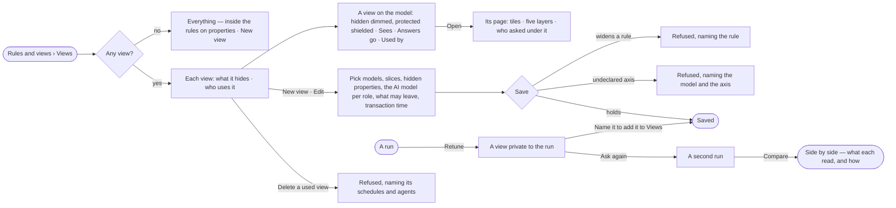

# SE-10 · Narrow what agents may see

**As** a modeller **I want** named views of the graph that narrow what a run may see — and to run one question in
two of them and read the difference **so that** people choose what an answer rests on, rather than discovering it
afterwards.

Tasks: [task.md](task.md) · Feature: [SE-F09](../../feature.md)

## Who can

| Lens | Can | Otherwise sees |
|---|---|---|
| Admin | Read every view; create, name, edit, duplicate and delete views; retune from a run; compare two runs | — |
| Operator | Read every view and its page; retune from their own run into a view private to that run; compare two runs | *New view*, *Edit*, *Duplicate* and *Delete* absent — *Ask Priya (owner) to shape the model*. With *Can shape the model*: as Admin |

## Flow

## Acceptance criteria

| # | Given | When | Then |
|---|---|---|---|
| SE-10.1 | A Graph with no view | the person opens Views | it reads *Everything — inside the rules on properties*, with *New view* for someone who can shape the model |
| SE-10.2 | Views exist | the person opens Views | each lists its name, what it narrows and who uses it, with its runs and last use as counted by the engine |
| SE-10.3 | A view | the person picks it | the model's kinds show with the kinds it hides dimmed and protected properties shielded, beside *Sees* (models *N of M*, each all · sliced · hidden; time and place; the AI model per role) · *Answers go* (each AI model and third-party destination, with what may leave) · *Used by* (agents, schedules and people, with their runs) |
| SE-10.4 | A view | the person opens its page | its tiles read rules · closed layers · in force · runs in 30 days · last used; the five layers show each one's state; *Who asked under it* lists the agents from the runs, or says nobody has |
| SE-10.5 | A person with *Can shape the model* | they create or edit a view | every control is a choice over what the Graph declares — published versions with *any version* beside each, their axes, configured AI models, caches; nothing is free text |
| SE-10.6 | A view that would widen a rule on a property | it is saved | it is refused naming the rule, before anything is written |
| SE-10.7 | A slice on an axis the model never declared | the view is saved | it is refused naming the model and the axis |
| SE-10.8 | A view that hides `Deal.price` | a run in it queries `Deal.price` | the query is refused; a whole Deal comes back without the property |
| SE-10.9 | A person reading their own run | they pick *Retune*, narrow, then *Ask again* | the run stays open, a view private to that run is made, and a second run of the same question opens beside the first |
| SE-10.10 | A private view | a person with *Can shape the model* types a name in *Name it to add it to Views* | it joins the Graph's views; a name already used in the Graph is refused |
| SE-10.11 | Two finished runs of one question | the person picks *Compare* from a run | both answers show side by side, with what each read, what only one read, and for a shared read how it differed — slice, hidden properties, projection, models — each count from the engine |
| SE-10.12 | A run in progress | someone edits its view | the run keeps what it was frozen with; the next run gets the edit |
| SE-10.13 | A view a schedule or an agent uses | someone deletes it | it is refused naming the schedules and agents |
| SE-10.14 | A view naming a model version that is not published | the views are listed | it carries a warning naming the version, and picking it is refused before a run opens |
| SE-10.15 | A run asked in a view | the person opens *How it got here* | it names the view as it was named when the run asked, its layers, and every step's reads and refusals |
| SE-10.16 | An Operator without *Can shape the model* | they open Views | every view reads; *New view*, *Edit*, *Duplicate* and *Delete* are absent, and *Ask Priya (owner) to shape the model* shows under the list |
| SE-10.17 | A view and a person with *Can shape the model* | they duplicate it | A copy opens to edit, private until it is named; the original is unchanged |
| SE-10.18 | Views and rules on properties written as a file | a person with *Can shape the model* applies it from the command line | Rules on properties are saved first, then views, each checked as at save in Studio; a refusal names the rule, model or axis, and writes nothing |
| SE-10.19 | A view whose cast names an AI model a rule denies | a run opens in it | The run does not open: it reads *cannot answer*, naming the rule, with *Use the view's cast* · *Pick another view* |
| SE-10.20 | A view that matches nothing, or whose cast names an AI model its rules deny | it is saved | It is refused naming why, before anything is written |
| SE-10.21 | A view whose cast names an AI model whose provider was removed | a run opens in it | The run does not open; it names the provider and the role it cannot cast |
| SE-10.22 | A views file whose rule slices or hides properties on a layer other than graph data | a person with *Can shape the model* applies it from the command line | It is refused naming the layer, and nothing is written |
| SE-10.23 | A question that needs a kind, a link or a slice its view keeps out | the run settles | It reads *outside this view*, naming what it was grounded in and the rule or view in the way, with *Retune* — never worded as the Graph not holding it |

## Screens

| Surface | Lens | First use | Empty after a filter | Loading | Has data | Failed | Agent working or proposing | No access |
|---|---|---|---|---|---|---|---|---|
| Views | Admin | model.rules · No views | — | model.rules · Loading | model.rules · Views | model.rules · Could not load | — | — |
| Views | Operator | model.rules · No views | — | model.rules · Loading | model.rules · Views | model.rules · Could not load | — | model.rules · Views read only |
| A view on the model | Admin | — | — | model.rules · View loading | model.rules · View on the model | model.rules · View unpublished version | — | — |
| A view on the model | Operator | — | — | model.rules · View loading | model.rules · View on the model | model.rules · View unpublished version | — | model.rules · View read only |
| A view's page | Admin | model.rules · View page nobody asked | — | model.rules · View page loading | model.rules · View page | model.rules · Could not load | — | — |
| A view's page | Operator | model.rules · View page nobody asked | — | model.rules · View page loading | model.rules · View page | model.rules · Could not load | — | model.rules · View page read only |
| Edit a view | Admin | model.rules · New view | — | model.rules · Edit view checking | model.rules · Edit view | model.rules · Edit view refused | — | — |
| Edit a view | Operator | model.rules · Retune private view | — | model.rules · Edit view checking | model.rules · Retune private view | model.rules · Edit view refused | — | model.rules · Views read only |
| Compare | Admin | — | — | explore.compare · Loading | explore.compare | explore.compare · Could not load | — | — |
| Compare | Operator | — | — | explore.compare · Loading | explore.compare | explore.compare · Could not load | — | — |
